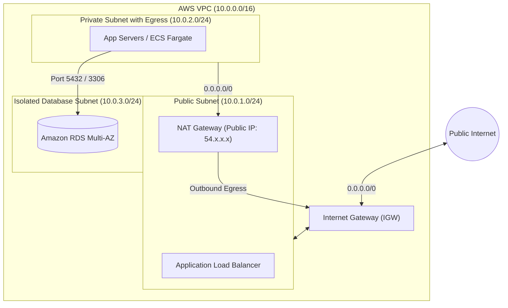

# AWS Networking Basics - AWS Subnets for Beginners

## 1. Overview & Fundamentals

In Amazon Web Services (AWS), the **Virtual Private Cloud (VPC)** represents your isolated private network within the AWS global infrastructure. A **Subnet** (subnetwork) is a contiguous partition of the VPC's IP address range that is tied strictly to a **single Availability Zone (AZ)**.

A common misconception is that subnets can span multiple Availability Zones. In AWS:
- A **VPC** spans all Availability Zones within an AWS Region.
- A **Subnet** lives exclusively in **one** Availability Zone.
- To build a highly available system, you create multiple subnets across at least two or three Availability Zones.

---

## 2. Anatomy of IP Addressing & CIDR Blocks

Subnets use **CIDR (Classless Inter-Domain Routing)** notation: `<Base-IP>/<Prefix-Length>`.

The prefix length denotes the number of fixed bits in the 32-bit IPv4 address:
$$\text{Total Addresses} = 2^{(32 - \text{Prefix})}$$

| CIDR Prefix | Total IP Addresses | Usable IPs in AWS | Common Use Case |
|-------------|--------------------|-------------------|-----------------|
| `/16` | 65,536 | 65,531 | Standard VPC Size (e.g., `10.0.0.0/16`) |
| `/20` | 4,096 | 4,091 | Large Container / Kubernetes Subnet |
| `/24` | 256 | 251 | Standard Microservice / Web Subnet |
| `/28` | 16 | 11 | Minimal Subnet (e.g., dedicated Bastion / VPN) |

---

## 3. The 5 Reserved IP Addresses in Every AWS Subnet

Regardless of the subnet size, **AWS always reserves 5 IP addresses** in every subnet for networking management:

```
Subnet CIDR: 10.0.1.0/24
├── 10.0.1.0   -> Network Address (first IP of the range)
├── 10.0.1.1   -> AWS VPC Router (default gateway for the subnet)
├── 10.0.1.2   -> Amazon-Provided DNS Server (Base IP + 2)
├── 10.0.1.3   -> Reserved by AWS for future use
└── 10.0.1.255 -> Network Broadcast Address (AWS does not support broadcast, but reserves it)
```

> [!WARNING]
> If you allocate a `/28` subnet (16 IPs), you will only have **11 usable IPs** for EC2, ALBs, or RDS instances. An Application Load Balancer requires at least 8 free IPs in each subnet to scale.

---

## 4. Subnet Types: Public, Private, and Isolated

The operational behavior of a subnet is governed by its associated **Route Table**:



### 1. Public Subnet
- **Route Table**: Contains a route `0.0.0.0/0` targeted to an **Internet Gateway (`igw-xxxx`)**.
- **IP Requirements**: Instances must have a Public IPv4 address or an Elastic IP (EIP) assigned to their Elastic Network Interface (ENI).
- **Target Workloads**: Internet-facing Load Balancers (ALB/NLB), NAT Gateways, Bastion Hosts.

### 2. Private Subnet (Egress-Enabled)
- **Route Table**: Contains a route `0.0.0.0/0` targeted to a **NAT Gateway (`nat-xxxx`)** situated in a public subnet.
- **Access**: Inbound internet traffic cannot directly reach these instances. Outbound internet traffic (e.g., OS security updates, third-party API webhooks) flows through the NAT Gateway.
- **Target Workloads**: Application servers, backend microservices, worker nodes.

### 3. Isolated / Database Subnet
- **Route Table**: Contains **only local VPC routing** (`10.0.0.0/16` -> `local`).
- **Access**: No direct route to the Internet Gateway or NAT Gateway. Inbound and outbound internet connectivity is completely blocked at the routing layer.
- **Target Workloads**: Production databases (RDS, Aurora), caching clusters (ElastiCache), HSMs.

---

## 5. Production Subnet Layout Pattern (Multi-AZ)

```
VPC CIDR: 10.0.0.0/16
├── us-east-1a
│   ├── Public-A:   10.0.1.0/24   (ALB, NAT-GW-A)
│   ├── Private-A:  10.0.11.0/24  (App Servers)
│   └── Data-A:     10.0.21.0/24  (RDS Primary)
└── us-east-1b
    ├── Public-B:   10.0.2.0/24   (ALB, NAT-GW-B)
    ├── Private-B:  10.0.12.0/24  (App Servers)
    └── Data-B:     10.0.22.0/24  (RDS Standby)
```

---

## 6. Terraform Reference Implementation

```hcl
# VPC Definition
resource "aws_vpc" "main" {
  cidr_block           = "10.0.0.0/16"
  enable_dns_hostnames = true
  enable_dns_support   = true

  tags = {
    Name = "production-vpc"
  }
}

# Internet Gateway
resource "aws_internet_gateway" "gw" {
  vpc_id = aws_vpc.main.id
}

# Public Subnet in AZ A
resource "aws_subnet" "public_a" {
  vpc_id                  = aws_vpc.main.id
  cidr_block              = "10.0.1.0/24"
  availability_zone       = "us-east-1a"
  map_public_ip_on_launch = true

  tags = {
    Name = "public-subnet-1a"
  }
}

# Public Route Table
resource "aws_route_table" "public_rt" {
  vpc_id = aws_vpc.main.id

  route {
    cidr_block = "0.0.0.0/0"
    gateway_id = aws_internet_gateway.gw.id
  }

  tags = {
    Name = "public-route-table"
  }
}

resource "aws_route_table_association" "public_a_assoc" {
  subnet_id      = aws_subnet.public_a.id
  route_table_id = aws_route_table.public_rt.id
}
```

---

## 7. Key Best Practices
1. **Never use overlapping CIDR blocks**: If you plan to connect your VPC to an on-premise datacenter (via Direct Connect/VPN) or other VPCs (via VPC Peering or Transit Gateway), ensure your CIDR range is unique.
2. **Size for growth**: While containers can reuse IPs when recycled, secondary IPs, ENIs, and load balancers can rapidly exhaust small subnets. Prefer `/20` or `/22` for heavy container clusters.
3. **Multi-AZ from Day 1**: Always deploy subnets in pairs across at least two Availability Zones to eliminate single points of failure.
