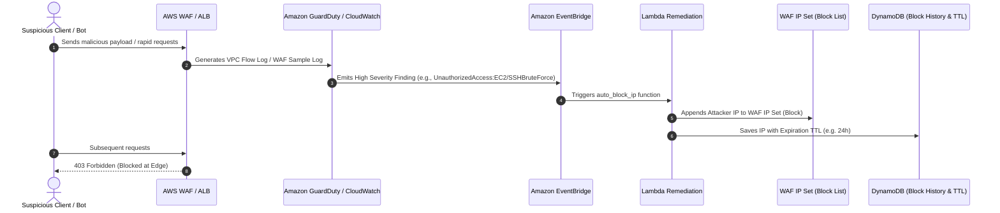

# How to Automatically Block Suspicious Traffic in AWS

## 1. Problem Statement & Threat Vector

Production applications face automated threats:
- **Layer 7 DDoS & HTTP Floods**: Excessive requests exhausting web server connections or backend databases.
- **Credential Stuffing / Brute Force**: Repeated failed logins from distributed botnets.
- **Vulnerability Scanners**: Automated probes scanning for SQL injection (`' OR 1=1`), sensitive endpoints (`/.env`, `/wp-admin`), or log4j exploits.
- **Port Scanners & SSH/RDP Probing**: External scanners targeting exposed IP addresses on unapproved ports.

Manually reviewing logs and blacklisting IPs in security groups is too slow. A production-ready defense requires **automated threat detection and real-time blacklisting**.

---

## 2. Multi-Layer Defense Architecture



---

## 3. Core Building Blocks

### A. AWS WAF Rate-Based Rules (Native Layer 7 Defense)
The first line of defense is AWS WAF's **Rate-Based Rule**. It monitors the number of requests from each client IP in a rolling 5-minute evaluation window.

* Example rule configuration:
  - **Threshold**: 100 requests per 5 minutes per IP on `/api/login`.
  - **Action**: Block with HTTP 429 (Too Many Requests) or HTTP 403 (Forbidden).
  - **Scope-down statement**: Only evaluate traffic hitting specific login or sensitive endpoints.

### B. Amazon GuardDuty (Intelligent Threat Detection)
GuardDuty analyzes:
- AWS CloudTrail management & data events
- Amazon VPC Flow Logs
- Amazon Route 53 DNS query logs
- Amazon EKS audit logs

When an IP is identified scanning ports, communicating with known Command & Control (C2) servers, or performing brute-force attacks, GuardDuty generates a finding in JSON format.

### C. Amazon EventBridge (Decoupled Automation Router)
Filters GuardDuty findings or CloudWatch Alarms and invokes the remediation Lambda function in near real-time.

---

## 4. Lambda Auto-Blocker Implementation (Python)

Here is a production-grade AWS Lambda handler that parses a GuardDuty finding or an alarm, and adds the malicious IP to an **AWS WAFv2 IP Set**:

```python
import os
import boto3
from datetime import datetime, timezone

waf_client = boto3.client('wafv2')
dynamodb = boto3.resource('dynamodb')

IP_SET_NAME = os.environ.get('WAF_IP_SET_NAME', 'SuspiciousIPBlockList')
IP_SET_ID = os.environ['WAF_IP_SET_ID']
IP_SET_SCOPE = os.environ.get('WAF_SCOPE', 'REGIONAL') # or CLOUDFRONT
TABLE_NAME = os.environ.get('BLOCK_TABLE_NAME', 'BlockedIPs')

def lambda_handler(event, context):
    print("Received event:", event)
    
    # 1. Extract offending IP from GuardDuty finding
    try:
        detail = event.get('detail', {})
        service_info = detail.get('service', {})
        action_info = service_info.get('action', {})
        network_info = action_info.get('networkConnectionAction', {})
        
        remote_ip = network_info.get('remoteIpDetails', {}).get('ipAddressV4')
        if not remote_ip:
            # Fallback for custom webhook / alarm payloads
            remote_ip = detail.get('source_ip')
            
        if not remote_ip:
            print("No valid IPv4 found in event payload.")
            return {"status": "skipped", "reason": "No IP detected"}
            
        cidr_ip = f"{remote_ip}/32"
        print(f"Targeting suspicious IP: {cidr_ip}")
        
        # 2. Retrieve the existing WAF IP Set
        response = waf_client.get_ip_set(
            Name=IP_SET_NAME,
            Scope=IP_SET_SCOPE,
            Id=IP_SET_ID
        )
        lock_token = response['LockToken']
        current_addresses = response['IPSet']['Addresses']
        
        # 3. Add IP if not already blocked
        if cidr_ip not in current_addresses:
            current_addresses.append(cidr_ip)
            
            waf_client.update_ip_set(
                Name=IP_SET_NAME,
                Scope=IP_SET_SCOPE,
                Id=IP_SET_ID,
                Addresses=current_addresses,
                LockToken=lock_token
            )
            print(f"Successfully blocked {cidr_ip} in WAF IP Set.")
            
            # 4. Save to DynamoDB with a 24-hour TTL for auto-unblock
            table = dynamodb.Table(TABLE_NAME)
            ttl_timestamp = int(datetime.now(timezone.utc).timestamp()) + (24 * 3600)
            table.put_item(
                Item={
                    'IP': cidr_ip,
                    'BlockedAt': datetime.now(timezone.utc).isoformat(),
                    'ExpiresAt': ttl_timestamp,
                    'Reason': detail.get('type', 'Automated GuardDuty Finding')
                }
            )
        else:
            print(f"IP {cidr_ip} is already present in the block list.")

        return {"status": "success", "blocked_ip": cidr_ip}

    except Exception as e:
        print(f"Error executing auto-blocker: {str(e)}")
        raise e
```

---

## 5. EventBridge Rule Pattern for GuardDuty

```json
{
  "source": ["aws.guardduty"],
  "detail-type": ["GuardDuty Finding"],
  "detail": {
    "severity": [4, 4.0, 4.1, 4.2, 4.3, 4.4, 4.5, 4.6, 4.7, 4.8, 4.9, 5, 6, 7, 8],
    "type": [
      "UnauthorizedAccess:EC2/SSHBruteForce",
      "UnauthorizedAccess:EC2/RDPBruteForce",
      "Recon:EC2/PortProbeUnprotectedPort",
      "Backdoor:EC2/C&CActivity.B!DNS"
    ]
  }
}
```

---

## 6. L4 vs L7 Blocking Comparison

| Feature | AWS WAF IP Set (Layer 7) | Network ACL Rule (Layer 4) |
|---------|---------------------------|----------------------------|
| **Inspection Layer** | Application Layer (HTTP/HTTPS) | Transport / Network Layer (IP/Port) |
| **Placement** | CloudFront CDN, ALB, API Gateway | VPC Subnet Boundary |
| **Capacity** | Up to 10,000 IPs per IP Set | Max 20-40 rules per NACL (Hard limit) |
| **Response** | Configurable (403, 429, custom JSON) | Silent drop (TCP RST / Drop) |
| **Cost** | Part of WAF web ACL rules | Free (Built into VPC) |
| **Best Used For** | Web scraping, HTTP floods, API attacks | SYN floods, brute force port scanning |

> [!TIP]
> Do not use Network ACLs (NACLs) for high-churn dynamic IP blocking. Because NACLs only support a maximum of 20 to 40 rules per subnet, you will quickly exhaust rule slots. Use **AWS WAF IP Sets** for scalable IP blacklisting.
