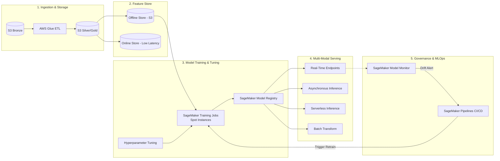
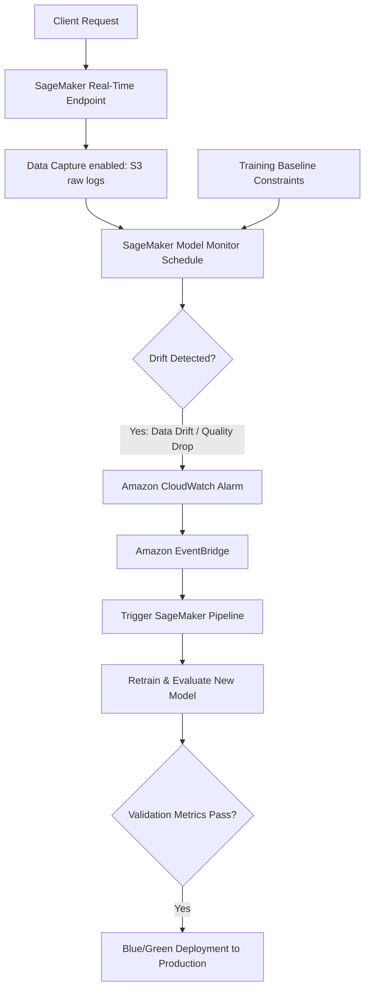

# Designing an AWS Machine Learning Architecture

## 1. Architectural Philosophy: The MLOps Lifecycle

A production Machine Learning system on AWS requires far more than just model code. The architecture must govern data ingestion, feature store synchronization, distributed training, model versioning, multi-mode inference, and continuous drift monitoring.



---

## 2. Deep Dive: Architectural Layers

### Phase 1: Ingestion & Feature Engineering
- **Data Lake (Amazon S3)**: Implements Medallion Architecture (`raw/`, `cleaned/`, `features/`). Partitioned by date (`/year=2026/month=11/`).
- **Amazon SageMaker Feature Store**:
  - **Online Store**: Backed by high-throughput, single-digit millisecond key-value storage (managed DynamoDB). Used by real-time inference endpoints to enrich user requests with computed features.
  - **Offline Store**: Backed by Amazon S3 and cataloged in AWS Glue Data Catalog. Queried using Amazon Athena or PySpark for generating point-in-time accurate training datasets without feature leakage.

### Phase 2: Distributed Training & Hyperparameter Optimization
- **SageMaker Managed Training**: Decouples code from compute. When a training job starts, SageMaker dynamically provisions a cluster of GPU/CPU instances, clones your container image from Amazon ECR, streams data from S3 using **Fast File Mode**, executes the training script, uploads artifacts to S3, and terminates the cluster immediately.
- **Cost Optimization with Managed Spot Training**: Uses EC2 Spot Instances with automated checkpointing to S3. Reduces compute costs by up to **70–90%**.

```python
# SageMaker Estimator using Spot Instances
from sagemaker.estimator import Estimator

estimator = Estimator(
    image_uri="763104351884.dkr.ecr.us-east-1.amazonaws.com/pytorch-training:2.1.0-gpu-py310",
    role="arn:aws:iam::123456789012:role/SageMakerExecutionRole",
    instance_count=2,
    instance_type="ml.g5.2xlarge",
    use_spot_instances=True,
    max_run=3600,
    max_wait=7200,  # Allows waiting for Spot capacity
    checkpoint_s3_uri="s3://ml-models-prod/checkpoints/fraud-detection/",
    output_path="s3://ml-models-prod/models/"
)
```

### Phase 3: Model Governance (Model Registry)
Before any model reaches production, it is cataloged in the **SageMaker Model Registry**:
- Stores model lineage (training dataset hash, container image URI, hyperparameters).
- Approval workflow: Models are initially in `PendingManualApproval`. After automated evaluation tests pass, CI/CD marks the model `Approved`.

---

## 3. Serving Topology: Choosing the Right Inference Pattern

AWS SageMaker provides 4 distinct inference mechanisms. Choosing the wrong one can inflate cloud bills by 10x or cause severe timeouts.

| Inference Option | Ideal Use Case | Payload Size | Max Timeout | Pricing Model |
|-------------------|----------------|--------------|-------------|---------------|
| **Real-Time Inference** | Sub-second latency, interactive web/mobile apps | Up to 6 MB | 60 seconds | Pay 24/7 per provisioned instance-hour |
| **Serverless Inference** | Intermittent, spiky, or unpredictable traffic | Up to 4 MB | 60 seconds | Pay per millisecond of compute + data processed |
| **Asynchronous Inference** | Large payloads (images, video, audio), heavy processing | Up to 1 GB (via S3) | Up to 1 hour | Auto-scales instances down to 0 when queue is empty |
| **Batch Transform** | Bulk offline dataset predictions (e.g., nightly churn scoring) | Gigabytes/Terabytes | Days | Pay only for duration of the batch job |

---

## 4. Production MLOps CI/CD & Drift Monitoring



### Automated Retraining Triggers:
1. **SageMaker Model Monitor** compares daily endpoint payloads against baseline statistics (identifying feature drift or concept drift).
2. If drift threshold is breached, a **CloudWatch Alarm** publishes an event to **EventBridge**.
3. EventBridge triggers an execution of **SageMaker Pipelines**, which ingests the latest 30 days of data, trains a candidate model, verifies it against the production model using a champion/challenger evaluation step, and triggers a Canary / Blue-Green deployment.
