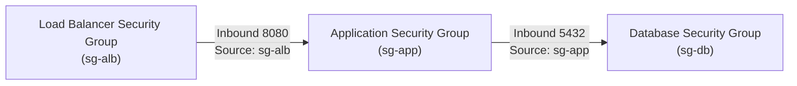
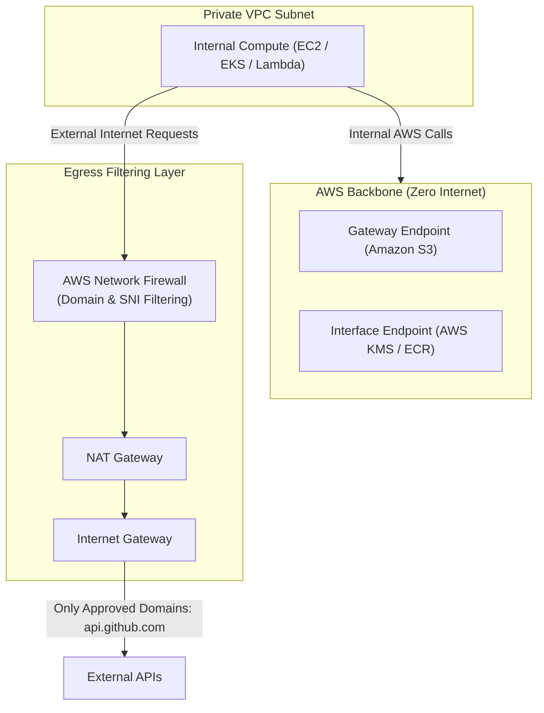

# How AWS Secures Inbound and Outbound Network Traffic

## 1. The AWS Defense-in-Depth Model

AWS implements network security through a multi-tiered defense-in-depth model. Traffic entering or leaving your workloads traverses four distinct inspection layers:

```
[Public Internet]
       │
       ▼  (Layer 1: Perimeter / Edge)
[AWS Shield & AWS WAF (CloudFront / ALB)]
       │
       ▼  (Layer 2: VPC Border & Inspection)
[AWS Network Firewall / Transit Gateway]
       │
       ▼  (Layer 3: Subnet Boundary)
[Network Access Control Lists (NACLs - Stateless)]
       │
       ▼  (Layer 4: Elastic Network Interface - ENI)
[Security Groups (Stateful)]
       │
       ▼
[EC2 / Container / Database Workload]
```

---

## 2. Security Groups vs. Network ACLs (The Core Differentiator)

Understanding the distinction between Security Groups (SGs) and Network Access Control Lists (NACLs) is vital for troubleshooting network connectivity and passing AWS security audits.

| Feature | Security Groups (SG) | Network Access Control Lists (NACL) |
|---------|----------------------|--------------------------------------|
| **Scope of Protection** | At the **ENI** (Instance / Task level) | At the **Subnet** boundary |
| **State Nature** | **Stateful**: Return traffic is automatically tracked and allowed regardless of inbound rules. | **Stateless**: Inbound and outbound traffic must be explicitly allowed independently. |
| **Rule Types** | **ALLOW only** (implicit deny for anything not matched). | **ALLOW and DENY** rules supported. |
| **Evaluation Order** | All rules evaluated simultaneously before making a decision. | Rules evaluated in numerical order (lowest number first, e.g., 100 before 200). First match wins. |
| **Ephemeral Ports** | Not required (state tracking handles return packets). | **Mandatory**: Must allow outbound ports 1024–65535 for return client traffic. |

---

## 3. The Stateless NACL Trap: Ephemeral Ports

When an external client communicates with your web server:
1. Client initiates connection from random port `51234` to server port `443` (Inbound).
2. Server responds from port `443` back to client's port `51234` (Outbound).

Because NACLs are **stateless**, your subnet NACL must explicitly permit this return traffic on ephemeral ports:

```
Inbound NACL Rules:
Rule 100: ALLOW TCP Port 443 from 0.0.0.0/0 (Client to Server)

Outbound NACL Rules:
Rule 100: ALLOW TCP Ports 1024-65535 to 0.0.0.0/0 (Server to Client Return Traffic)
```

> [!WARNING]
> If you omit outbound ephemeral ports (1024–65535) in a custom NACL, clients will experience connection timeouts even if your Security Group and inbound NACL rule for port 443 are correctly configured!

---

## 4. Security Group Referencing (Zero IP Hardcoding)

In production environments, never hardcode IP addresses between internal tiers. Use **Security Group Chaining**:



### Terraform Example:
```hcl
# Database Security Group allowing traffic strictly from the App Tier SG
resource "aws_security_group" "db_sg" {
  name        = "production-db-sg"
  description = "Controls inbound database traffic"
  vpc_id      = aws_vpc.main.id

  ingress {
    description     = "PostgreSQL from App Tier only"
    from_port       = 5432
    to_port         = 5432
    protocol        = "tcp"
    security_groups = [aws_security_group.app_sg.id] # References SG ID directly!
  }

  egress {
    from_port   = 0
    to_port     = 0
    protocol    = "-1"
    cidr_blocks = ["0.0.0.0/0"]
  }
}
```

---

## 5. Securing Outbound Egress Traffic: Network Firewall vs VPC Endpoints

Protecting outbound egress traffic prevents data exfiltration and blocks infected instances from phoning home to malware servers.



### 1. AWS PrivateLink & VPC Endpoints (Internal Shielding)
Instead of routing internal AWS API calls through a NAT Gateway and public internet:
- **Gateway Endpoints**: Free endpoints for **Amazon S3** and **DynamoDB**. Traffic routes internally over the AWS high-speed backbone.
- **Interface Endpoints (PrivateLink)**: Elastic Network Interfaces (ENIs) inside your subnet for services like KMS, ECR, CloudWatch, and SQS. Ensures private IPs are used end-to-end.

### 2. AWS Network Firewall (Egress Domain Filtering)
When instances require outbound access to third-party APIs (e.g., Stripe, GitHub, Datadog), a standard NAT Gateway cannot restrict traffic by domain name (FQDN). 

Deploying **AWS Network Firewall** enables:
- **TLS SNI Inspection**: Inspects the Server Name Indication during the TLS handshake to allow only whitelisted domains (e.g., `*.stripe.com`).
- **Stateful Intrusion Prevention (IPS)**: Uses open-source Suricata rule specifications to block known malicious payloads and exfiltration signatures.
