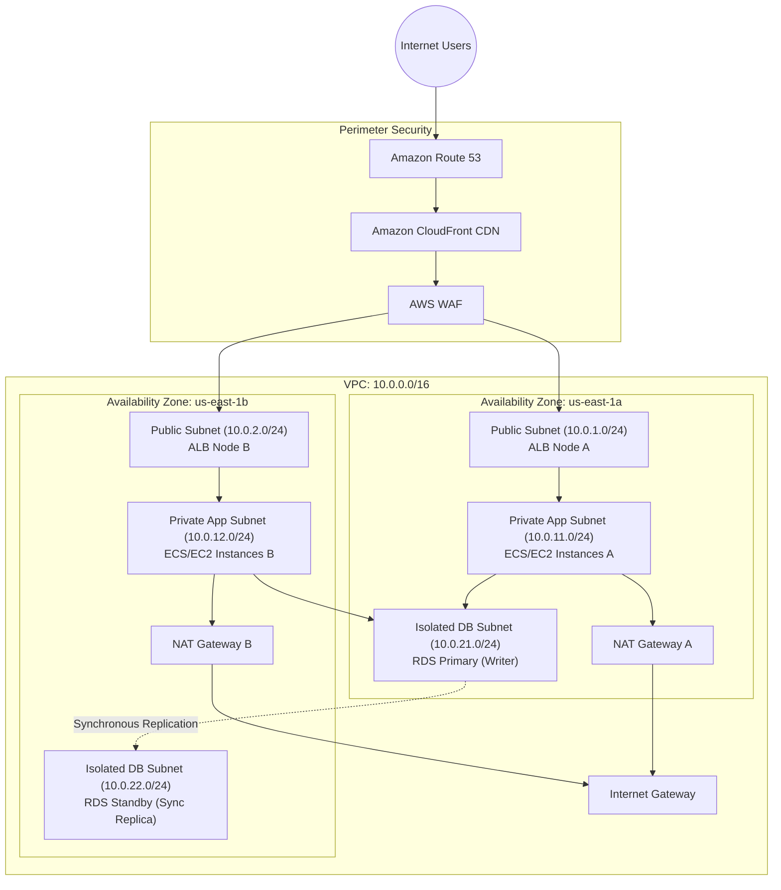

# How To Design a Secure Three-Tier Architecture on AWS

## 1. Architecture Overview

The **Three-Tier Architecture** is the industry standard for enterprise applications. It enforces strict separation of concerns into three independent tiers:
1. **Web / Presentation Tier**: Handles external client connections, TLS termination, and request routing.
2. **Application / Business Logic Tier**: Executes domain logic, background processing, and business rules.
3. **Database / Persistence Tier**: Manages relational and caching data stores in complete network isolation.

---

## 2. Detailed Tier Specifications

### Tier 1: Web / Presentation Tier
* **Subnets**: Public subnets (`10.0.1.0/24`, `10.0.2.0/24`) attached to an Internet Gateway.
* **Component**: Application Load Balancer (ALB).
* **Security Controls**:
  - AWS WAF enabled with OWASP Top 10 rules and IP rate-limiting.
  - AWS Certificate Manager (ACM) for automatic TLS 1.3 certificate renewals.
  - Security Group: Accepts inbound ports `80` (HTTP redirects to 443) and `443` (HTTPS) from CloudFront or Internet.

### Tier 2: Application Tier
* **Subnets**: Private subnets (`10.0.11.0/24`, `10.0.12.0/24`) with default route `0.0.0.0/0` targeted to the local NAT Gateway in the same AZ.
* **Compute**: Auto Scaling Group of Amazon EC2 instances or Amazon ECS Fargate container tasks.
* **Zero Public IP**: Instances are assigned private IPs only.
* **Security Controls**:
  - Security Group allows inbound port `8080` (or `443`) **only from the Web ALB Security Group ID**.
  - **No SSH Ports Open**: System administration is managed strictly through **AWS Systems Manager (SSM) Session Manager** (IAM-authenticated, audited, no port 22 exposed).

### Tier 3: Database Tier
* **Subnets**: Isolated data subnets (`10.0.21.0/24`, `10.0.22.0/24`). Route table contains **only local VPC routing**. Zero egress to Internet or NAT Gateways.
* **Database Engine**: Amazon RDS Multi-AZ or Amazon Aurora Cluster.
* **Security Controls**:
  - Security Group allows inbound port `5432` (PostgreSQL) or `3306` (MySQL) **only from the App Tier Security Group ID**.
  - **KMS Encryption at Rest**: Encrypted using a customer-managed AWS KMS key (CMK).
  - **Automated Credential Rotation**: Database passwords stored in **AWS Secrets Manager** with automatic 30-day rotation via an internal Lambda function.

---

## 3. Production Security Group Configuration Matrix

| Tier / Component | Security Group Name | Inbound Rules | Outbound Rules |
|-------------------|---------------------|---------------|----------------|
| **Web ALB** | `sg-web-alb` | Port 443 from `0.0.0.0/0` (or CloudFront managed prefix list) | Port 8080 to `sg-app-compute` |
| **App Compute** | `sg-app-compute` | Port 8080 from `sg-web-alb` | Port 5432 to `sg-db`, Port 443 to `0.0.0.0/0` (via NAT for APIs) |
| **RDS Database** | `sg-db` | Port 5432 from `sg-app-compute` | None (or local VPC) |

---

## 4. High Availability & Disaster Recovery Mechanisms

1. **Multi-AZ RDS Failover**:
   - RDS synchronously replicates data to the standby instance in AZ-B.
   - If AZ-A experiences a power or hardware failure, RDS automatically flips the DNS endpoint to AZ-B with **zero data loss** (RPO = 0) within 60–120 seconds.
2. **Independent NAT Gateways**:
   - Each AZ has its own dedicated NAT Gateway (`NAT_A` in AZ-A, `NAT_B` in AZ-B).
   - If an entire Availability Zone experiences an outage, the remaining AZ continues processing outbound requests independently without cross-AZ dependencies.
3. **Session State Externalization**:
   - EC2/ECS instances remain completely stateless.
   - User sessions and cache entries are stored in a distributed **Amazon ElastiCache Redis** replication group spanning both AZs.
