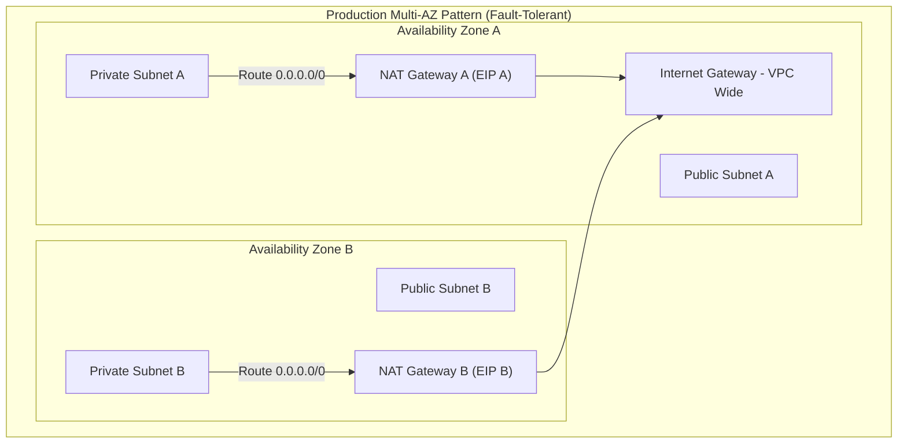
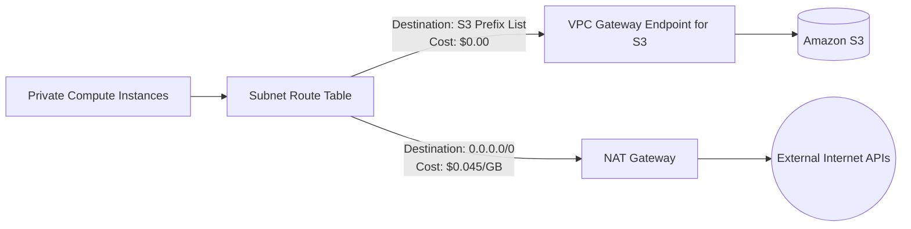

# AWS Internet Gateway vs NAT Gateway: When to Use What?

## 1. Core Definitions

### What is an Internet Gateway (IGW)?
An **Internet Gateway (IGW)** is a managed, horizontally scaled, redundant VPC software component that acts as the default edge router between your VPC and the public internet.
- It performs **1:1 Network Address Translation (NAT)** between an instance's private IP and its associated Public/Elastic IP.
- It supports **bidirectional communication** (traffic can originate from the internet to your instance, or from your instance to the internet).

### What is a NAT Gateway?
A **NAT Gateway** is a managed AWS service that enables instances in a **private subnet** to initiate outbound connections to the internet (or other AWS services), while completely blocking unsolicited inbound connections from the internet.
- It performs **1-to-Many Port Address Translation (PAT / SNAT)**, mapping multiple private IP addresses to a single Elastic IP address assigned to the NAT Gateway.
- It is strictly **unidirectional (egress-only)**.

---

## 2. In-Depth Technical Comparison

| Feature | Internet Gateway (IGW) | NAT Gateway |
|---------|------------------------|-------------|
| **Directionality** | **Bidirectional** (Inbound & Outbound) | **Outbound Only** (Egress only, stateful response allowed) |
| **Subnet Placement** | Attached at the **VPC level** (VPC Route Target) | Deployed inside a specific **Public Subnet** |
| **Instance IP Requirement** | Instance **must** have a Public IPv4 or Elastic IP | Instance has **only a Private IP**; NAT GW has an Elastic IP |
| **Availability Scope** | **Regional / VPC-wide** (AWS manages HA across all AZs) | **Zonal** (Bound to a single Availability Zone) |
| **High Availability Setup** | Native (Single IGW covers entire VPC across all AZs) | **Requires 1 NAT Gateway per AZ** for multi-AZ fault tolerance |
| **Bandwidth Limit** | Imposes **no bandwidth constraints** (scales automatically) | Starts at 5 Gbps, bursts up to **45 Gbps** per gateway |
| **Cost Model** | **Free** (No hourly fee, no processing fee; pay standard DTO) | **Expensive**: ~$0.045/hour + **~$0.045 per GB processed** |

---

## 3. High Availability Architecture: The Zonal Trap

Because a NAT Gateway is a **zonal resource**, placing only one NAT Gateway in AZ-A and routing traffic from private subnets in AZ-B creates two major architectural flaws:
1. **Single Point of Failure**: If `us-east-1a` fails, instances in `us-east-1b` lose all internet access.
2. **Cross-AZ Data Transfer Fees**: AWS charges **$0.01/GB** for inter-AZ traffic moving between subnets in AZ-B and the NAT Gateway in AZ-A.

---

## 4. The NAT Gateway Cost Pitfall (FinOps Optimization)

The most common cause of unexpected AWS bill inflation is **NAT Gateway data processing charges** (`$0.045 per GB`).

### Scenario:
A Kubernetes cluster or backend worker in a private subnet pulls container images from Amazon ECR and uploads 20 TB of analytics data to Amazon S3 every month.

* **Routing through NAT Gateway**:
  - $20,000 \text{ GB} \times \$0.045/\text{GB} = \mathbf{\$900/\text{month}}$ in pure NAT processing fees!
  - Plus 2 NAT Gateways running 24/7: $2 \times (730 \text{ hrs} \times \$0.045) = \mathbf{\$65.70/\text{month}}$.
  - **Total Cost**: **~$965.70/month**.

### The Fix: AWS Gateway VPC Endpoints (S3 & DynamoDB)
Gateway VPC Endpoints create direct, internal routes between your VPC and Amazon S3/DynamoDB across the AWS internal network.
- **Cost**: **$0.00 (100% Free)**.
- Data bypasses the NAT Gateway completely.

---

## 5. Summary Decision Matrix

| Requirement | Use Internet Gateway | Use NAT Gateway | Use VPC Endpoint |
|-------------|:-------------------:|:---------------:|:----------------:|
| Load Balancer needs to accept public HTTP/HTTPS traffic | ✅ | ❌ | ❌ |
| Backend DB servers need security patches from Linux mirrors | ❌ | ✅ | ❌ |
| Serverless Lambda / App needs to call Stripe / GitHub APIs | ❌ | ✅ | ❌ |
| EC2 instances in private subnet downloading images from ECR | ❌ | ❌ | ✅ (Interface) |
| App uploading files to private Amazon S3 bucket | ❌ | ❌ | ✅ (Gateway) |
| Public Bastion Host / Jump Server accessible via SSH/SSM | ✅ | ❌ | ❌ |
