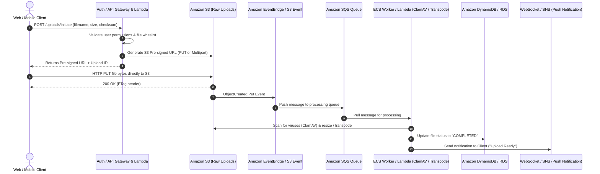
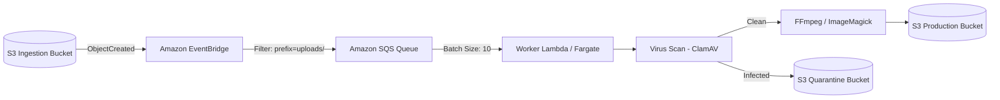

# How to Design a Scalable File Upload Architecture in AWS

## 1. The Anti-Pattern vs. The Modern Direct-to-S3 Pattern

### The Monolithic Anti-Pattern
```
[Client] ---> [API Gateway (10 MB Limit)] ---> [Lambda (6 MB Limit)] ---> [Amazon S3]
```
**Why this fails:**
- Strict payload caps: API Gateway rejects requests $> 10 \text{ MB}$; Lambda rejects synchronous requests $> 6 \text{ MB}$.
- Web server memory bloat and thread starvation while streaming gigabytes.
- High compute cost: Lambda charges for duration while waiting on network I/O.

### The Scalable Direct-to-S3 Architecture
Offload the actual data transfer to Amazon S3's managed ingestion endpoints, using your backend strictly as an authentication and orchestration coordinator.



---

## 2. Large File Uploads: S3 Multipart Upload Pattern

For files larger than **100 MB** (and up to **5 TB**), uploading as a single HTTP PUT risks network failure midway through the transfer, forcing the user to restart from 0%.

### S3 Multipart Upload Workflow:
1. **Initiate**: Client requests a multipart session. Backend calls `s3.create_multipart_upload()` and returns an `UploadId`.
2. **Generate Signed Parts**: Backend generates a pre-signed URL for each part (e.g., 10 MB per part).
3. **Parallel Uploads**: The browser or mobile app uploads parts 1 to $N$ concurrently directly to S3 using standard HTTP `PUT`. If part 4 fails, only part 4 is retried.
4. **Complete**: When all parts are uploaded, client sends part numbers and `ETag` checksums to the backend, which invokes `s3.complete_multipart_upload()`.

```python
# Backend Multipart Generation (Python boto3)
import boto3

s3 = boto3.client('s3')

def initiate_large_upload(bucket: str, key: str, total_parts: int):
    # Step 1: Create multipart upload
    response = s3.create_multipart_upload(Bucket=bucket, Key=key)
    upload_id = response['UploadId']
    
    # Step 2: Generate pre-signed URLs for each part
    part_urls = []
    for part_number in range(1, total_parts + 1):
        url = s3.generate_presigned_url(
            ClientMethod='upload_part',
            Params={
                'Bucket': bucket,
                'Key': key,
                'UploadId': upload_id,
                'PartNumber': part_number
            },
            ExpiresIn=3600
        )
        part_urls.append({'part_number': part_number, 'url': url})
        
    return {'upload_id': upload_id, 'parts': part_urls}
```

---

## 3. Asynchronous Event-Driven Pipeline

Never perform virus scanning, image watermarking, or video transcoding synchronously during the upload request.



### Why Decouple with Amazon SQS?
- **Buffer Traffic Spikes**: If 5,000 users upload files simultaneously, SQS holds the events safely without overwhelming downstream container tasks or database connections.
- **Dead-Letter Queue (DLQ)**: Files that fail processing 3 times are moved to a DLQ for manual engineer review.

---

## 4. Latency Optimization: S3 Transfer Acceleration

For globally distributed users uploading to a centralized AWS region (e.g., users in Tokyo uploading to `us-east-1` in Virginia):
- Enable **Amazon S3 Transfer Acceleration (S3TA)** on the bucket.
- S3TA utilizes AWS CloudFront's globally distributed Edge Locations.
- Client uploads over the public internet to the nearest AWS Edge Location, where data is ingested and routed over AWS's optimized, private fiber-optic backbone to the target S3 bucket.

```http
Standard Endpoint:
https://my-bucket.s3.us-east-1.amazonaws.com

Accelerated Endpoint:
https://my-bucket.s3-accelerate.amazonaws.com
```

---

## 5. Security Checklist
- [x] **Enforce Content-Type & Hash Verification**: Include `ContentMD5` or `ChecksumSHA256` in the pre-signed URL params so S3 rejects corrupted or altered files.
- [x] **S3 Lifecycle Rules for Incomplete Uploads**: Add a lifecycle policy to automatically abort incomplete multipart uploads after **7 days**, preventing orphaned chunks from generating hidden storage bills.
- [x] **Zero Public Bucket Access**: Keep the bucket private; access processed files using CloudFront with Origin Access Control (OAC).
