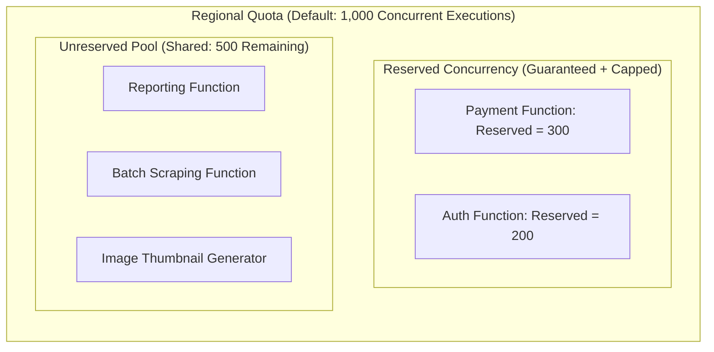
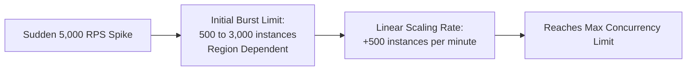
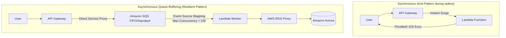

# How AWS Lambda Prevents Function Throttling During Traffic Spikes

## 1. Concurrency Math: How Lambda Scales

Lambda concurrency is not simply the number of incoming requests—it is a function of both throughput and execution duration:

$$\text{Concurrency} = \text{Requests per Second (RPS)} \times \text{Average Execution Duration (seconds)}$$

### Real-World Example:
* **Function A (Fast)**: 1,000 RPS with a 20 ms (0.02s) duration:
  $$\text{Concurrency} = 1000 \times 0.02 = \mathbf{20 \text{ concurrent executions}}$$
* **Function B (Slow DB Queries)**: 1,000 RPS with a 2,000 ms (2.0s) duration:
  $$\text{Concurrency} = 1000 \times 2.0 = \mathbf{2,000 \text{ concurrent executions}}$$

> [!IMPORTANT]
> If a downstream database slows down by 3x, your Lambda duration triples, causing concurrency consumption to triple instantaneously and triggering severe throttling!

---

## 2. The Three Concurrency Types

AWS accounts have a default regional quota of **1,000 concurrent executions**.

### 1. Unreserved Concurrency (The Noisy Neighbor Risk)
- All functions without explicit configuration draw from this shared pool.
- **The Risk**: A runaway background function (e.g., recursive loop or massive batch job) can consume all 1,000 slots in seconds, completely knocking out business-critical checkout or login APIs with `429 Too Many Requests`.

### 2. Reserved Concurrency (Dedicated Floor & Hard Ceiling)
- Guarantees a dedicated pool of execution slots for a specific function.
- **Double-edged Sword**:
  - **Floor**: Other functions cannot steal these slots.
  - **Ceiling**: The function can *never* exceed this number. Requests above this limit will throttle.

### 3. Provisioned Concurrency (Zero Cold Starts)
- Keeps execution environments initialized and hyper-warmed (runtime booted, handler loaded).
- Eliminates the 100ms–2000ms cold start latency. Ideal for latency-sensitive public APIs and Flash Sale traffic spikes.

---

## 3. Lambda Burst Limits & Scaling Rate

When a traffic spike occurs, Lambda cannot scale infinitely in millisecond 0:

1. **Initial Burst**: 500 to 3,000 instances immediately available depending on the region.
2. **Linear Scale**: After the burst, Lambda adds **500 additional instances every minute** until the demand is satisfied or the concurrency limit is reached.
3. If incoming traffic exceeds this slope, requests are **throttled**.

---

## 4. Architectural Strategies to Prevent Throttling

### Strategy 1: Queue Buffering with Amazon SQS
Instead of invoking Lambda synchronously, write incoming payloads directly into **Amazon SQS**.
- Configure Lambda **Event Source Mapping (ESM)** with `MaximumConcurrency`.
- SQS absorbs sudden spikes of 50,000 messages. Lambda drains the queue at a controlled, sustainable rate without dropping requests.

### Strategy 2: Client-Side Exponential Backoff & Jitter
When calling Lambda via AWS SDKs or REST APIs, configure exponential backoff with full randomized jitter to prevent the "thundering herd" problem:

$$T_{\text{sleep}} = \text{random}(0, \; \min(M, \; B \times 2^{\text{attempt}}))$$

### Strategy 3: AWS RDS Proxy for Connection Pooling
When Lambda scales to 800 instances, each Lambda container opens connections to PostgreSQL/MySQL, crashing the database engine.
- **RDS Proxy** maintains a centralized connection pool, sharing and reusing database connections among thousands of concurrent Lambda instances.

---

## 5. Handling Throttled Invocations: Synchronous vs. Asynchronous

| Invocation Type | Throttling Behavior | Automated Remediation |
|-----------------|---------------------|-----------------------|
| **Synchronous** (API Gateway, ALB, Mobile SDK) | Caller receives **HTTP 429 (Too Many Requests)** error. | Caller must retry with exponential backoff; or implement API Gateway Usage Plans. |
| **Asynchronous** (S3 Event, SNS, EventBridge) | Lambda automatically retries the invocation for up to **6 hours** with exponential backoff. | Configure an **Amazon SQS Dead Letter Queue (DLQ)** or **Lambda Destination (On-Failure)** to capture discarded events. |
| **Poll-based (SQS)** | Message stays in the queue until retention period expires (default 4 days). | Adjust SQS Visibility Timeout (must be $\ge 6 \times \text{Lambda Timeout}$). |
