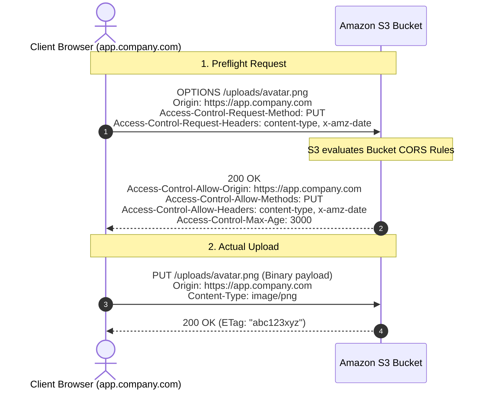

# Using Cross-Origin Resource Sharing (CORS) in Amazon S3

## 1. What is CORS and Why Does S3 Need It?

**Cross-Origin Resource Sharing (CORS)** is a browser-enforced security mechanism based on the **Same-Origin Policy (SOP)**. Two URLs have the same origin only if their **protocol, domain/host, and port** are identical.

```
Frontend Application:  https://app.company.com:443
Target Storage:        https://my-bucket.s3.us-east-1.amazonaws.com:443
                        └── Distinct Origins! ──┘
```

When client-side JavaScript (`fetch`, `XMLHttpRequest`, or Axios) running on `https://app.company.com` tries to:
1. Upload a file directly to S3 via an HTTP `PUT` pre-signed URL, or
2. Download an asset (e.g., custom web fonts, WebAssembly binaries, canvas textures) from S3,

the browser blocks the request unless Amazon S3 explicitly sends HTTP CORS headers authorizing `https://app.company.com`.

---

## 2. The Browser Preflight Request (`OPTIONS`)

For requests that modify data or contain custom headers (e.g. `x-amz-*`), modern browsers send a lightweight **preflight check** before sending the actual request:



---

## 3. Production S3 CORS Configuration (JSON)

Apply this configuration to your Amazon S3 bucket:

```json
[
  {
    "AllowedOrigins": [
      "https://app.company.com",
      "https://staging.company.com"
    ],
    "AllowedMethods": [
      "GET",
      "PUT",
      "POST",
      "HEAD"
    ],
    "AllowedHeaders": [
      "*"
    ],
    "ExposeHeaders": [
      "ETag",
      "x-amz-server-side-encryption",
      "x-amz-request-id"
    ],
    "MaxAgeSeconds": 3000
  }
]
```

### Parameter Breakdown:
* **`AllowedOrigins`**: The exact origins permitted to make requests. Avoid wildcard `["*"]` in production environments handling sensitive user uploads.
* **`AllowedMethods`**: Standard HTTP verbs needed for your operations (`PUT` for pre-signed uploads, `GET` for asset reading).
* **`AllowedHeaders`**: Headers allowed in the request. S3 pre-signed requests often pass headers like `x-amz-*`, `Authorization`, and `Content-Type`. Setting `["*"]` is standard for uploads.
* **`ExposeHeaders`**: Crucial setting! By default, browsers hide response headers from JavaScript. Exposing `ETag` allows your client code to read the S3 object MD5 checksum after upload completion.
* **`MaxAgeSeconds`**: Instructs the browser to cache preflight responses for this duration (3000 seconds = 50 mins). Prevents the browser from sending redundant `OPTIONS` calls for every single chunk or file.

---

## 4. Terraform Infrastructure as Code

```hcl
resource "aws_s3_bucket_cors_configuration" "uploads_cors" {
  bucket = aws_s3_bucket.user_uploads.id

  cors_rule {
    allowed_headers = ["*"]
    allowed_methods = ["PUT", "POST", "GET", "HEAD"]
    allowed_origins = ["https://app.company.com"]
    expose_headers  = ["ETag"]
    max_age_seconds = 3000
  }
}
```

---

## 5. Three Classic CORS Gotchas & Troubleshooting

### Gotcha 1: Testing with `curl` Without the `Origin` Header
A common complaint: *"I configured CORS, but my curl test does not return CORS headers!"*
- **Reason**: Amazon S3 is an object store, not a dedicated web server. S3 evaluates and injects `Access-Control-Allow-Origin` headers **only when an incoming request includes an `Origin` header**.
- **Correct Test**:
  ```bash
  curl -X OPTIONS https://my-bucket.s3.amazonaws.com/test.jpg \
    -H "Origin: https://app.company.com" \
    -H "Access-Control-Request-Method: PUT" \
    -I
  ```

### Gotcha 2: CloudFront Caching Without the `Origin` Header (The Cache Poisoning Trap)
If you place Amazon CloudFront in front of S3, CloudFront by default uses only the URL path as the cache key.
- If a direct user or server fetches an image without an `Origin` header, CloudFront caches the response **without CORS headers**.
- When a browser user later requests the same image with `Origin: https://app.company.com`, CloudFront serves the cached response lacking CORS headers, causing the browser to throw a CORS error.
- **The Solution**: Configure CloudFront's **Origin Request Policy** and **Cache Policy** to include `Origin`, `Access-Control-Request-Method`, and `Access-Control-Request-Headers` in the cache key.

### Gotcha 3: Pre-Signed Signature Mismatch with Headers
If your backend generated a Pre-signed URL signing `Content-Type: image/png`, the client must send `Content-Type: image/png`. If the client omits or changes the header to `application/octet-stream`, S3 rejects the request with `SignatureDoesNotMatch` before CORS headers can even be returned, masking the true problem as a CORS failure in the browser console.
