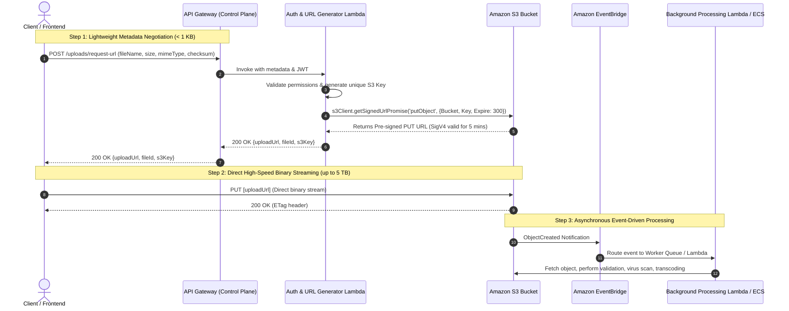

# Architecture to Overcome API Gateway Payload Limit (10MB Hard Limit)

## 1. Context & Problem Statement

AWS API Gateway imposes a **strict, non-configurable 10 MB payload limit** on both REST APIs and HTTP APIs.
When clients attempt to upload files (e.g., high-resolution photos, raw sensor data, PDF contracts, backups, or video clips) exceeding 10 MB through API Gateway, the request fails immediately at the AWS edge layer with:

```http
HTTP/1.1 413 Request Entity Too Large
{"message": "Total payload size exceeded 10485760 bytes limit."}
```

Even if payload sizes are under 10 MB (e.g., 6–9 MB), passing binary payloads directly through API Gateway into AWS Lambda causes severe anti-patterns:
- **Base64 Encoding Overhead**: Binary payloads must often be base64-encoded, causing a ~33% size inflation (a 7.5 MB file becomes ~10 MB).
- **Lambda Memory & Execution Cost**: Holding multi-megabyte payloads in Lambda RAM while uploading to storage ties up Lambda execution concurrency and inflates billing.
- **Latency**: Traffic traverses two hops (Client $\rightarrow$ API Gateway $\rightarrow$ Lambda $\rightarrow$ S3) instead of direct transfer.

---

## 2. Target Architecture: The Claim-Check / Direct-to-S3 Presigned Pattern

The production-grade pattern decouples metadata handling from raw binary data ingestion using **S3 Pre-signed URLs** and asynchronous event-driven notifications.



---

## 3. Handling Files Exceeding 100 MB: S3 Multipart Upload Architecture

For files above 100 MB up to 5 TB (e.g., video uploads, raw DB dumps), a single `putObject` is fragile because network interruptions require restarting from 0%. The solution is **S3 Multi-Part Upload with Pre-signed URLs**:

1. **Initiate**: Client requests multipart initiation $\rightarrow$ Lambda calls `CreateMultipartUpload` $\rightarrow$ returns `UploadId`.
2. **Chunking**: Client splits file into 5 MB to 10 MB chunks.
3. **Signed Part URLs**: Lambda generates a pre-signed URL for each chunk part number.
4. **Parallel Uploads**: Client uploads chunks directly to S3 concurrently with retries.
5. **Complete**: Client calls API Gateway with all part ETags $\rightarrow$ Lambda calls `CompleteMultipartUpload`.

---

## 4. Production Terraform Implementation

```hcl
# S3 Ingestion Bucket
resource "aws_s3_bucket" "uploads" {
  bucket        = "acme-raw-uploads-prod-useast1"
  force_destroy = false
}

resource "aws_s3_bucket_server_side_encryption_configuration" "uploads_crypto" {
  bucket = aws_s3_bucket.uploads.id
  rule {
    apply_server_side_encryption_by_default {
      sse_algorithm = "AES256"
    }
  }
}

resource "aws_s3_bucket_cors_configuration" "uploads_cors" {
  bucket = aws_s3_bucket.uploads.id

  cors_rule {
    allowed_headers = ["*"]
    allowed_methods = ["PUT", "POST"]
    allowed_origins = ["https://app.acme.com"]
    expose_headers  = ["ETag"]
    max_age_seconds = 3600
  }
}

# Block all public bucket access
resource "aws_s3_bucket_public_access_block" "block_public" {
  bucket = aws_s3_bucket.uploads.id

  block_public_acls       = true
  block_public_policy     = true
  ignore_public_acls      = true
  restrict_public_buckets = true
}

# EventBridge Notification for Asynchronous Processing
resource "aws_s3_bucket_notification" "bucket_notification" {
  bucket      = aws_s3_bucket.uploads.id
  eventbridge = true
}
```

---

## 5. Python (boto3) Presigned URL Generator Lambda

```python
import json
import boto3
import os
import uuid
from botocore.config import Config

s3_client = boto3.client(
    's3',
    region_name=os.environ['AWS_REGION'],
    config=Config(signature_version='s3v4')
)

BUCKET_NAME = os.environ['UPLOAD_BUCKET_NAME']
EXPIRY_SECONDS = 300  # 5 minutes

def lambda_handler(event, context):
    try:
        body = json.loads(event.get('body', '{}'))
        file_name = body.get('fileName')
        content_type = body.get('contentType', 'application/octet-stream')
        
        if not file_name:
            return {
                "statusCode": 400,
                "body": json.dumps({"error": "fileName parameter is required"})
            }
        
        file_uuid = str(uuid.uuid4())
        s3_key = f"incoming/{file_uuid}/{file_name}"
        
        # Generate pre-signed URL with strict conditions
        presigned_url = s3_client.generate_presigned_url(
            ClientMethod='put_object',
            Params={
                'Bucket': BUCKET_NAME,
                'Key': s3_key,
                'ContentType': content_type
            },
            ExpiresIn=EXPIRY_SECONDS,
            HttpMethod='PUT'
        )
        
        return {
            "statusCode": 200,
            "headers": {
                "Content-Type": "application/json",
                "Access-Control-Allow-Origin": "https://app.acme.com"
            },
            "body": json.dumps({
                "uploadUrl": presigned_url,
                "fileKey": s3_key,
                "expiresInSeconds": EXPIRY_SECONDS
            })
        }
    except Exception as e:
        return {
            "statusCode": 500,
            "body": json.dumps({"error": str(e)})
        }
```

---

## 6. Production Gotchas & Best Practices

1. **Enforce `ContentType` in Presigned URLs**: Always bind `ContentType` during signature generation. If omitted, malicious clients can upload executables (`.exe`, `.sh`) into buckets meant for PDFs or images.
2. **Never allow long expiration windows**: Keep pre-signed URL expiration between **60 and 300 seconds**. The URL is only meant for initiating the HTTP connection, not for long-term storage.
3. **Guard Against Unprocessed Abandoned Files**: Clients may request a pre-signed URL but never upload. Use **S3 Lifecycle Rules** with `AbortIncompleteMultipartUpload` (7 days) and move orphan `incoming/` files to Glacier/Expiration after 24 hours if no database record confirms completion.
4. **Client Checksum Verification**: Use the `x-amz-checksum-sha256` header in S3 Pre-signed URLs to verify upload integrity end-to-end directly at S3 ingestion.