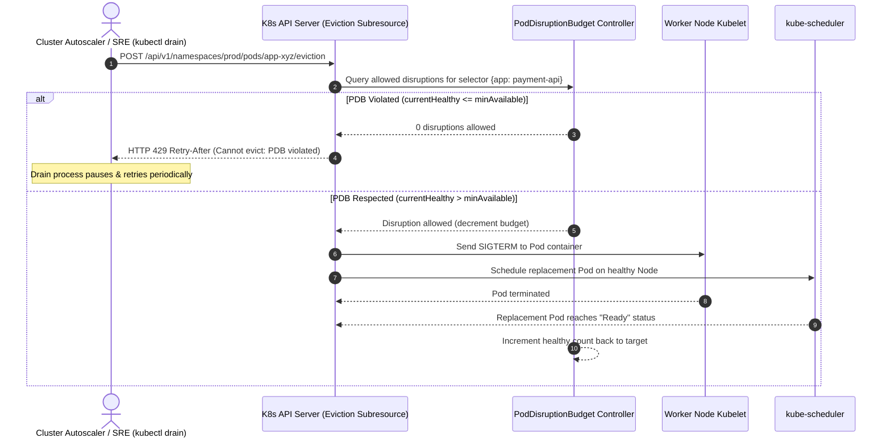

# Kubernetes Pod Disruption Budget (PDB) Practical Guide

## 1. Context & Overview

In Kubernetes production clusters, workloads face two distinct categories of disruptions:

| Disruption Type | Origin & Causes | Mitigation Strategy |
|-----------------|-----------------|---------------------|
| **Involuntary Disruptions** | Hardware crash, kernel panic, VM hypervisor reboot, network partition, out-of-memory (OOM) killer | Replicas, Anti-affinity, Multi-AZ, Health Probes |
| **Voluntary Disruptions** | Node draining for OS patches (`kubectl drain`), cluster autoscaler scale-down, GKE/EKS worker node AMI upgrades, preemptible/spot node reclamation | **Pod Disruption Budget (PDB)** |

Without a **Pod Disruption Budget (PDB)**, executing `kubectl drain <node>` or an automated Karpenter / Cluster Autoscaler consolidation action will evict **all pods simultaneously**, causing cascading outages for single-replica or lightly replicated services.

A PDB is an API resource (`policy/v1`) that limits the number of pods of a replicated application that can be down simultaneously from voluntary disruptions.

---

## 2. PDB Eviction Mechanics & Eviction API

When an operator or automated system runs `kubectl drain`:
1. The client invokes the Kubernetes **Eviction API** (`/v1/pods/{name}/eviction`) rather than a direct `DELETE` call.
2. The API Server checks all active `PodDisruptionBudgets` whose `spec.selector` matches the target pod labels.
3. If evicting the pod would violate the PDB constraint (`currentHealthyPods < minAvailable` or `disruptedPods > maxUnavailable`), the API server **rejects the eviction request** with HTTP `429 Too Many Requests`.
4. The draining process waits and retries until new replacement pods are scheduled on another node and reach the `Ready` state.



---

## 3. Specification: `minAvailable` vs. `maxUnavailable`

A PDB spec accepts **either** `minAvailable` or `maxUnavailable`, expressed as an integer or a percentage:

```yaml
# Option A: minAvailable (Absolute count or percentage)
# "At least 80% or at least 2 pods must remain healthy at all times"
apiVersion: policy/v1
kind: PodDisruptionBudget
metadata:
  name: payment-api-pdb
  namespace: production
spec:
  minAvailable: 2 # Or "80%"
  selector:
    matchLabels:
      app: payment-api
---
# Option B: maxUnavailable (Absolute count or percentage)
# "At most 1 pod may be down simultaneously during maintenance"
apiVersion: policy/v1
kind: PodDisruptionBudget
metadata:
  name: orders-worker-pdb
  namespace: production
spec:
  maxUnavailable: 1 # Or "25%"
  selector:
    matchLabels:
      app: orders-worker
```

> [!IMPORTANT]
> Never specify both `minAvailable` and `maxUnavailable` in the same PDB manifest. The Kubernetes API server will reject the definition.

---

## 4. Production Scenarios & Guidelines

### Scenario 1: Critical High-Traffic Web APIs (Stateless)
- **Deployment**: `replicas: 5`
- **PDB Configuration**: `maxUnavailable: 1` or `minAvailable: 80%`
- **Result**: Node drain will evict exactly 1 pod at a time. The next node will not evict payment pods until the replacement pod passes its readiness probe.

### Scenario 2: Quorum-Based Distributed State (Zookeeper, Kafka, Cassandra, etcd)
- **StatefulSet**: `replicas: 3` (Quorum requires $(N/2) + 1 = 2$ nodes)
- **PDB Configuration**: `minAvailable: 2`
- **Result**: Prevents cluster split-brain or quorum loss. If 1 node is already down, draining a second node is blocked until the first node recovers.

### Scenario 3: Single Replica Deployments (`replicas: 1`)
- **PDB Configuration**: `minAvailable: 1`
- **⚠️ The Deadlock Trap**: If you set `minAvailable: 1` on a deployment with `replicas: 1`, **the node containing that pod can NEVER be drained**! Evicting the pod drops available count to 0, permanently violating the PDB.
- **Rule**: For `replicas: 1`, either set `maxUnavailable: 1` (allowing downtime during maintenance) or increase `replicas: 2` with pod anti-affinity.

---

## 5. Helm & Terraform Production Pattern

```hcl
# Terraform Kubernetes Provider PDB
resource "kubernetes_pod_disruption_budget_v1" "api_gateway" {
  metadata {
    name      = "api-gateway-pdb"
    namespace = "production"
    labels = {
      "app.kubernetes.io/name"    = "api-gateway"
      "app.kubernetes.io/part-of" = "platform"
    }
  }

  spec {
    max_unavailable = "1"

    selector {
      match_labels = {
        "app.kubernetes.io/name" = "api-gateway"
      }
    }
  }
}
```

---

## 6. How to Inspect & Troubleshoot PDBs in Production

```bash
# 1. View all active PDBs across namespaces
kubectl get pdb -A

# Output Example:
# NAMESPACE    NAME              MIN AVAILABLE   MAX UNAVAILABLE   ALLOWED DISRUPTIONS   AGE
# production   payment-api-pdb   2               N/A               1                     42d
# production   orders-worker     N/A             1                 0                     12d

# 2. Inspecting ALLOWED DISRUPTIONS:
# If ALLOWED DISRUPTIONS is 0, node drains will stall indefinitely!

# 3. Find why disruptions are blocked:
kubectl describe pdb payment-api-pdb -n production
# Check "Current: 2", "Desired: 2", "DisruptionsAllowed: 0"
# Look for unready pods:
kubectl get pods -n production -l app=payment-api
```

---

## 7. Real-World Failure Modes & Prevention

1. **Unhealthy Pods Stalling Upgrades Forever**: If a deployment has crashing pods (`CrashLoopBackOff`), `currentHealthy` is less than `minAvailable`. The cluster autoscaler will hang when trying to consolidate nodes.
   - *Fix*: Kubernetes 1.27+ supports `spec.unhealthyPodEvictionPolicy: AlwaysAllow`. This ensures stuck/failing pods do not block node drains.
2. **Missing Readiness Probes**: Kubernetes considers a pod "Healthy" as soon as its container starts unless a `readinessProbe` is defined. Always define realistic `readinessProbe` with `initialDelaySeconds` and `periodSeconds` so traffic isn't routed before the JVM or application framework finishes booting.
3. **PDBs paired with Pod Anti-Affinity**: Always pair PDBs with `topologySpreadConstraints` or `podAntiAffinity` (`topologyKey: kubernetes.io/hostname`) so replicas are scheduled across different nodes and AZs. If all 5 replicas sit on the same node, draining that single node will challenge the scheduler.