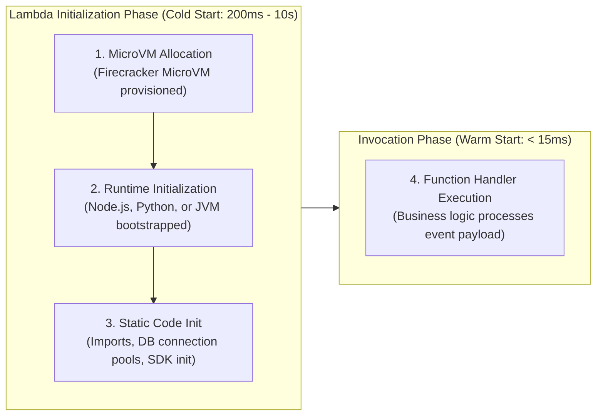
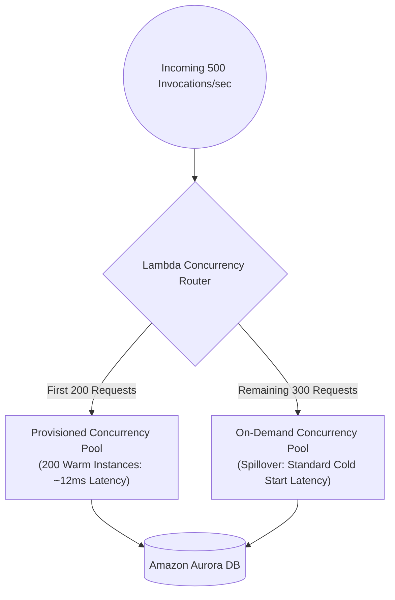

# How Provisioned Concurrency Cuts AWS Lambda Cold Starts by 98%

## 1. The Physics of AWS Lambda Cold Starts

When an AWS Lambda function receives an invocation request, AWS checks if an idle execution environment (microVM) is already active (a **Warm Start**). If no idle worker exists, AWS must initiate a **Cold Start**, executing three sequential phases:

```
Total Latency = Init Duration (Cold Start) + Execution Duration (Handler)
```



### Why Cold Starts Break SLA in Modern APIs:
- In lightweight runtimes (Node.js, Python, Go, Rust), cold starts take **150ms to 500ms**.
- In heavy enterprise runtimes (Java Spring Boot, .NET, large ML libraries like Pandas/PyTorch), cold starts can reach **5 to 15 seconds**.
- For user-facing synchronous REST APIs behind API Gateway, an occasional 3-second delay leads to connection timeouts, dropped baskets, and poor SEO Web Vitals (INP/TTFB).

---

## 2. What Provisioned Concurrency Does

**Provisioned Concurrency** pre-initializes a requested number of execution environments beforehand.
When Provisioned Concurrency is enabled:
- AWS spins up the Firecracker microVM.
- AWS boots the runtime and downloads your deployment package/container image.
- AWS runs all code **outside the handler** (imports, database connection pooling, AWS SDK clients).
- These environments sit **perpetually warm and idle**, ready to respond to incoming invocations in **double-digit or single-digit milliseconds**.

$$\text{Cold Start Latency Reduction} \approx 98\% \quad (3000\text{ms} \rightarrow 15\text{ms})$$

| Feature | Standard (On-Demand) Concurrency | Provisioned Concurrency |
|---------|----------------------------------|-------------------------|
| **Cold Start** | Yes (on new instance spin-up) | **0% Cold Start** (for provisioned quota) |
| **Code Outside Handler Execution** | Runs during first invocation | Runs **before** any invocation arrives |
| **Billing Model** | Pay only for compute time | Hourly base fee + standard execution time |
| **Scale Mechanism** | Bursts up to regional quota | Pre-allocated pool + spills over to On-Demand |

---

## 3. The Spillover Mechanism (Safety Net)

A common fear is: *"What happens if traffic exceeds the number of provisioned instances?"*
AWS Lambda handles this gracefully:
- Invocations within the provisioned count are served with **zero cold start**.
- Traffic exceeding the provisioned capacity automatically **spills over to standard on-demand concurrency**, incurring standard cold starts rather than failing or returning 429 errors (unless Reserved Concurrency is exhausted).



---

## 4. Terraform Reference Architecture

> [!WARNING]
> Provisioned Concurrency cannot be applied to `$LATEST`. It requires a published Lambda **Version** or **Alias**.

```hcl
# Lambda Function
resource "aws_lambda_function" "api_backend" {
  function_name = "payment-checkout-api"
  role          = aws_iam_role.lambda_exec.arn
  handler       = "index.handler"
  runtime       = "nodejs20.x"
  filename      = "dist/bundle.zip"
  publish       = true # Required to publish numbered versions

  memory_size = 1024
  timeout     = 10

  environment {
    variables = {
      NODE_ENV = "production"
    }
  }
}

# Lambda Alias pointing to published version
resource "aws_lambda_alias" "prod_alias" {
  name             = "production"
  description      = "Production traffic alias"
  function_name    = aws_lambda_function.api_backend.function_name
  function_version = aws_lambda_function.api_backend.version

  lifecycle {
    ignore_changes = [function_version] # Managed by deployment pipeline
  }
}

# Provisioned Concurrency Configuration
resource "aws_lambda_provisioned_concurrency_config" "prod_pc" {
  function_name                     = aws_lambda_function.api_backend.function_name
  provisioned_concurrent_executions = 50
  qualifier                         = aws_lambda_alias.prod_alias.name
}
```

---

## 5. FinOps: Auto-Scaling Provisioned Concurrency with Application Auto Scaling

Keeping 100 instances provisioned 24/7 costs unnecessary money overnight when traffic is zero.
You can auto-scale Provisioned Concurrency using **Application Auto Scaling** based on schedule (cron) or utilization metrics (`ProvisionedConcurrencyUtilization`):

```hcl
# Register Scalable Target
resource "aws_appautoscaling_target" "lambda_target" {
  max_capacity       = 100
  min_capacity       = 10
  resource_id        = "function:${aws_lambda_function.api_backend.function_name}:${aws_lambda_alias.prod_alias.name}"
  scalable_dimension = "lambda:function:ProvisionedConcurrency"
  service_namespace  = "lambda"
}

# Target Tracking Policy (Keep utilization at 70%)
resource "aws_appautoscaling_policy" "lambda_tracking" {
  name               = "LambdaProvisionedConcurrencyUtilization"
  policy_type        = "TargetTrackingScaling"
  resource_id        = aws_appautoscaling_target.lambda_target.resource_id
  scalable_dimension = aws_appautoscaling_target.lambda_target.scalable_dimension
  service_namespace  = aws_appautoscaling_target.lambda_target.service_namespace

  target_tracking_scaling_policy_configuration {
    target_value = 0.70

    predefined_metric_specification {
      predefined_metric_type = "LambdaProvisionedConcurrencyUtilization"
    }
  }
}
```

---

## 6. How to Write Code Optimized for Provisioned Concurrency

Code outside the handler executes **only once** when the provisioned instance is created:

```javascript
// ✅ GOOD: Instantiated once outside handler during Provisioned Concurrency bootstrap
const { DynamoDBClient } = require("@aws-sdk/client-dynamodb");
const { DynamoDBDocumentClient, GetCommand } = require("@aws-sdk/lib-dynamodb");
const mysql = require("mysql2/promise");

// SDK clients reused across all warm invocations
const ddbClient = new DynamoDBClient({ region: process.env.AWS_REGION });
const docClient = DynamoDBDocumentClient.from(ddbClient);

// Connection pool initialized ONCE before requests ever hit
const pool = mysql.createPool({
  host: process.env.DB_PROXY_ENDPOINT,
  user: process.env.DB_USER,
  database: 'ecommerce',
  connectionLimit: 1
});

exports.handler = async (event, context) => {
  // ⚡ Handler runs in ~10ms because connections are already warm!
  const [rows] = await pool.query('SELECT status FROM orders WHERE id = ?', [event.pathParameters.id]);
  return {
    statusCode: 200,
    body: JSON.stringify(rows[0])
  };
};
```

---

## 7. Cost Calculation & Key Interview Takeaways

1. **The Cost Trade-off**:
   - Provisioned Concurrency costs ~\$0.015 per GB-hour plus execution time.
   - If your function runs continuously with a steady throughput of 10–20 requests per second, Provisioned Concurrency is often **cheaper or cost-neutral** compared to on-demand while delivering uniform sub-20ms latencies.
2. **Snapshot vs Warm Instances**: AWS also introduced **Lambda SnapStart** for Java and .NET (taking a microVM memory snapshot at build time). For Node, Python, and Go, Provisioned Concurrency with Auto Scaling remains the gold standard.
3. **Database Guardrails**: When Provisioned Concurrency spins up 200 instances simultaneously, each initializes a DB pool. Always place **Amazon RDS Proxy** in front of PostgreSQL/MySQL to prevent exhausting database connections.