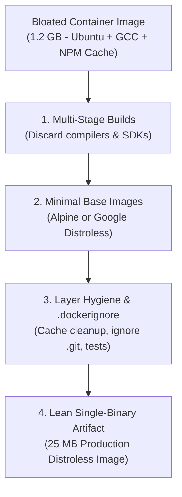

# How to Reduce Docker Image Size: From 1.2 GB to 25 MB

## 1. Why Docker Image Size Matters in Production

Bloated Docker images (e.g., 800 MB to 2 GB) cause severe operational, financial, and security problems:
- **Deployment & Scaling Latency**: When an EKS or ECS node scales up or replaces a failed instance, downloading a 1.5 GB image over the network adds 45–90 seconds before the pod can start.
- **Vulnerability Attack Surface**: Full OS images (like Ubuntu or Debian full) include hundreds of packages, shell binaries (`curl`, `wget`, `bash`, `tar`), and package managers (`apt`, `dpkg`) with unpatched CVEs.
- **Bandwidth & Storage Costs**: Cloud container registries (ECR, GCR, ACR) charge for storage and inter-region data transfer. A 10x smaller image reduces registry bills by 90%.

---

## 2. Core Image Optimization Strategies



---

## 3. The 6 Rules of Container Image Minimization

### Rule 1: Multi-Stage Builds (The #1 Impact Rule)
Separate your **build environment** (which requires GCC, npm, Maven, Go SDK, header files) from your **runtime environment** (which only needs the compiled binary or stripped runtime).

### Rule 2: Pick the Right Base Image
| Base Image | Typical Size | Suitable For | Trade-offs |
|------------|--------------|--------------|------------|
| `ubuntu:latest` | ~78 MB | Legacy apps | Includes unnecessary OS tools |
| `debian:bookworm-slim` | ~30 MB | Python / Node / C libraries | Uses `glibc`, excellent compatibility |
| `alpine:latest` | ~7 MB | Go, Rust, lightweight scripts | Uses `musl libc` (can have DNS/perf quirks with Python/C extensions) |
| `gcr.io/distroless/static` | **~2 MB** | Go, Rust binaries | **No shell**, maximum security, zero CVEs |
| `gcr.io/distroless/nodejs` | ~35 MB | Production Node.js apps | Stripped Node runtime without shell or package managers |

### Rule 3: Leverage `.dockerignore`
Never copy development cruft, `.git` histories, local virtual environments, or documentation into the Docker daemon context:

```dockerignore
# .dockerignore
.git
.gitignore
node_modules
__pycache__
*.pyc
.env*
dist/*.map
tests/
coverage/
Dockerfile*
README.md
.terraform
```

### Rule 4: Chain Commands & Clean Package Caches in a Single `RUN`
Every `RUN`, `COPY`, and `ADD` directive creates a distinct read-only layer in the image union filesystem.
If you install packages in one layer and delete the cache in the next layer, the disk space remains permanently locked in the previous layer.

```dockerfile
# ❌ BAD: Leaves ~150 MB of apt cache locked in Layer 1
RUN apt-get update
RUN apt-get install -y curl build-essential
RUN rm -rf /var/lib/apt/lists/*

# ✅ GOOD: Cleans cache in the SAME layer before it commits to disk
RUN apt-get update && apt-get install -y --no-install-recommends \
    curl \
    ca-certificates \
 && apt-get purge -y --auto-remove build-essential \
 && rm -rf /var/lib/apt/lists/*
```

---

## 4. Real-World Before vs. After Examples

### Example A: Node.js / TypeScript Application

#### ❌ The Bloated Anti-Pattern (`1.15 GB`)
```dockerfile
FROM node:20

WORKDIR /app
COPY . .
RUN npm install
RUN npm run build
EXPOSE 3000
CMD ["npm", "start"]
```

#### ✅ The Optimized Multi-Stage Production Build (`78 MB`)
```dockerfile
# Stage 1: Build & Dependencies
FROM node:20-bookworm-slim AS builder
WORKDIR /app

# Copy dependency manifests first to leverage Docker layer caching
COPY package*.json tsconfig.json ./
RUN npm ci

# Copy source and compile TypeScript
COPY src/ ./src
RUN npm run build

# Remove development dependencies
RUN npm prune --production

# Stage 2: Minimal Runtime
FROM gcr.io/distroless/nodejs20-debian12
WORKDIR /app

# Copy production artifacts only
COPY --from=builder /app/node_modules ./node_modules
COPY --from=builder /app/dist ./dist
COPY package.json ./

USER nonroot:nonroot
ENV NODE_ENV=production
EXPOSE 3000

CMD ["dist/server.js"]
```

---

### Example B: Golang Microservice

#### ❌ Single-Stage Image (`850 MB`)
```dockerfile
FROM golang:1.22
WORKDIR /app
COPY . .
RUN go build -o server main.go
CMD ["./server"]
```

#### ✅ Multi-Stage Static Binary with Distroless (`14 MB`)
```dockerfile
# Stage 1: Compilation
FROM golang:1.22-alpine AS builder
WORKDIR /app

# Download dependencies
COPY go.mod go.sum ./
RUN go mod download

# Copy code and compile static binary (no external C libraries)
COPY . .
RUN CGO_ENABLED=0 GOOS=linux GOARCH=amd64 go build \
    -ldflags="-s -w" \
    -o /app/server .

# Stage 2: Scratch / Distroless
FROM gcr.io/distroless/static-debian12:nonroot
WORKDIR /
COPY --from=builder /app/server /server

USER nonroot:nonroot
EXPOSE 8080
ENTRYPOINT ["/server"]
```
*(Notice `-ldflags="-s -w"` which strips debug symbols and DWARF tables, reducing the binary size by another 35%).*

---

## 5. Tooling to Analyze & Audit Docker Layers

### Dive Tool
Inspect layer-by-layer file size and wasted space:
```bash
# Install and run dive on any image
curl -sL https://github.com/wagoodman/dive/releases/download/v0.12.0/dive_0.12.0_linux_amd64.tar.gz | tar -xz
./dive my-app:latest
```
Look for:
- **Efficiency score** (Aim for > 95%).
- **Wasted space** (duplicate files written in multiple layers).

### Docker Image History
```bash
docker history --human --format "{{.Size}}\t{{.CreatedBy}}" my-app:latest
```

---

## 6. Key Takeaways for DevOps Interviews

1. **Layer Caching Rule**: Order Dockerfile directives from **least frequently changing to most frequently changing**. Put OS package installs and `package.json` copy first, and application code copy last.
2. **Distroless over Alpine for Go/Rust**: Distroless images contain zero package managers or shell executables, which completely nullifies remote code execution (RCE) attempts like reverse shells (`/bin/sh` or `/bin/bash` literally do not exist).
3. **Always Run as Non-Root**: A smaller image isn't secure if it runs as `root`. Always include `USER nonroot:nonroot` or `USER 10001:10001`.