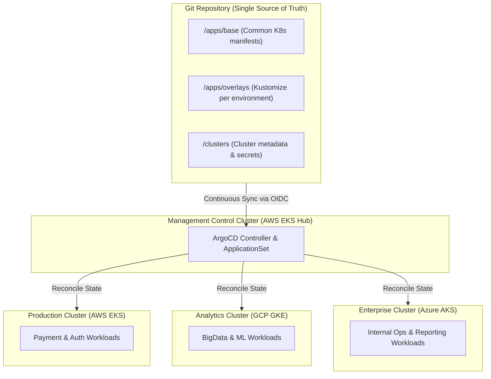
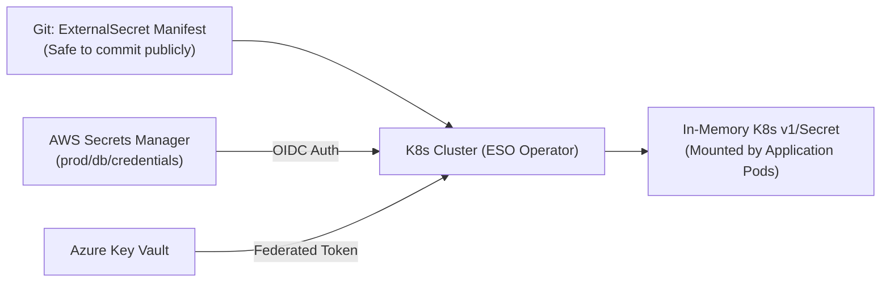

# Multi-Cloud GitOps Workflow for Kubernetes Management

## 1. Context & Architecture Overview

Modern enterprise architectures increasingly span multiple cloud providers (e.g., AWS EKS for transactional services, GCP GKE for BigQuery/ML workloads, Azure AKS for Active Directory/Office 365 integrations) or multiple geographical regions for compliance and disaster recovery.

Managing multiple Kubernetes clusters manually via `kubectl` or fragmented CI/CD pipelines leads to:
- **Configuration Drift**: Clusters diverge over time as engineers run ad-hoc patches.
- **Credential Sprawl**: CI/CD systems require cluster-admin credentials across every cloud provider.
- **Slow Disaster Recovery**: Rebuilding a region requires running dozens of brittle scripts.

**GitOps** solves this by establishing **Git as the Single Source of Truth**. Instead of external CI pipelines pushing changes (`push-based`), an in-cluster GitOps operator like **ArgoCD** continuously pulls and reconciles desired state from Git (`pull-based`).



---

## 2. Multi-Cloud GitOps Architecture: Hub-and-Spoke Pattern

In enterprise multi-cloud setups, the recommended architecture is the **Centralized Management Hub**:
1. **Hub Cluster**: A dedicated, lightweight EKS or GKE cluster hosting the ArgoCD control plane.
2. **Spoke Clusters**: Workload clusters in AWS, Azure, GCP, and On-Premises.
3. **Cluster Registration**: The Hub connects to Spoke cluster API servers using short-lived tokens or cross-cloud IAM federation (AWS IAM Roles for Service Accounts - IRSA, GCP Workload Identity, Azure Workload Identity).

---

## 3. Directory Structure: Repository Best Practice

Use a repository structure combining **Kustomize** or **Helm** with environment overlays:

```
gitops-multi-cloud-repo/
├── apps/
│   └── payment-service/
│       ├── base/
│       │   ├── deployment.yaml
│       │   ├── service.yaml
│       │   └── kustomization.yaml
│       └── overlays/
│           ├── aws-us-east-1/
│           │   ├── kustomization.yaml
│           │   └── patches/ingress-alb.yaml
│           ├── gcp-europe-west1/
│           │   ├── kustomization.yaml
│           │   └── patches/ingress-gke.yaml
│           └── azure-eastus/
│               ├── kustomization.yaml
│               └── patches/ingress-appgw.yaml
└── bootstrap/
    ├── application-set.yaml
    └── clusters/
        ├── cluster-aws-eks.yaml
        ├── cluster-gcp-gke.yaml
        └── cluster-azure-aks.yaml
```

---

## 4. Automating Multi-Cluster Sync with ArgoCD ApplicationSet

The **ArgoCD ApplicationSet controller** allows generating hundreds of cluster-specific applications dynamically using the `cluster` generator:

```yaml
apiVersion: argoproj.io/v1alpha1
kind: ApplicationSet
metadata:
  name: multi-cloud-workloads
  namespace: argocd
spec:
  generators:
    # Generates applications targeting all registered clusters matching labels
    - clusters:
        selector:
          matchLabels:
            environment: production
        values:
          branch: main
  template:
    metadata:
      name: '{{name}}-payment-service'
    spec:
      project: default
      source:
        repoURL: 'https://github.com/acme-corp/gitops-infra.git'
        targetRevision: '{{values.branch}}'
        path: 'apps/payment-service/overlays/{{metadata.labels.cloud}}-{{metadata.labels.region}}'
      destination:
        server: '{{server}}'
        namespace: production
      syncPolicy:
        automated:
          prune: true
          selfHeal: true
        syncOptions:
          - CreateNamespace=true
```

---

## 5. Secret Management Across Multi-Cloud: External Secrets Operator (ESO)

Never store plaintext secrets in Git! The multi-cloud standard is the **External Secrets Operator (ESO)**:
- Secrets are created in provider-native secret vaults (AWS Secrets Manager, Azure Key Vault, Google Secret Manager).
- ESO runs inside the cluster and maps external secrets into native Kubernetes `v1/Secret` objects dynamically.



#### ExternalSecret Kubernetes Manifest:
```yaml
apiVersion: external-secrets.io/v1beta1
kind: ExternalSecret
metadata:
  name: database-credentials
  namespace: production
spec:
  refreshInterval: "1h"
  secretStoreRef:
    name: aws-secrets-manager
    kind: ClusterSecretStore
  target:
    name: db-secret-synced
    creationPolicy: Owner
  data:
    - secretKey: DB_PASSWORD
      remoteRef:
        key: production/rds/master-credentials
        property: password
```

---

## 6. Real-World Disaster Recovery & Migration

When disaster strikes a specific cloud or region (e.g., AWS us-east-1 fiber cut):
1. **Traffic Cutover**: Update Global DNS (e.g., Cloudflare, Route 53 ARC - Application Recovery Controller) to shift 100% of user traffic to GCP GKE or Azure AKS.
2. **Cluster Spin-Up**: Spin up a replacement cluster using Terraform.
3. **Instant Hydration**: Apply the single ArgoCD `ApplicationSet` manifest. Within 3 minutes, ArgoCD reconciles the entire cluster state, spinning up Deployments, Services, RBAC, NetworkPolicies, and CRDs without human intervention.

---

## 7. Key Takeaways for DevOps Interviews

1. **Pull vs. Push Security**: Traditional CI/CD requires opening firewall ports and sharing `kubeconfig` admin tokens with external runners (e.g., GitHub Actions, Jenkins). GitOps reverses this: the cluster pulls changes from Git via HTTPS, needing zero inbound open ports.
2. **Self-Healing / Anti-Drift**: If an engineer manually deletes a deployment or edits a replica count via `kubectl edit`, ArgoCD detects the diff against Git and immediately restores the desired state (Self-Heal).
3. **Kustomize Overlays**: Use Kustomize overlays to inject cloud-specific Ingress controllers (AWS ALB Controller on EKS vs. Managed Certificate on GKE) while sharing the core deployment spec.