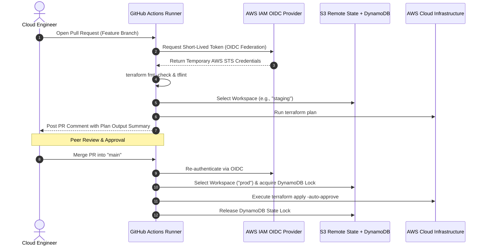

# GitHub Actions Workflow for Terraform Workspaces with AWS OIDC

## 1. Context & Architecture Overview

Automating Terraform through CI/CD pipelines eliminates manual `terraform apply` executions from engineer laptops ("works on my machine" syndrome), enforces automated peer reviews, and generates audit logs of all infrastructure mutations.

However, two common flaws plague junior Terraform CI/CD pipelines:
1. **Hardcoded AWS Access Keys (`AWS_ACCESS_KEY_ID` / `AWS_SECRET_ACCESS_KEY`)**: Long-lived keys stored in GitHub Secrets are frequently leaked or unrotated.
2. **Environment Collision**: Running commands against the wrong environment (accidentally deleting production while intending to test dev).

The production architecture solves this using:
- **AWS OpenID Connect (OIDC)**: Short-lived, temporary STS tokens without static secrets.
- **Terraform Workspaces**: Isolating state files (`dev`, `staging`, `prod`) within the same backend bucket.
- **Automated Pull Request (PR) Previews**: Outputting `terraform plan` directly as a PR comment.



---

## 2. Setting Up AWS IAM OIDC for GitHub Actions (Terraform Blueprint)

Configure AWS to trust your GitHub repository:

```hcl
# 1. GitHub OIDC Provider in AWS IAM
resource "aws_iam_openid_connect_provider" "github" {
  url             = "https://token.actions.githubusercontent.com"
  client_id_list  = ["sts.amazonaws.com"]
  thumbprint_list = ["6938fd4d98bab03faadb97b34396831e3780aea1"] # Standard GitHub Actions OIDC Thumbprint
}

# 2. IAM Role assumed by GitHub Actions
resource "aws_iam_role" "github_actions_terraform" {
  name = "github-actions-terraform-role"

  assume_role_policy = jsonencode({
    Version = "2012-10-17"
    Statement = [
      {
        Effect = "Allow"
        Principal = {
          Federated = aws_iam_openid_connect_provider.github.arn
        }
        Action = "sts:AssumeRoleWithWebIdentity"
        Condition = {
          StringEquals = {
            "token.actions.githubusercontent.com:aud" : "sts.amazonaws.com"
          }
          StringLike = {
            # Restricts access strictly to your specific repository and branches
            "token.actions.githubusercontent.com:sub" : "repo:SanjeevKumar-Cloud/terraform-infrastructure:*"
          }
        }
      }
    ]
  })
}

# Attach Administrator or Scoped Permissions
resource "aws_iam_role_policy_attachment" "admin_attach" {
  role       = aws_iam_role.github_actions_terraform.name
  policy_arn = "arn:aws:iam::aws:policy/AdministratorAccess"
}
```

---

## 3. The Complete Production GitHub Actions Workflow

Create `.github/workflows/terraform.yml`:

```yaml
name: "Terraform CI/CD Workspaces"

on:
  push:
    branches:
      - main
      - staging
  pull_request:
    branches:
      - main
      - staging

permissions:
  id-token: write   # Required for requesting the JWT from AWS OIDC
  contents: read    # Required to check out code
  pull-requests: write # Required to post PR comment with plan output

jobs:
  terraform:
    name: "Terraform Lint, Plan & Apply"
    runs-on: ubuntu-latest

    # Map Git branch to Terraform workspace
    env:
      TF_WORKSPACE: ${{ github.ref_name == 'main' && 'prod' || 'staging' }}
      AWS_REGION: "us-east-1"
      ROLE_TO_ASSUME: "arn:aws:iam::123456789012:role/github-actions-terraform-role"

    steps:
      - name: Checkout Code
        uses: actions/checkout@v4

      - name: Configure AWS Credentials (OIDC - Zero Static Keys)
        uses: aws-actions/configure-aws-credentials@v4
        with:
          role-to-assume: ${{ env.ROLE_TO_ASSUME }}
          aws-region: ${{ env.AWS_REGION }}
          audience: sts.amazonaws.com

      - name: Setup Terraform CLI
        uses: hashicorp/setup-terraform@v3
        with:
          terraform_version: "1.8.0"

      - name: Terraform Format Check
        run: terraform fmt -check

      - name: Terraform Init
        run: terraform init

      - name: Select or Create Workspace
        run: |
          echo "Selecting Terraform workspace: ${{ env.TF_WORKSPACE }}"
          terraform workspace select ${{ env.TF_WORKSPACE }} || terraform workspace new ${{ env.TF_WORKSPACE }}

      - name: Terraform Validate
        run: terraform validate -no-color

      - name: Terraform Plan
        id: plan
        if: github.event_name == 'pull_request'
        run: |
          terraform plan -no-color -out=tfplan \
            -var-file="environments/${{ env.TF_WORKSPACE }}.tfvars"
        continue-on-error: false

      - name: Post Plan Summary to Pull Request
        uses: actions/github-script@v7
        if: github.event_name == 'pull_request'
        with:
          github-token: ${{ secrets.GITHUB_TOKEN }}
          script: |
            const output = `#### Terraform Plan Status: \`${{ steps.plan.outcome }}\`
            #### Workspace: \`${{ env.TF_WORKSPACE }}\`
            *Pushed by: @${{ github.actor }}*`;

            github.rest.issues.createComment({
              issue_number: context.issue.number,
              owner: context.repo.owner,
              repo: context.repo.repo,
              body: output
            })

      - name: Terraform Apply (Main Branch Merge Only)
        if: github.ref == 'refs/heads/main' && github.event_name == 'push'
        run: |
          echo "Applying infrastructure changes to workspace: ${{ env.TF_WORKSPACE }}"
          terraform apply -auto-approve -var-file="environments/${{ env.TF_WORKSPACE }}.tfvars"
```

---

## 4. Terraform Backend Workspace Architecture

```hcl
# backend.tf
terraform {
  required_version = ">= 1.7.0"
  backend "s3" {
    bucket         = "acme-terraform-state-prod"
    key            = "core/terraform.tfstate"
    region         = "us-east-1"
    dynamodb_table = "terraform-locks"
    encrypt        = true
  }
}
```

In AWS S3, Terraform Workspaces isolate state files automatically under the prefix:
```
s3://acme-terraform-state-prod/
├── env:/
│   ├── staging/
│   │   └── core/terraform.tfstate
│   └── prod/
│       └── core/terraform.tfstate
```

---

## 5. Security & Production Guardrails

1. **GitHub Concurrency Locks**: Prevent concurrent Terraform applies from running simultaneously on overlapping PR merges by adding concurrency control to your workflow:
   ```yaml
   concurrency:
     group: terraform-${{ github.ref_name }}
     cancel-in-progress: false
   ```
2. **Never commit `.tfvars` containing secrets**: Store environment parameters (CIDRs, instance types) in `prod.tfvars`, but inject sensitive values via AWS Secrets Manager or GitHub Encrypted Environments.
3. **Automated Static Security Scanning**: Add `trivy config .` or `checkov -d .` before `terraform plan` to catch misconfigurations (e.g., unencrypted S3 buckets, open 0.0.0.0/0 SSH security groups) before code reaches human review.