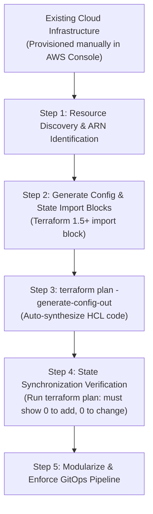

# How to Convert Existing Cloud Infrastructure into Terraform (Zero Downtime)

## 1. Context & The "ClickOps" Dilemma

Most organizations don't start with 100% Infrastructure as Code (IaC). Cloud resources are frequently provisioned during rapid prototypes through the AWS Management Console ("ClickOps"), ad-hoc CLI commands, or legacy CloudFormation stacks.

Migrating live, revenue-generating infrastructure into Terraform without downtime or accidental resource recreation requires a disciplined, step-by-step reverse-engineering workflow.



---

## 2. Modern Approach: Terraform 1.5+ Import Blocks (Declarative)

Prior to Terraform 1.5, importing required running imperative CLI commands (`terraform import aws_vpc.main vpc-123456`) and manually authoring exact HCL code that matched state properties byte-for-byte.

Terraform 1.5 introduced declarative **`import` blocks** combined with automatic HCL code generation.

### Step 1: Author the Import Block
Create a temporary file `imports.tf`:

```hcl
# imports.tf
import {
  to = aws_vpc.imported_vpc
  id = "vpc-0a1b2c3d4e5f67890" # Existing AWS VPC ID
}

import {
  to = aws_security_group.app_sg
  id = "sg-0987654321fedcba0" # Existing Security Group ID
}

import {
  to = aws_s3_bucket.data_archive
  id = "acme-production-data-archive-2024" # Existing S3 Bucket Name
}
```

### Step 2: Auto-Generate HCL Code via CLI
Run the code generator flag:

```bash
terraform plan -generate-config-out=generated_resources.tf
```

Terraform queries the AWS APIs, inspects the live resource attributes, and generates the exact HCL syntax in `generated_resources.tf`:

```hcl
# generated_resources.tf (Synthesized by Terraform)
resource "aws_vpc" "imported_vpc" {
  cidr_block           = "172.31.0.0/16"
  enable_dns_hostnames = true
  enable_dns_support   = true
  instance_tenancy     = "default"
  tags = {
    Name = "legacy-production-vpc"
  }
}
```

### Step 3: Run `terraform apply` to Hydrate State
```bash
terraform apply
```
*Output:*
```
aws_vpc.imported_vpc: Importing from ID "vpc-0a1b2c3d4e5f67890"...
aws_vpc.imported_vpc: Import prepared!
Apply complete! Resources: 1 imported, 0 added, 0 changed, 0 destroyed.
```

---

## 3. Alternative Tooling: Former2 & Terraformer

For large-scale migrations involving hundreds of resources across entire accounts:

| Tool | Mechanism | Best Use Case |
|------|-----------|---------------|
| **Former2** (Open Source by Ian Mckay) | Browser extension + AWS JavaScript SDK; scans active account and outputs clean Terraform / CDK / CloudFormation | Fast visual selection of specific VPCs, ECS services, and IAM roles. |
| **Terraformer** (by Google / Waze) | CLI tool (`terraformer import aws --resources=vpc,subnet,sg`) | Bulk CLI reverse-engineering across multi-region environments. |

---

## 4. The Critical Danger: Avoiding Accidental Destructions

The biggest hazard during infrastructure import is the **"Forces Replacement"** flag. If an imported Terraform attribute does not match an unchangeable cloud setting (e.g., changing VPC CIDR, RDS DB Subnet Group, KMS Key, or EC2 AMI), Terraform will plan to **destroy the live resource and recreate it from scratch**!

### How to Protect Live Systems:

1. **Add `lifecycle { prevent_destroy = true }`**:
   ```hcl
   resource "aws_rds_cluster" "primary" {
     # ...
     lifecycle {
       prevent_destroy = true
     }
   }
   ```
   If any command attempts to destroy this resource, Terraform halts with an error.

2. **Always inspect `terraform plan` for `~` vs `- / +`**:
   - `~` means in-place modification (safe).
   - `- / +` means **DESTROY AND RECREATE** (Downtime & potential data loss!).

3. **Ignore Benign Cloud Defaults with `ignore_changes`**:
   AWS often assigns default attributes (such as default KMS keys, tags, or system attributes) that cause perpetual diffs. Suppress them:
   ```hcl
   lifecycle {
     ignore_changes = [
       tags["aws:cloudformation:stack-name"],
       tags["CreatedBy"]
     ]
   }
   ```

---

## 5. Post-Import Refactoring into Production Modules

Once the resources are safely in state with a clean plan (`0 to add, 0 to change, 0 to destroy`):

1. **Move into Child Modules without State Loss**:
   Use Terraform `moved` blocks to shift resources into modules without triggering recreation:
   ```hcl
   # Move flat resource into modular hierarchy
   moved {
     from = aws_vpc.imported_vpc
     to   = module.networking.aws_vpc.main
   }
   ```
2. **Remove the temporary `imports.tf` file**:
   Once state is synchronized, delete the `import { ... }` blocks; state tracking is now permanent in your S3 remote backend.
3. **Commit to Git and lock down AWS Console permissions**:
   Revoke direct console write access for developers; all future changes must pass through the GitHub Actions CI/CD review pipeline.