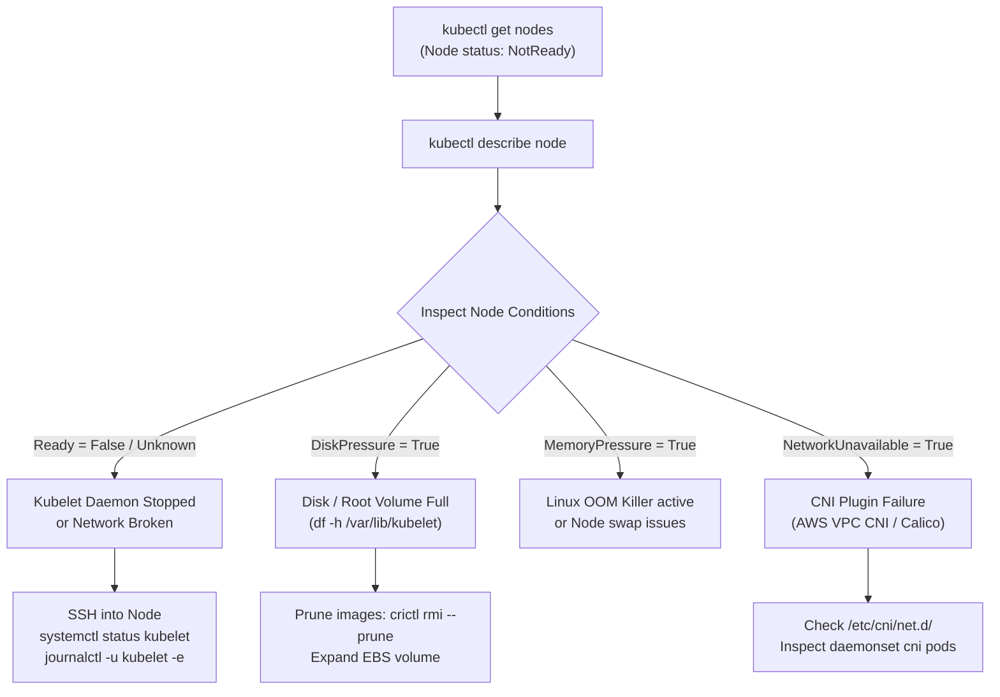

# Kubernetes Node Not Ready: Production Troubleshooting Playbook

## 1. Context & Overview

In Kubernetes, worker nodes report their health to the control plane every 10 seconds via a heartbeat sent by the **`kubelet`** daemon.
If the control plane fails to receive a heartbeat for a defined window (default: `node-monitor-grace-period = 40s`), the Node Controller updates the node status to **`NotReady`**.

When a node enters `NotReady`:
- The Kubernetes scheduler stops scheduling new pods to that node.
- If the node remains `NotReady` beyond the pod eviction timeout (default: 5 minutes), the control plane begins evicting non-daemonset pods and rescheduling them to healthy nodes.

---

## 2. Fast Triage Decision Tree



---

## 3. Step-by-Step Production Diagnosis Commands

### Step 1: Inspect Node Details from Cluster Control Plane
```bash
# Get node status and condition summary
kubectl describe node ip-10-0-2-45.ec2.internal
```

Look closely at the **Conditions** block:
```yaml
Conditions:
  Type             Status  Reason                        Message
  ----             ------  ------                        -------
  NetworkUnavailable False KubeletHasSufficientNetwork   daemonset is healthy
  MemoryPressure   False   KubeletHasSufficientMemory    kubelet has sufficient memory available
  DiskPressure     True    KubeletHasDiskPressure        kubelet has disk pressure
  PIDPressure      False   KubeletHasSufficientPID       kubelet has sufficient PID available
  Ready            False   KubeletNotReady               container runtime status check failed
```

---

## 4. Root Causes & How to Fix Them

### Root Cause 1: Kubelet Service Stopped or Crashed
The `kubelet` process running as a `systemd` unit on the host machine may have died due to a configuration error, memory exhaustion, or expired certificate.

```bash
# 1. SSH into the node
ssh -i /path/key.pem ec2-user@10.0.2.45

# 2. Check service status
sudo systemctl status kubelet

# 3. View recent crash logs
sudo journalctl -u kubelet -n 100 --no-pager
```

**Common fixes**:
- If killed by OOM: adjust Linux `sysctl` and reserve memory for system daemons via `--system-reserved=memory=500Mi,cpu=200m`.
- If certificate expired: verify kubelet client cert in `/var/lib/kubelet/pki/kubelet-client-current.pem` via `openssl x509 -in /var/lib/kubelet/pki/kubelet-client-current.pem -noout -dates`.

---

### Root Cause 2: Container Runtime (containerd) Frozen or Dead
If the container runtime daemon fails, `kubelet` cannot query container status or spin up pods.

```bash
# Check containerd daemon
sudo systemctl status containerd

# Test runtime responsiveness using crictl
sudo crictl ps
sudo crictl info
```

**Fix**: Restart the container runtime and kubelet:
```bash
sudo systemctl restart containerd
sudo systemctl restart kubelet
```

---

### Root Cause 3: Disk Pressure (`DiskPressure = True`)
When the root filesystem (`/`) or `/var/lib/containerd` exceeds the eviction threshold (typically 85% utilization), `kubelet` sets `DiskPressure` and begins evicting pods.

```bash
# Check disk space
df -h

# Check inode consumption
df -i

# Inspect largest directories in /var
sudo du -sh /var/lib/containerd/* | sort -rh | head -n 10
sudo du -sh /var/log/* | sort -rh | head -n 5
```

**Remediation**:
1. Remove dangling, unused container images immediately:
   ```bash
   sudo crictl rmi --prune
   ```
2. Clean rotated log files in `/var/log/pods`:
   ```bash
   sudo find /var/log/pods -name "*.log" -size +100M -exec truncate -s 0 {} \;
   ```
3. Expand node EBS volume via AWS CLI / Terraform and run `growpart /dev/nvme0n1 1` and `xfs_growfs /`.

---

### Root Cause 4: CNI Plugin Failure (`NetworkUnavailable = True`)
If the Container Network Interface (CNI) daemon (e.g., `aws-node` for AWS VPC CNI, `cilium`, or `calico-node`) crashes, the node cannot allocate IP addresses to new pods.

```bash
# Check CNI pod logs from your local terminal
kubectl get pods -n kube-system -l k8s-app=aws-node -o wide

# Check CNI config files on the node host
ls -l /etc/cni/net.d/
cat /var/log/aws-routed-eni/ipamd.log
```

**Common AWS VPC CNI Fix**:
- Verify the node IAM Role has permissions (`AmazonEKS_CNI_Policy`).
- Check if the subnet ran out of available private IP addresses! If all IPs in `10.0.2.0/24` are exhausted, ENI attachment fails.

---

## 5. Automated Health Remediation in Production

In production environments (EKS, GKE, self-managed), engineers don't manually SSH into nodes every time a node degrades. You deploy automated remediation controllers:

### 1. Node Problem Detector (NPD)
An open-source daemon running on every node that surfaces kernel errors (kernel deadlocks, corrupt filesystems, hung tasks) as Kubernetes Events and Node Conditions.

### 2. Auto-Drain & Auto-Healing (Karpenter / ASG Health Checks)
- AWS Auto Scaling Group EC2 Status Checks automatically replace degraded instances.
- Karpenter continuously evaluates node health and replaces `NotReady` nodes seamlessly.

---

## 6. Key Takeaways for DevOps Interviews

1. **Grace Period Mechanics**: A node transitions through `Ready` $\rightarrow$ `Unknown` (after 40s default heartbeat loss) $\rightarrow$ `NotReady` $\rightarrow$ Pod eviction initiated (after 300s `pod-eviction-timeout`).
2. **Kubelet vs Container Runtime**: Understand the boundary: `kubelet` communicates with `containerd` via the **CRI (Container Runtime Interface)** over Unix domain socket `/run/containerd/containerd.sock`. If containerd hangs, kubelet cannot mark the node `Ready`.
3. **Reservation Configuration**: Always configure `--kube-reserved` and `--system-reserved` in kubelet config to guarantee that host OS processes and kubelet never get starved of CPU or RAM by runaway application pods.