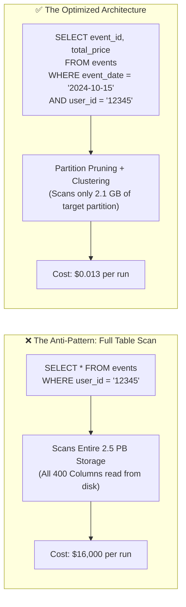

# How One BigQuery Query Costs Shopify \$1M a Month: FinOps Lessons

## 1. Context & The \$1,000,000 Query Incident

In cloud data warehousing (Google Cloud BigQuery, AWS Athena, Snowflake), queries do not bill based on how many rows are returned; they bill based on **how many bytes are scanned from storage**.

At companies operating at Shopify's scale—handling millions of merchants, billions of orders, and multi-petabyte analytics tables—a seemingly innocent query running in a high-frequency automation loop or BI dashboard can trigger catastrophic financial bills.

### The Math Behind the Bill:
- BigQuery On-Demand Pricing: **\$6.25 per Terabyte (TB)** of data scanned.
- A single unpartitioned raw event table: **2.5 Petabytes (PB) = 2,560 TB**.
- Single scan cost:
  $$2,560 \text{ TB} \times \$6.25 = \$16,000 \text{ per query execution}$$
- If an automated cron pipeline or poorly configured Looker dashboard executes this query every 10 minutes:
  $$\$16,000 \times 6 \text{ runs/hr} \times 24 \text{ hrs} \times 30 \text{ days} = \$69,120,000 \text{ potential monthly disaster!}$$

Even executing this scan twice a day generated over **\$960,000 per month** in pure wasted cloud spend.

---

## 2. Anatomy of the Faulty Query



### Why Did This Happen?
1. **Columnar Storage Misunderstanding**: BigQuery uses Capacitor (a columnar storage format). When you write `SELECT *`, BigQuery reads every single column from disk across all historical rows.
2. **Missing Partition Pruning**: The query filtered on `user_id` instead of the partitioning key (`event_date`), forcing the query engine to scan the entire historical archive from day one.
3. **No Query Guardrails**: The service account executing the query had unrestricted billing quota without a `maximum_bytes_billed` limit.

---

## 3. The 4 Production Pillars to Prevent Cloud Data Spills

### Pillar 1: Partitioning & Clustering (Architecture Level)

- **Partitioning**: Divides tables physically by date, timestamp, or integer range. Queries filtering on the partition key only scan the relevant partition slice.
- **Clustering**: Automatically sorts data within each partition based on high-cardinality columns (e.g., `merchant_id`, `customer_id`), further reducing byte reads via block pruning.

```sql
-- DDL for Production Scaled Table
CREATE TABLE `acme-prod.analytics.order_events`
(
    event_id STRING,
    merchant_id INT64,
    event_timestamp TIMESTAMP,
    order_payload JSON
)
PARTITION BY DATE(event_timestamp) -- Physical partitioning by day
CLUSTER BY merchant_id, event_id   -- Logical clustering inside partitions
OPTIONS(
    partition_expiration_days = 730 -- Automatic lifecycle cleanup (2 years)
);
```

---

### Pillar 2: Setting `maximum_bytes_billed` (Engineering Guardrail)

Every production query executed via SDK (Python, Node.js, Go) or dbt must define `maximum_bytes_billed`. If the query plan exceeds this threshold, BigQuery aborts the query **before running**, costing \$0.00:

```python
from google.cloud import bigquery

client = bigquery.Client()

# Set hard ceiling: 50 GB maximum per query (~$0.31 limit)
job_config = bigquery.QueryJobConfig()
job_config.maximum_bytes_billed = 50 * 1024 * 1024 * 1024  # 50 Gigabytes

query_str = """
    SELECT event_id, merchant_id 
    FROM `acme-prod.analytics.order_events`
    WHERE DATE(event_timestamp) = CURRENT_DATE()
    AND merchant_id = 45892
"""

try:
    query_job = client.query(query_str, job_config=job_config)
    results = query_job.result()
except Exception as e:
    # Fails immediately if query would scan > 50 GB
    print(f"Safety guardrail triggered! Query aborted: {e}")
```

---

### Pillar 3: Dry-Run Query Cost Validation in CI/CD

You can validate how many bytes a query will scan without executing it using `--dry_run`:

```bash
# Returns bytes processed without spending a single cent
bq query \
  --use_legacy_sql=false \
  --dry_run \
  "SELECT * FROM \`acme-prod.analytics.order_events\`"

# Output:
# Query will process 2,814,749,767,106 bytes (2.56 TB).
# Cost estimate: ~$16.00
```

Automate this check inside GitHub Actions PRs for all analytical SQL / dbt models! If a query model exceeds 100 GB in dry-run, block the pull request.

---

### Pillar 4: Quotas and Custom Cost Controls in GCP Console

Configure organizational cost limits in the Google Cloud Console:
1. Navigate to **IAM & Admin $\rightarrow$ Quotas**.
2. Filter for **Query usage per day per user** and set a hard ceiling (e.g., 5 TB/day).
3. Switch from **On-Demand** to **BigQuery Editions (Capacity Slots)** with auto-scaling slot commitments. Capacity-based pricing caps total spend at a fixed hourly rate, eliminating unbounded billing spikes.

---

## 4. Key Takeaways for DevOps & FinOps Interviews

1. **Scan Cost vs Compute Cost**: In on-demand architectures (BigQuery, Athena), scanning data is where 99% of costs originate. Using `LIMIT 10` does **not** reduce costs because columnar databases still scan the entire column across all rows before truncating output.
2. **Materialized Views**: For frequently queried aggregations (e.g., hourly sales totals), pre-calculate metrics using Materialized Views so dashboards query 100 KB summaries instead of raw transaction tables.
3. **Always Enforce Partition Filters**: Enable the BigQuery option:
   `require_partition_filter = true` on all tables. This forces engineers to provide a partition filter in the `WHERE` clause or the query will be rejected outright.