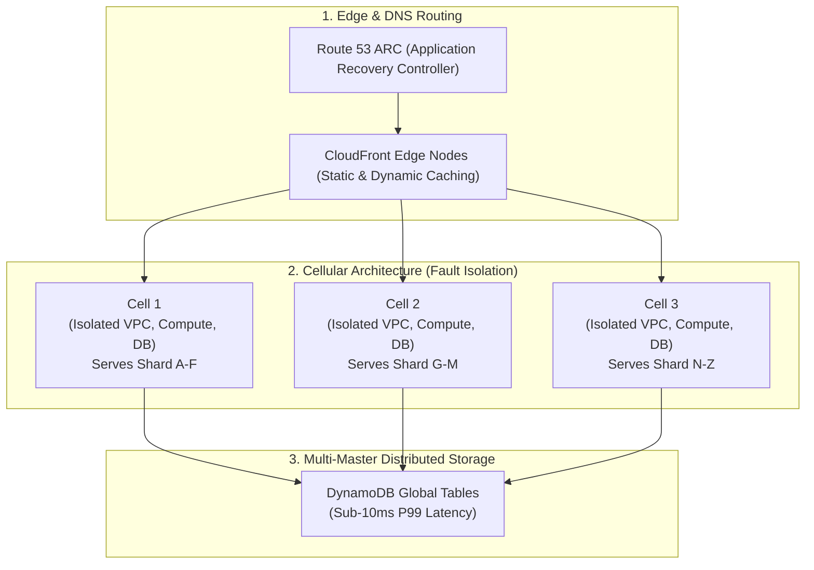
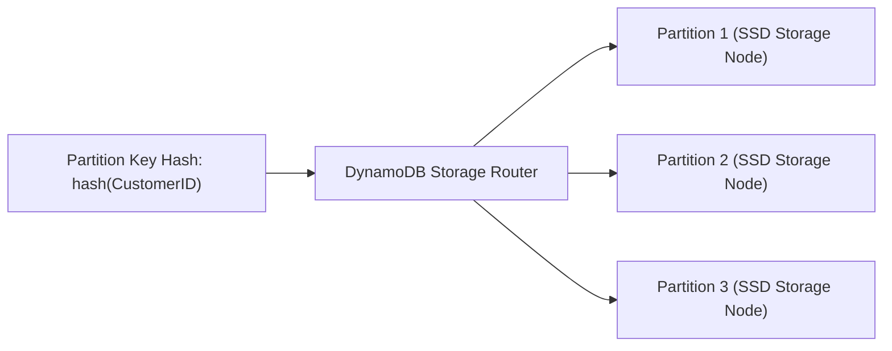

# How AWS Handled 2024 Prime Day’s Record-Breaking Traffic

## 1. Context & The Scale of Prime Day

Amazon Prime Day is one of the highest-traffic global e-commerce events in history.
During Prime Day 2024:
- **Amazon DynamoDB** maintained high availability while peaking at **hundreds of millions of requests per second**.
- **AWS Lambda** executed trillions of invocations across the 48-hour event.
- **Amazon Aurora & EBS** processed tens of petabytes of transactional volume per hour without dropping transactions.

Operating at this scale cannot rely on simple "auto-scaling" of monolithic clusters. It requires architectural paradigms specifically engineered for fault isolation, predictable concurrency, and blast-radius minimization.

---

## 2. The Core Architecture Pillars of Hyper-Scale



---

## 3. Deep Dive: Cellular Architecture & Shuffle Sharding

### The Failure of Traditional "Giant Monoliths"
In a traditional architecture, all users hit a massive shared pool of 1,000 application servers backed by a single giant database. If a single toxic request (a "poison pill" payload) causes a memory leak or crash, the failure cascades across the entire cluster, taking down 100% of global customers.

### The Cellular Solution
Amazon breaks systems into self-contained, independent units called **Cells**:
- Each cell contains its own Application Load Balancers, ECS/EKS clusters, Redis caches, and database partitions.
- Cells have a hard ceiling on size (e.g., maximum 50,000 active shoppers).
- If Cell 2 experiences a failure, only a tiny percentage of users are impacted; the remaining 95%+ of customers experience zero downtime.

### Shuffle Sharding
To further isolate customers, Amazon uses **Shuffle Sharding**:
Instead of assigning a customer to a single cell, each customer is assigned a unique combination of shards (e.g., Shards [A, C]). Even if Shard A is degraded by a malicious query, Customer 2 (assigned to [B, D]) is completely unaffected.

```
Total Combinations = (N choose K)
From just 8 shards assigned in pairs of 2:
(8 choose 2) = 28 distinct virtual customer fault domains!
```

---

## 4. DynamoDB Architectural Mastery: Partitioning & On-Demand

DynamoDB powers Amazon's shopping cart and order processing pipeline. How does it handle hundreds of millions of requests per second?



1. **Uniform Key Distribution**: DynamoDB hashes the partition key (e.g., `MD5(customer_id)`) to distribute traffic evenly across thousands of physical storage nodes.
2. **Adaptive Capacity**: If a flash-sale item (a "hot key") receives a massive traffic spike, DynamoDB automatically shifts unused throughput from cold partitions to the hot partition within milliseconds, preventing throttling.
3. **Multi-Region Global Tables**: DynamoDB Global Tables replicate data across regions in under 1 second, providing local read/write latencies worldwide.

---

## 5. Principle of Static Stability & Graceful Degradation

Amazon designs systems to be **Statically Stable**:
> *"A system is statically stable if it can continue to operate normally even if its dependencies or external control planes become completely unavailable."*

### Examples in Practice:
- **Pre-Scaled Fleets**: Never rely on auto-scaling spinning up new EC2 instances in the middle of a Prime Day flash sale. Infrastructure is **pre-warmed and pre-scaled days in advance**.
- **Decoupled Control Planes**: Application nodes cache authorization tokens and configuration locally in memory. If AWS IAM or Parameter Store becomes slow or unreachable, active nodes keep running without interruption.
- **Graceful Degradation (Load Shedding)**:
  Under extreme strain, the system sheds non-critical features to protect the core checkout loop:
  1. *Core Loop (Never drops)*: "Buy Now" button, Payment Gateway, Order Confirmation.
  2. *Degraded Features (Disabled or Cached)*: Recommendation carousels ("Customers who bought this also bought..."), reviews count, personalized greeting banners.

---

## 6. Key Takeaways for DevOps Interviews

1. **Bulkhead Pattern / Blast Radius**: The primary objective of high-scale cloud architecture is not preventing all failures—hardware and networks *will* fail. The goal is **limiting the blast radius** to a fraction of users using cells and shuffle sharding.
2. **Circuit Breakers & Exponential Backoff with Jitter**: When backend services experience load, client retries without jitter can trigger a "retry storm" (thundering herd). Adding full jitter prevents retry synchronization:
   $$\text{Sleep} = \text{random}(0, \min(\text{max\_backoff}, \text{base} \times 2^{\text{attempt}}))$$
3. **Route 53 ARC**: AWS Route 53 Application Recovery Controller allows one-click, highly reliable multi-region traffic failover using independent, highly redundant cell health checks.