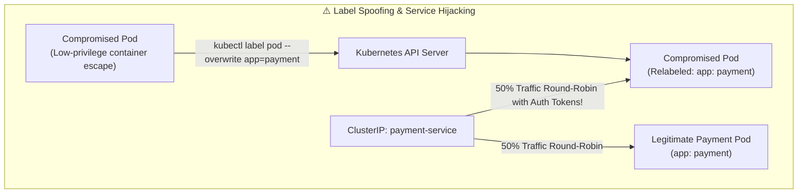

# Hidden Risks of Relying on Labels in Kubernetes Security

## 1. Context & The Core Problem

In Kubernetes, **Labels** are key-value pairs attached to objects (such as Pods, Services, and Deployments). They serve as the primary glue for:
- Routing traffic via **Services** (`spec.selector`)
- Enforcing microsegmentation via **NetworkPolicies** (`podSelector`)
- Controlling placement via **Affinity / Anti-Affinity**
- Monitoring via Prometheus scraping targets

### The Hidden Vulnerability:
> [!CAUTION]
> **Kubernetes labels are arbitrary, unauthenticated metadata.** They possess **zero cryptographic integrity**, and by default, any user or ServiceAccount with pod `update` or `patch` permissions can alter them at runtime.

Relying purely on labels for access control or network isolation creates catastrophic security loopholes.



---

## 2. Attack Vectors Exploiting Label Trust

### Vector 1: Traffic Hijacking via Service Selectors
If a rogue container or compromised CI runner attaches a label matching an existing Kubernetes Service:
```bash
kubectl label pod rogue-sniffer app=auth-service --overwrite
```
The Kubernetes `kube-proxy` immediately updates `iptables` / IPVS rules. Traffic intended for the authentication service will now be round-robined into the rogue pod, allowing attackers to sniff cleartext passwords and bearer tokens.

---

### Vector 2: NetworkPolicy Bypass
Consider a typical NetworkPolicy designed to allow only frontend pods to talk to the billing database:

```yaml
apiVersion: networking.k8s.io/v1
kind: NetworkPolicy
metadata:
  name: allow-frontend-to-db
spec:
  podSelector:
    matchLabels:
      role: database
  ingress:
    - from:
        - podSelector:
            matchLabels:
              role: authorized-frontend # ⚠️ Vulnerable selector
```

If an attacker compromises an untrusted public-facing analytics pod and runs:
```bash
kubectl patch pod analytics-worker -p '{"metadata":{"labels":{"role":"authorized-frontend"}}}'
```
The CNI plugin (Calico, Cilium, AWS VPC CNI) immediately opens firewall access to the database port!

---

## 3. How to Mitigate: The 4 Security Controls

### Control 1: Policy Enforcement via Kyverno or OPA Gatekeeper
Deploy an admission controller to block modifications to security-sensitive labels after pod creation:

```yaml
# Kyverno Policy: Prevent Label Mutation on Running Pods
apiVersion: kyverno.io/v1
kind: ClusterPolicy
metadata:
  name: protect-security-labels
spec:
  validationFailureAction: Enforce
  rules:
    - name: prevent-role-label-tampering
      match:
        any:
          - resources:
              kinds:
                - Pod
      validate:
        message: "Modifying security-critical labels (role, tier, security-zone) is strictly prohibited."
        deny:
          conditions:
            all:
              - key: "{{ request.operation }}"
                operator: Equals
                value: UPDATE
              - key: "{{ request.object.metadata.labels.role }}"
                operator: NotEquals
                value: "{{ request.oldObject.metadata.labels.role }}"
```

---

### Control 2: Namespace-Based Hard Isolation
Never rely on `podSelector` alone in a flat, multi-tenant namespace. Enforce strict **Namespace isolation** combined with `namespaceSelector`:

```yaml
apiVersion: networking.k8s.io/v1
kind: NetworkPolicy
metadata:
  name: isolated-db-policy
  namespace: finance-backend
spec:
  podSelector:
    matchLabels:
      app: rds-proxy
  ingress:
    - from:
        - namespaceSelector:
            matchLabels:
              # Only pods in the explicitly labeled, RBAC-protected namespace can connect
              kubernetes.io/metadata.name: payment-processing
          podSelector:
            matchLabels:
              app: payment-worker
```

Developers who have `edit` rights in `payment-processing` cannot alter namespaces or create pods in `finance-backend`.

---

### Control 3: Cryptographic Identity via Service Mesh (Istio / SPIFFE)
Replace insecure label-based network trust with **mTLS and SPIFFE IDs**:
- When Pod A connects to Pod B, Istio or Linkerd verifies the client's X.509 certificate.
- The certificate encodes the pod's cryptographically signed ServiceAccount identity:
  `spiffe://cluster.local/ns/production/sa/payment-service-account`
- Tampering with pod labels has **zero effect** because authorization policies inspect the SPIFFE identity inside the TLS handshake, not Kubernetes labels.

---

### Control 4: Cilium eBPF Security (Identity-Aware)
Modern Cilium eBPF networking derives a numeric security identity from metadata and enforces encryption at the kernel level, auditing and blocking label spoofing attempts before packets hit the wire.

---

## 4. Key Takeaways for Kubernetes Security Interviews

1. **Labels are Metadata, Not Identity**: Never treat Kubernetes labels as authentication credentials or authorization boundaries.
2. **Principle of Least Privilege for RBAC**: Restrict `pods/edit`, `pods/patch`, and `deployments/patch` permissions. Developers should deploy via GitOps (ArgoCD) rather than having interactive patch rights against production namespaces.
3. **Admission Webhooks**: Always run Kyverno or OPA Gatekeeper in production clusters to enforce immutability on sensitive labels and prevent privileged container escalation.