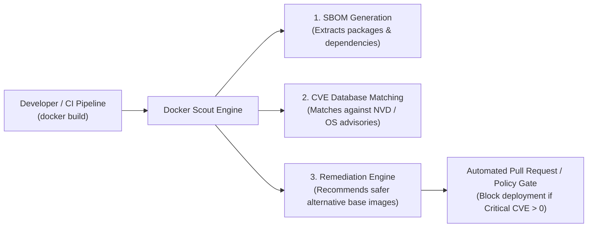

# Detecting and Mitigating Image Vulnerabilities with Docker Scout

## 1. Context & The Container Supply Chain Threat

Modern container images contain layers of software dependencies:
- **Base OS packages** (OpenSSL, glibc, curl, system utilities)
- **Runtime platforms** (Node.js, Python, OpenJDK)
- **Application dependencies** (npm, PyPI, Maven libraries)

Over 80% of reported vulnerabilities (CVEs) in production container images originate not from your custom application code, but from **inherited base images and unpruned transitive dependencies**.

**Docker Scout** is a container security tool integrated directly into the Docker CLI and Docker Desktop that generates a complete **Software Bill of Materials (SBOM)**, analyzes vulnerabilities against CVE databases, and provides automated base image update recommendations.



---

## 2. Docker Scout CLI Commands & Practical Workflow

### Step 1: Scan an Image for Vulnerabilities
```bash
# Scan local or remote image
docker scout cves my-company/payment-api:v1.0.0
```

*Example Output:*
```
Target:        my-company/payment-api:v1.0.0
Base image:    node:18.12.0-alpine3.16

Packages:      389
Vulnerabilities: 14 (Critical: 2, High: 5, Medium: 6, Low: 1)

CRITICAL CVE-2023-38545
Package:      curl 7.83.1-r3
Fixed in:     curl 7.83.1-r4
Description:  SOCKS5 heap buffer overflow vulnerability

HIGH CVE-2023-44487
Package:      nghttp2 1.47.0-r0
Fixed in:     nghttp2 1.47.0-r2
Description:  HTTP/2 Rapid Reset DDoS vulnerability
```

---

### Step 2: Get Automated Base Image Recommendations
Instead of manually hunting for which base image fixes the issues, use `recommendations`:

```bash
docker scout recommendations my-company/payment-api:v1.0.0
```

*Output:*
```
Current base image: node:18.12.0-alpine3.16 (14 vulnerabilities)

Recommended alternatives:
 ↳ node:20.12.2-alpine3.19
   Reduces vulnerabilities by 100%!
   0 Critical, 0 High, 0 Medium, 1 Low

 ↳ node:20-bookworm-slim
   Reduces vulnerabilities by 85%!
```

---

### Step 3: Compare Images (`docker scout compare`)
Verify that an updated image successfully remediates vulnerabilities before pushing to production:

```bash
docker scout compare my-company/payment-api:v2.0.0 --to my-company/payment-api:v1.0.0
```

---

## 3. Integrating Docker Scout into GitHub Actions CI/CD

Block builds automatically if **Critical** or **High** vulnerabilities are detected:

```yaml
name: "Container Security Scan (Docker Scout)"

on:
  pull_request:
    branches: [main]
  push:
    branches: [main]

jobs:
  build-and-scan:
    runs-on: ubuntu-latest
    steps:
      - name: Checkout Code
        uses: actions/checkout@v4

      - name: Set up Docker Buildx
        uses: docker/setup-buildx-action@v3

      - name: Log in to Docker Hub
        uses: docker/login-action@v3
        with:
          username: ${{ secrets.DOCKERHUB_USER }}
          password: ${{ secrets.DOCKERHUB_TOKEN }}

      - name: Build Docker Image
        run: |
          docker build -t my-company/auth-service:${{ github.sha }} .

      - name: Docker Scout CVE Scan
        uses: docker/scout-action@v1
        with:
          command: cves
          image: my-company/auth-service:${{ github.sha }}
          only-severities: critical,high
          exit-code: true # Fails pipeline if Critical or High CVEs are found
          summary: true   # Outputs rich markdown summary directly into GitHub Actions

      - name: Docker Scout Compare against Production
        uses: docker/scout-action@v1
        if: github.event_name == 'pull_request'
        with:
          command: compare
          image: my-company/auth-service:${{ github.sha }}
          to: my-company/auth-service:latest
          only-severities: critical,high
```

---

## 4. Best Practices to Remediate Image Vulnerabilities

1. **Adopt Distroless or Minimal Slim Bases**: Moving from `node:latest` (Ubuntu-based, ~1,200 packages, 40+ CVEs) to `gcr.io/distroless/nodejs20` (zero OS shell, ~15 packages) eliminates 95% of reported CVEs instantly.
2. **Rebuild Base Images Frequently**: CVEs are discovered continuously. Schedule weekly automated builds to pull patched upstream base images (`docker build --no-cache`).
3. **Pin Package Versions**: Pin exact versions in your package managers (`package-lock.json`, `poetry.lock`, `go.sum`).
4. **Multi-Stage Builds**: Ensure build tools (`gcc`, `python3-dev`, `git`) never leak into the production runtime stage.

---

## 5. Key Takeaways for DevOps Interviews

- **SBOM (Software Bill of Materials)**: Executive Order 14028 and enterprise compliance (SOC2 / ISO 27001) mandate knowing every software component inside deployed artifacts. Docker Scout exports SBOM in SPDX or CycloneDX formats via `docker scout sbom`.
- **Policy Gates**: Security tools must be integrated into CI/CD as blocking gates. Catching vulnerabilities before registry push costs \$0; remediating an exploited zero-day in production costs millions.