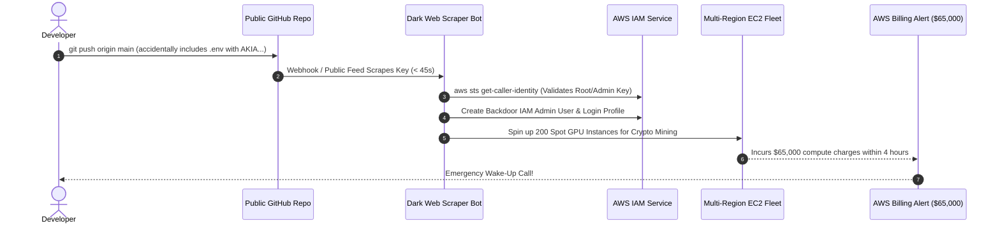
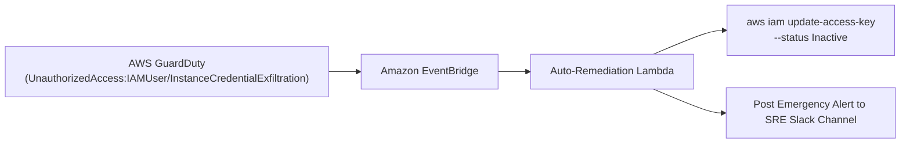

# Exposed AWS Keys and API Secrets: Anatomy of a Breach & Prevention

## 1. Context & The War Story

A security researcher made headlines by discovering exposed production AWS credentials and administrative API keys belonging to a **\$1 Billion Silicon Valley Venture Capital firm in just 5 clicks**.

How did this happen?
1. **Click 1**: Navigated to an intern's personal public GitHub repository.
2. **Click 2**: Searched repository commit history for `.env` or `config.json`.
3. **Click 3**: Found an unredacted AWS Access Key (`AKIA...`) and Secret Access Key committed 14 months prior.
4. **Click 4**: Ran `aws sts get-caller-identity` — the credentials had `AdministratorAccess`.
5. **Click 5**: Unrestricted access to private portfolio balance sheets, LP financial documents, and internal databases.

### The Threat Reality in 2026:
Automated botnets scrape GitHub public event streams (`https://api.github.com/events`) 24/7/365. When an engineer commits an AWS key:
- Within **45 seconds**, automated scrapers harvest the key.
- Within **2 minutes**, automated bots execute `sts get-caller-identity`, enumerate all S3 buckets, create rogue IAM users, and spin up massive GPU/compute clusters (`g5.48xlarge`, `c5.metal`) across multiple unmonitored AWS regions (e.g., `af-south-1`, `me-south-1`) for cryptocurrency mining.
- The company typically discovers the breach hours later via a **\$50,000+ AWS billing alert**.

---

## 2. Attack Lifecycle & Blast Radius



---

## 3. The 4 Layers of Defense-in-Depth

### Layer 1: Eliminate Long-Lived Access Keys Entirely
The modern security standard is **Zero Long-Lived Keys**:
- **Workloads on AWS (EC2/ECS/EKS/Lambda)**: Use **IAM Roles** and instance profiles. The AWS SDK automatically requests temporary, rotating 1-hour credentials via the Instance Metadata Service (IMDSv2).
- **CI/CD Pipelines (GitHub Actions / GitLab CI)**: Use **OpenID Connect (OIDC)** federated authentication. Temporary STS tokens expire as soon as the pipeline job terminates.
- **Developers**: Use **AWS IAM Identity Center (Single Sign-On - SSO)** via `aws sso login`. Local credentials in `~/.aws/credentials` expire automatically after 8 hours.

---

### Layer 2: Pre-Commit Hooks (Block Secrets at the Source)
Prevent secrets from ever leaving developer laptops. Integrate **Gitleaks** as a pre-commit hook:

```bash
# Install Gitleaks
brew install gitleaks # Or download binary

# Add to .pre-commit-config.yaml
repos:
  - repo: https://github.com/gitleaks/gitleaks
    rev: v8.18.2
    hooks:
      - id: gitleaks
```

If an engineer attempts to commit a file containing `AKIA...` or Stripe keys, Git halts the commit locally.

---

### Layer 3: GitHub Push Protection & Secret Scanning
Enable **GitHub Push Protection** across all organizational repositories:
- When enabled, GitHub inspects incoming pushes for known secret patterns (AWS, Slack, Datadog, Stripe, GCP).
- If a secret is detected, GitHub **rejects the git push outright**, preventing it from entering the git commit tree.

---

### Layer 4: Automated Incident Response with EventBridge & Lambda

If an access key is leaked or compromised, automated remediation must deactivate the key within seconds without human delay:



#### Auto-Revocation Lambda (Python / Boto3):
```python
import boto3
import json

iam = boto3.client('iam')
sns = boto3.client('sns')

def lambda_handler(event, context):
    # Triggered by AWS GuardDuty or AWS CompromisedKeyQuarantine policy
    detail = event.get('detail', {})
    user_name = detail.get('resource', {}).get('accessKeyDetails', {}).get('userName')
    access_key_id = detail.get('resource', {}).get('accessKeyDetails', {}).get('accessKeyId')
    
    if not user_name or not access_key_id:
        print("No user or key identified in event payload.")
        return
    
    print(f"🚨 ALERT: Deactivating compromised key {access_key_id} for user {user_name}")
    
    # 1. Immediately deactivate the access key
    iam.update_access_key(
        UserName=user_name,
        AccessKeyId=access_key_id,
        Status='Inactive'
    )
    
    # 2. Attach DenyAll policy to isolate user
    iam.attach_user_policy(
        UserName=user_name,
        PolicyArn='arn:aws:iam::aws:policy/AWSDenyAll'
    )
    
    print(f"✅ Successfully locked down compromised identity: {user_name}")
```

---

## 4. What to Do Immediately If an AWS Key Is Leaked

If you or your team accidentally exposes an AWS Access Key:
1. **Deactivate Key Immediately**: Run `aws iam update-access-key --access-key-id AKIAXXXX --status Inactive`. Do not delete it yet (keep for CloudTrail audit correlation).
2. **Check CloudTrail**: Search CloudTrail for `eventSource: "ec2.amazonaws.com"` or `eventName: "RunInstances"` initiated by that `accessKeyId` across all regions.
3. **Terminate Rogue Instances**: Terminate any unexpected EC2 instances, Lambda functions, or IAM users created in foreign regions.
4. **Purge Git History**: A simple `git revert` or deleting the file does **NOT** remove the key from Git history! Use `git-filter-repo` or BFG Repo-Cleaner to rewrite history and force-push.
5. **Contact AWS Support**: File an emergency Support Ticket with AWS to reverse fraudulent charges resulting from automated crypto-mining abuse.

---

## 5. Key Takeaways for DevOps Interviews

- **Root Account Keys**: Never generate access keys for the AWS Account Root User. Lock root with hardware MFA (YubiKey) and lock it in a safe.
- **Git History Persistence**: Deleting a secret in a subsequent commit leaves it in Git history forever. Attackers specifically clone repositories and run `git log -p` to harvest secrets from commits made months ago.
- **IMDSv2 Enactment**: Always enforce `HttpTokens=required` (IMDSv2) on EC2 instances to prevent Server-Side Request Forgery (SSRF) attacks from stealing temporary instance profile credentials.