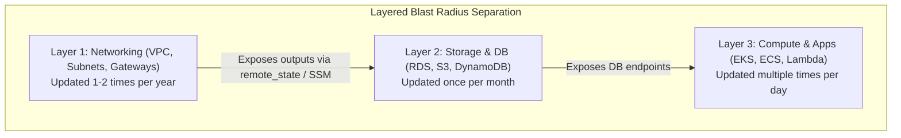

# Guide to a Well-Structured Production Terraform Project

## 1. Context & The Monolithic State Anti-Pattern

When engineering teams first adopt Terraform, they frequently place all infrastructure definitions into a single, flat directory containing one massive `main.tf` file (often 2,000+ lines).

### Why the "Monolithic Main.tf" Fails in Production:
- **Catastrophic Blast Radius**: A single typo or failed provider update can destroy the production database while trying to tweak a DNS record.
- **State File Bloat & Slow Plans**: Terraform must query every single cloud API to refresh state during `terraform plan`. On a 500-resource monolith, `terraform plan` can take 15 to 30 minutes!
- **State Lock Contention**: Only one engineer or CI pipeline can run operations at a time. The DynamoDB state lock is held constantly, creating team gridlock.
- **Accidental Environment Leakage**: Staging and production variables get intertwined, leading to accidental production outages.

---

## 2. Production Directory Layout: Enterprise Standard

The recommended architecture separates infrastructure by **Layer (Blast Radius)** and **Environment (Isolation)** using reusable Child Modules:

```
terraform-enterprise-repo/
├── modules/                         # Reusable, tested, unopinionated modules
│   ├── vpc/
│   │   ├── main.tf
│   │   ├── variables.tf
│   │   ├── outputs.tf
│   │   └── versions.tf
│   ├── eks-cluster/
│   │   ├── main.tf
│   │   ├── variables.tf
│   │   ├── outputs.tf
│   │   └── versions.tf
│   └── rds-aurora/
│       ├── main.tf
│       ├── variables.tf
│       └── outputs.tf
│
├── live/                            # Root configurations with isolated states
│   ├── dev/
│   │   ├── 01-networking/           # Isolated state 1
│   │   │   ├── backend.tf
│   │   │   ├── main.tf
│   │   │   ├── variables.tf
│   │   │   └── terraform.tfvars
│   │   ├── 02-database/             # Isolated state 2
│   │   └── 03-compute-eks/          # Isolated state 3
│   │
│   └── prod/
│       ├── 01-networking/
│       ├── 02-database/
│       └── 03-compute-eks/
│
└── .github/
    └── workflows/
        └── terraform-ci.yml
```

---

## 3. The 3 Architectural Rules of Well-Structured Terraform



### Rule 1: Layered State Files (Small Blast Radius)
Never mix rapidly changing compute workloads (EKS nodegroups, Lambdas) with foundational storage and networking (VPC, RDS). If compute state corrupts, your VPC and production database remain completely untouched.

### Rule 2: Decouple Modules from Backends & Providers
Reusable modules located inside `modules/`:
- **Must NEVER declare `provider "aws" { ... }` blocks.**
- **Must NEVER declare a `terraform { backend "s3" { ... } }` block.**
- Modules are generic blueprints; the root environment (`live/prod/01-networking`) instantiates the provider and declares the remote backend bucket.

### Rule 3: File Naming Hygiene
Every module must maintain consistent file separation:
- `main.tf`: Resource definitions and module calls.
- `variables.tf`: Explicit type declarations and descriptions for all input variables.
- `outputs.tf`: Exported attributes (ARNs, IDs, endpoints) for other modules to consume.
- `versions.tf`: Required Terraform core version and provider version constraints.
- `terraform.tfvars`: Environment-specific literal values (e.g., `cidr_block = "10.0.0.0/16"`).

---

## 4. Cross-Layer Communication: Passing Data Cleanly

How does `03-compute-eks` discover the subnet IDs created in `01-networking` without sharing a giant state file?

### Method A: AWS SSM Parameter Store (Recommended)
`01-networking` writes subnet IDs to AWS SSM Parameter Store:
```hcl
# In 01-networking/main.tf
resource "aws_ssm_parameter" "private_subnets" {
  name  = "/prod/network/private_subnet_ids"
  type  = "StringList"
  value = join(",", module.vpc.private_subnets)
}
```

`03-compute-eks` reads the parameter via standard data source:
```hcl
# In 03-compute-eks/main.tf
data "aws_ssm_parameter" "private_subnets" {
  name = "/prod/network/private_subnet_ids"
}

module "eks" {
  source     = "../../../modules/eks-cluster"
  subnet_ids = split(",", data.aws_ssm_parameter.private_subnets.value)
}
```

### Method B: `terraform_remote_state` Data Source
Enables read-only access to another layer's S3 state file outputs.

---

## 5. Workspaces vs. Directory-Based Isolation

| Approach | How It Works | Production Verdict |
|----------|--------------|-------------------|
| **Terraform Workspaces** | Single configuration directory, dynamic state switching (`terraform workspace select prod`) | Good for ephemeral review environments; risky for `prod` vs `dev` because accidental CLI state switching can apply staging vars to prod. |
| **Directory-Based Separation** (`live/dev` vs `live/prod`) | Separate directory trees, separate backends, separate IAM permissions | **Industry Best Practice for Enterprise.** Enables hard RBAC: CI runner for `dev` has zero AWS IAM permissions to touch `prod` S3 state bucket. |
| **Terragrunt** | Thin wrapper providing DRY configurations, automated dependency management, and remote state orchestration | Highly popular in mid-to-large enterprises to eliminate repeated backend/provider boilerplate. |

---

## 6. Key Takeaways for DevOps Interviews

1. **State Locking**: Always configure `dynamodb_table` alongside your S3 backend. State locking prevents race conditions where two engineers or pipelines run `terraform apply` concurrently and corrupt the JSON state file.
2. **Version Pinning**: Always pin both the Terraform core version (`required_version = "~> 1.8.0"`) and provider versions (`aws = "~> 5.40"`). Never use unpinned floating versions in production.
3. **Plan Output Files**: In automated CI/CD, always execute `terraform plan -out=tfplan` and subsequently run `terraform apply tfplan`. This guarantees that the exact changes reviewed during the plan phase are executed without race condition alterations.