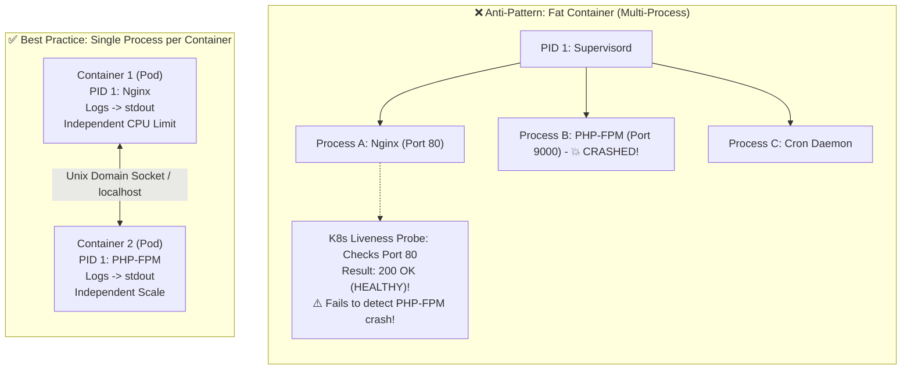

# Why Should a Container Have Only One Process? The Linux & K8s Reality

## 1. Context & The "Fat Container" Trap

Engineers transitioning from traditional Linux virtual machines (where `systemd` manages SSH, Nginx, PHP-FPM, Cron, and Logrotate concurrently) often attempt to treat Docker containers like miniature virtual machines.

They install an init supervisor like `supervisord`, `monit`, or even `systemd` inside a single Docker image to run multiple background services simultaneously.

While technically possible, running multiple independent services inside one container violates fundamental **Linux kernel container mechanics** and **Kubernetes orchestration guarantees**.



---

## 2. The Linux Kernel Mechanics: PID 1 & Zombie Reaping

In Linux, **PID 1** (traditionally `systemd` or `init`) has two critical, hard-coded kernel responsibilities:

### Responsibility 1: Reaping Zombie (Defunct) Processes
When a child process terminates, it enters the `zombie` state until its parent process invokes the `wait()` or `waitpid()` syscall to read its exit code and release its process table entry.
If the parent process dies before the child, the child becomes an **orphan**, and the Linux kernel automatically re-parents the orphan to **PID 1**.

If your container's PID 1 process (e.g., a simple Node.js or Python script) does **not** implement a zombie-reaping loop:
- Orphaned child processes remain permanently in the kernel process table as `<defunct>`.
- Over time, the Linux PID table (`/proc/sys/kernel/pid_max`) is completely exhausted.
- The host or container can no longer spawn any new processes, resulting in unexplained `fork: resource temporarily unavailable` system crashes.

---

### Responsibility 2: Signal Forwarding & Graceful Shutdown
When Kubernetes stops a pod (during a rolling deployment or node drain):
1. The container runtime sends **`SIGTERM` (Signal 15)** directly to **PID 1**.
2. A proper PID 1 process catches `SIGTERM`, flushes in-flight HTTP connections, completes database transactions, and forwards `SIGTERM` to all child processes.
3. If PID 1 does not forward signals, child processes continue running unaware of shutdown.
4. After the grace period (default: 30 seconds), Kubernetes sends **`SIGKILL` (Signal 9)**, violently terminating processes and corrupting in-flight transactions.

---

## 3. The 4 Operational Failures of Multi-Process Containers

### 1. Masked Health Checks (Silent Failures)
Kubernetes evaluates container health via Liveness and Readiness probes. If your container runs both Nginx and an application server:
- If the application server crashes or deadlocks, Nginx may continue returning HTTP 200 on `/healthz`.
- Kubernetes sees the container as healthy and keeps routing production traffic to a broken container!

### 2. Log Stream Fragmentation
The twelve-factor app standard mandates streaming logs directly to `stdout` and `stderr`.
- When a container runs a single process, `docker logs` and `kubectl logs` capture everything cleanly.
- In multi-process containers, processes write to disparate files on local disk (`/var/log/nginx/access.log`, `/var/log/app/error.log`), filling the root filesystem and breaking centralized logging pipelines (Fluentbit, Datadog).

### 3. Asymmetric Resource Contention & Scaling
If your web server needs 100m CPU and your background worker needs 4,000m CPU:
- Packaging them together forces you to scale both in lockstep, wasting massive compute capacity.
- Separating them allows Kubernetes Horizontal Pod Autoscaler (HPA) to scale background workers to 50 replicas while keeping web servers at 3 replicas.

### 4. Blast Radius of Process Crashes
In a single-process container, if the application crashes, the container exits immediately with a non-zero code. Kubernetes instantly detects the failure, triggers a restart, and notifies alerts. In a multi-process container, a crashed sub-process leaves the container running as an unmonitored zombie.

---

## 4. How to Fix PID 1 in Single-Process Containers: Tini & Dumb-Init

Many application runtimes (Node.js, Python, Java) were never designed to act as Linux PID 1.
To solve signal forwarding and zombie reaping cleanly in single-process containers, use **`tini`** or **`dumb-init`**:

```dockerfile
# Production Dockerfile with Tini Init
FROM node:20-alpine

# Install tini init daemon
RUN apk add --no-cache tini

WORKDIR /app
COPY package*.json ./
RUN npm ci --only=production
COPY . .

USER node

# Tini runs as PID 1, reaps zombies, and forwards SIGTERM cleanly to Node.js
ENTRYPOINT ["/sbin/tini", "--"]
CMD ["node", "dist/server.js"]
```

*(Note: Docker also provides a built-in flag: `docker run --init ...`)*

---

## 5. What If Services MUST Run Together? The Kubernetes Pod & Sidecar Pattern

If two processes genuinely require ultra-low latency inter-process communication (e.g., an Application and an Envoy Proxy, or an App and a Log-Shipper):

**Do not put them in the same container. Put them in the same Pod!**

```yaml
apiVersion: v1
kind: Pod
metadata:
  name: web-app-with-sidecar
spec:
  containers:
    # Main Container
    - name: application
      image: acme/payment-api:v2.1
      ports:
        - containerPort: 8080
    
    # Sidecar Container (Native K8s 1.29+ Sidecar feature)
    - name: envoy-proxy
      image: envoyproxy/envoy:v1.28
      restartPolicy: Always # Kubernetes manages sidecar lifecycle
```

### Why the Pod Pattern Wins:
- Both containers share the same **Network Namespace** (talk via `localhost` and shared ports).
- Both containers share the same **IPC / Shared Memory** volume.
- Each container has its own independent **PID 1**, its own **Liveness Probe**, and its own **`kubectl logs` stream**.

---

## 6. Key Takeaways for DevOps Interviews

1. **The Core Philosophy**: "One process per container" does not mean you cannot run threads or worker pools inside a process (e.g., Gunicorn or Nginx worker threads are fine). It means **one business capability / service boundary per container lifecycle**.
2. **Zombie Reaping**: When asked about PID 1 in interviews, mention `waitpid()` and the adoption of `tini` / `dumb-init` to prevent PID exhaustion.
3. **Decoupled Lifecycles**: Packaging distinct microservices together recreates the monolith inside a container image. Keep container boundaries strictly decoupled.