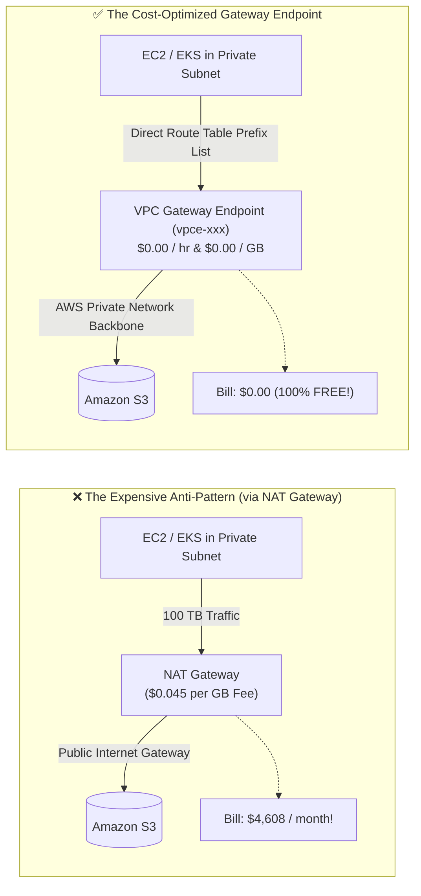

# AWS VPC Gateway Endpoints: The Most Underrated Cloud Cost Saver

## 1. Context & The \$4,500/Month NAT Gateway Bill

Every AWS cloud architect is familiar with the standard 3-tier VPC architecture:
- Applications, worker nodes, and databases live in **Private Subnets**.
- Outbound internet connectivity is routed through a **NAT Gateway** located in a public subnet.

### The Hidden Financial Trap:
AWS NAT Gateway charges two separate fees:
1. **Hourly Runtime Fee**: ~\$0.045 per hour per NAT Gateway (~\$32.40/month per AZ).
2. **Data Processing Fee**: **\$0.045 per Gigabyte (GB)** of data processed!

Consider a typical production application in private subnets that writes nightly database backups to Amazon S3, pulls container images from ECR/S3, or reads analytical datasets (e.g., 100 Terabytes per month):

$$\text{Monthly NAT Data Cost} = 100 \text{ TB} \times 1,024 \text{ GB/TB} \times \$0.045/\text{GB} = \mathbf{\$4,608.00 \text{ per month!}}$$

This entire bill is completely wasted spend.



---

## 2. What Is an AWS VPC Gateway Endpoint?

A **Gateway Endpoint** is a target in your VPC Route Table used for traffic destined to either **Amazon S3** or **Amazon DynamoDB**.

### Key Characteristics:
- **Zero Cost**: AWS charges **\$0.00 per hour** and **\$0.00 per GB** transferred.
- **High Performance**: Traffic never leaves the Amazon private network backbone; it never traverses the public internet or external gateways.
- **Zero Infrastructure to Manage**: Unlike NAT instances or proxies, Gateway Endpoints have virtually infinite bandwidth and cannot bottleneck.
- **Supported Services**: Gateway Endpoints exist **strictly for two services**: **S3** and **DynamoDB**. All other AWS services (KMS, Secrets Manager, SQS, STS) utilize **Interface Endpoints (AWS PrivateLink)**, which incur hourly and data charges.

---

## 3. How It Works Under the Hood: The Prefix List Route

When you create a Gateway Endpoint, AWS automatically assigns an AWS-managed **Prefix List ID** (e.g., `pl-63a5400a` for `com.amazonaws.us-east-1.s3`) and injects a route entry directly into your private subnet Route Tables:

```
VPC Route Table for Private Subnet:
Destination             Target
---------------------   -----------------
10.0.0.0/16             local
pl-63a5400a (S3 IPs)    vpce-0123456789abcdef0   <-- Gateway Endpoint overrides default route!
0.0.0.0/0               nat-0987654321fedcba0    <-- Remaining internet traffic goes to NAT
```

Because longest-prefix match routing applies, all requests targeting S3 public IP ranges automatically take the Gateway Endpoint path instead of the `0.0.0.0/0` NAT route!

---

## 4. Terraform Reference Blueprint

Deploying Gateway Endpoints across your VPC takes less than 15 lines of Terraform code and provides immediate cost elimination:

```hcl
# 1. AWS VPC Gateway Endpoint for Amazon S3
resource "aws_vpc_endpoint" "s3_gateway" {
  vpc_id            = aws_vpc.main.id
  service_name      = "com.amazonaws.us-east-1.s3"
  vpc_endpoint_type = "Gateway"

  # Automatically associates with your private route tables
  route_table_ids = aws_route_table.private[*].id

  tags = {
    Name        = "s3-vpc-gateway-endpoint"
    Environment = "production"
  }
}

# 2. AWS VPC Gateway Endpoint for Amazon DynamoDB
resource "aws_vpc_endpoint" "dynamodb_gateway" {
  vpc_id            = aws_vpc.main.id
  service_name      = "com.amazonaws.us-east-1.dynamodb"
  vpc_endpoint_type = "Gateway"

  route_table_ids = aws_route_table.private[*].id

  tags = {
    Name        = "dynamodb-vpc-gateway-endpoint"
    Environment = "production"
  }
}
```

---

## 5. Security Hardening: Endpoint Policies

By default, a Gateway Endpoint allows access to *any* S3 bucket in any AWS account.
You can attach an **Endpoint Policy** to prevent data exfiltration (e.g., preventing a rogue employee or compromised pod from uploading corporate databases to their personal AWS S3 bucket):

```hcl
# Restrict Gateway Endpoint strictly to internal company buckets
resource "aws_vpc_endpoint_policy" "s3_lockdown" {
  vpc_endpoint_id = aws_vpc_endpoint.s3_gateway.id

  policy = jsonencode({
    Version = "2012-10-17"
    Statement = [
      {
        Sid       = "AllowCorporateBucketsOnly"
        Effect    = "Allow"
        Principal = "*"
        Action = [
          "s3:GetObject",
          "s3:PutObject",
          "s3:ListBucket"
        ]
        Resource = [
          "arn:aws:s3:::acme-corp-*",
          "arn:aws:s3:::acme-corp-*/*"
        ]
      }
    ]
  })
}
```

---

## 6. Gateway Endpoints vs. Interface Endpoints

| Feature | Gateway Endpoint | Interface Endpoint (AWS PrivateLink) |
|---------|------------------|-------------------------------------|
| **Supported Services** | **S3 & DynamoDB ONLY** | SQS, SNS, KMS, Secrets Manager, ECR, + S3 |
| **Pricing** | **100% Free** (\$0/hr, \$0/GB) | ~\$0.01/hr per AZ + \$0.01/GB processed |
| **Network Implementation** | Route Table entry pointing to prefix list | Elastic Network Interface (ENI) with private IP in subnet |
| **On-Premise Access** | Cannot be accessed from Direct Connect / VPN | Can be accessed over Direct Connect, VPN & Peering |

> [!TIP]
> If on-premises servers need to access S3 over AWS Direct Connect, use an **Interface Endpoint** for on-premise routing, but keep the **Gateway Endpoint** active for all in-VPC traffic to ensure zero-cost transfers.

---

## 7. Key Takeaways for DevOps Interviews & Resumes

1. **The Instant FinOps Win**: Adding Gateway Endpoints to existing VPCs is one of the quickest, zero-risk ways to slash cloud bills by thousands of dollars per month without touching application code.
2. **Zero Performance Penalty**: Gateway Endpoints operate directly on the AWS hypervisor switching layer, eliminating NAT Gateway connection tracking state tables and packet latency.
3. **Audit Question**: *"How do you audit if private traffic is bypassing NAT?"* Enable VPC Flow Logs, filter by destination ENI of your NAT Gateway, and check for S3 IP addresses. If present, Gateway Endpoints are missing or route tables are misconfigured.