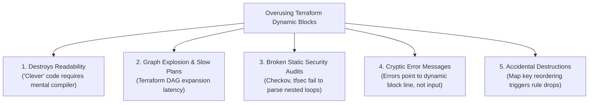

# The Problem With Overusing Terraform Dynamic Blocks: Anti-Patterns & Best Practices

## 1. Context & The "DRY" Obsession

When software developers transition into Infrastructure as Code (IaC), they bring general-purpose programming dogmas—most notably **DRY (Don't Repeat Yourself)**.

In Terraform HCL, the `dynamic` block construct was introduced in Terraform 0.12 to dynamically construct repeatable nested blocks inside resources (such as `ingress`, `egress`, `setting`, or `tag` blocks) based on a collection:

```hcl
# Example of a Dynamic Block
dynamic "ingress" {
  for_each = var.rules
  content {
    from_port   = ingress.value.from
    to_port     = ingress.value.to
    protocol    = ingress.value.proto
    cidr_blocks = ingress.value.cidrs
  }
}
```

While dynamic blocks have legitimate narrow use cases, **overusing them turns declarative, readable infrastructure code into an unmaintainable, un-debuggable nightmare**.

---

## 2. The 5 Major Production Pitfalls of Dynamic Blocks



---

### Pitfall 1: Readability & Cognitive Load
The primary superpower of Terraform is that it is **declarative**. An engineer reviewing a pull request should be able to glance at a resource and immediately see what infrastructure will exist.

When a resource is obscured by three layers of nested `dynamic`, `for`, `merge()`, and `try()` expressions, nobody on the on-call team can understand what the code actually creates during a 3:00 AM production outage.

---

### Pitfall 2: Static Analysis & Policy-as-Code Failures
Security scanners like **Checkov**, **Trivy**, **tfsec**, and **Open Policy Agent (OPA)** analyze static HCL syntax before deployment.
- Static scanners easily evaluate:
  `resource "aws_security_group" { ingress { cidr_blocks = ["0.0.0.0/0"] } }` $\rightarrow$ Flagged as **FAIL**.
- When rules are buried inside complex dynamic loops with runtime variable evaluation, security scanners frequently fail to resolve the graph statically, resulting in **false negatives** and allowing insecure configurations to slip into production.

---

### Pitfall 3: Graph Bloat & `terraform plan` Latency
Terraform evaluates dynamic blocks by expanding them into the internal **Directed Acyclic Graph (DAG)** during the configuration validation phase.
Massive nested dynamic blocks with hundreds of generated combinations cause graph evaluation times to balloon exponentially, slowing down CI/CD pipelines.

---

### Pitfall 4: Map Key Reordering Causes Production Outages
If your dynamic block iterates over an unordered map or a list where an item is removed from the middle:
- Terraform may drop and recreate multiple nested blocks instead of updating only the intended item.
- For AWS Security Groups with inline `ingress` blocks, recreating rules drops active TCP sessions in production!

---

## 3. Real-World Case Study: Security Groups

### ❌ The Anti-Pattern: Monolithic Dynamic Security Group
```hcl
# BAD: Hard to read, fragile, drops connections on reordering
resource "aws_security_group" "monolith_sg" {
  name   = "app-firewall"
  vpc_id = aws_vpc.main.id

  dynamic "ingress" {
    for_each = [
      for rule in var.firewall_rules : rule
      if rule.enabled && contains(["tcp", "udp"], rule.protocol)
    ]
    content {
      description = try(ingress.value.description, null)
      from_port   = ingress.value.from_port
      to_port     = ingress.value.to_port
      protocol    = ingress.value.protocol
      cidr_blocks = try(ingress.value.cidr_blocks, null)
      security_groups = try(ingress.value.source_sgs, null)
    }
  }
}
```

---

### ✅ The Production Best Practice: Standalone Rule Resources
Instead of using inline dynamic blocks inside `aws_security_group`, use standalone **`aws_vpc_security_group_ingress_rule`** and **`aws_vpc_security_group_egress_rule`** resources:

```hcl
# GOOD: Clean, modular, individually audited and updated without SG recreation
resource "aws_security_group" "app" {
  name        = "app-service-sg"
  description = "Security group for internal backend services"
  vpc_id      = aws_vpc.main.id

  tags = {
    Name = "app-service-sg"
  }
}

# Individual, readable rules with clear blast radius
resource "aws_vpc_security_group_ingress_rule" "allow_alb_http" {
  security_group_id            = aws_security_group.app.id
  description                  = "Allow HTTP from Application Load Balancer"
  referenced_security_group_id = aws_security_group.alb.id
  from_port                    = 8080
  to_port                      = 8080
  ip_protocol                  = "tcp"
}

resource "aws_vpc_security_group_ingress_rule" "allow_internal_metrics" {
  security_group_id = aws_security_group.app.id
  description       = "Allow Prometheus scraping from monitoring subnet"
  cidr_ipv4         = "10.0.50.0/24"
  from_port         = 9090
  to_port           = 9090
  ip_protocol       = "tcp"
}

resource "aws_vpc_security_group_egress_rule" "allow_all_outbound" {
  security_group_id = aws_security_group.app.id
  description       = "Allow all outbound traffic to NAT"
  cidr_ipv4         = "0.0.0.0/0"
  ip_protocol       = "-1"
}
```

### Why Standalone Rules Win:
1. **Zero Connection Drops**: Adding or modifying one rule does not touch the other rules or the parent Security Group.
2. **Clear Git Diffs**: When an engineer adds a port, the GitHub PR diff shows `+ 10 lines` in a dedicated rule, rather than modifying a shared dictionary.
3. **No Circular Dependencies**: Enables decoupling ingress rules when two security groups need to reference each other.

---

## 4. The Golden Rule: When ARE Dynamic Blocks Acceptable?

Dynamic blocks should be reserved **exclusively** for situations where:
1. The provider **does not offer a standalone sub-resource** (e.g., configuring `lifecycle_rule` inside an S3 bucket or `ordered_cache_behavior` inside CloudFront).
2. The count of blocks is **genuinely dynamic** and driven by variable conditions (e.g., adding an optional backup tag or an optional custom origin).
3. The logic inside the block is simple (no complex ternary or nested loops).

---

## 5. Key Takeaways for DevOps Interviews

1. **Clarity Over Cleverness**: In IaC, explicit code is superior to clever, highly compressed code. Code is read 100 times more often than it is written.
2. **Avoid Inline SG Blocks**: In AWS Terraform, never mix inline `ingress { ... }` blocks with standalone `aws_security_group_rule` resources; they will fight each other and overwrite rules during every plan.
3. **DRY vs. Decoupling**: Repeating 3 lines of HCL across two resources is vastly better than introducing a dynamic block that creates hidden dependencies.