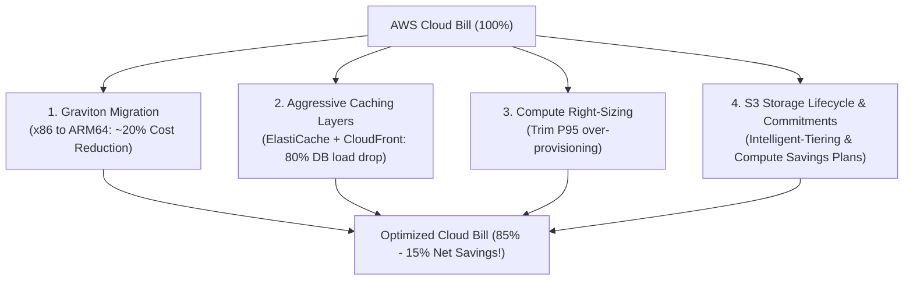

# How Levels.fyi Cuts Cloud Bill by 15%: Pragmatic FinOps for Lean Teams

## 1. Context & The Lean Engineering Mindset

Levels.fyi is one of the most visited compensation and career sites in tech, handling tens of millions of monthly pageviews with a remarkably lean engineering team.

As traffic scaled, their cloud infrastructure bill began to swell. Instead of raising more capital or blindly throwing bigger instances at traffic spikes, the engineering team conducted a surgical **FinOps optimization drive**, successfully slashing their monthly AWS bill by **15% to 20%** while simultaneously **improving application response times**.

Their playbook demonstrates that massive cloud savings do not require rewriting entire systems—they require understanding AWS cost curves and making targeted architectural adjustments.

---

## 2. The 4 Core Cost Optimization Pillars



---

## 3. Deep Dive into the 4 Optimization Moves

### Move 1: Migration to AWS Graviton (ARM64 Architecture)
AWS designs custom silicon chips based on the ARM architecture called **AWS Graviton** (Graviton2, Graviton3, Graviton4).
- **The Financial Advantage**: Graviton instances (e.g., `c7g`, `m7g`, `r7g`) cost **20% less per hour** than comparable x86 Intel (`c6i`) or AMD (`c6a`) instances.
- **The Performance Bonus**: For web applications (Node.js, Go, Python, Java), Graviton delivers up to **20–40% higher performance** per vCPU.

```
Instance Comparison (us-east-1 On-Demand):
• m6i.large (Intel x86):   $0.096 / hr  ($70.08 / month)
• m7g.large (Graviton ARM): $0.0816 / hr ($59.56 / month) -> 15% instant reduction!
```

#### How They Migrated with Zero Downtime:
1. Docker builds were updated to cross-compile multi-architecture images using Buildx:
   ```bash
   docker buildx build --platform linux/amd64,linux/arm64 -t acme/api:latest --push .
   ```
2. Migrated managed services first (**Amazon RDS** and **Amazon ElastiCache**). Switching RDS from `db.m5.large` to `db.m6g.large` requires **zero code changes**—it's a single dropdown click or Terraform line update during a maintenance window!
3. Migrated application compute nodes in ECS/EKS.

---

### Move 2: Aggressive Multi-Tier Caching (Protecting the Database)
Relational databases (PostgreSQL/MySQL on RDS) are typically the most expensive single line item on an AWS bill.

Instead of scaling RDS to larger instance sizes (`db.r6g.4xlarge` costing thousands per month):
1. **Edge Caching via CloudFront**: Cached public compensation pages, static assets, and company salary averages with reasonable TTLs (e.g., `Cache-Control: public, max-age=300`). CloudFront serves cached content for pennies, absorbing up to 80% of incoming web traffic before it ever hits backend compute.
2. **In-Memory Caching with Redis**: Cached heavy database queries (e.g., company percentile aggregations) in Redis. This allowed the primary RDS instance to drop from a large multi-core instance down to a modest size.

---

### Move 3: Compute Right-Sizing Based on P95 Utilization
Junior engineers often size EC2 instances or ECS task definitions based on theoretical maximum peaks (e.g., allocating 4 vCPUs and 8 GB RAM when the container never exceeds 0.5 vCPU and 1.2 GB RAM).

By analyzing **Amazon CloudWatch** and **AWS Compute Optimizer**:
- Identified instances running at sustained < 15% CPU utilization.
- Right-sized instances down by one or two tiers (e.g., `m6g.xlarge` $\rightarrow$ `m6g.large`).
- Tuned Horizontal Pod Autoscaler (HPA) to scale dynamically based on memory and request throughput, running minimal nodes during off-peak hours.

---

### Move 4: Compute Savings Plans & S3 Intelligent-Tiering

1. **Compute Savings Plans**:
   - Committing to a consistent compute spend (e.g., \$10/hour across EC2, Fargate, and Lambda) for 1 or 3 years yields up to **66% discounts** compared to On-Demand rates.
   - *Key Strategy*: Unlike standard EC2 Reserved Instances (which lock you into a specific instance family in a specific region), **Compute Savings Plans** automatically apply across instance family changes, region shifts, and even migrations from EC2 to Lambda/Fargate!
2. **S3 Intelligent-Tiering**:
   - Enabled S3 Intelligent-Tiering across historical file uploads and logs. AWS automatically shifts objects that haven't been accessed in 30 days to the Infrequent Access tier, and after 90 days to Archive Instant Access, saving up to 68% in storage fees without operational overhead.

---

## 4. The 15-Minute DevOps FinOps Checklist

You can audit any AWS account tomorrow and identify thousands in savings using this checklist:

| Check | Tool / Service | Action |
|-------|----------------|--------|
| **Unattached EBS Volumes** | EC2 Console $\rightarrow$ Volumes (Status: `available`) | Delete orphaned disks left behind from terminated EC2 instances. |
| **Old EBS Snapshots** | EC2 $\rightarrow$ Snapshots | Delete snapshots older than 90 days or automate via AWS Backup. |
| **Idle NAT Gateways** | VPC $\rightarrow$ NAT Gateways | Audit subnets; replace internal S3 traffic with free Gateway Endpoints. |
| **Unassociated Elastic IPs** | VPC $\rightarrow$ Elastic IPs | Release unattached EIPs (AWS charges \$0.005/hr for idle public IPs). |
| **EC2 / RDS Architecture** | Compute Optimizer | Identify candidate instances for Graviton (ARM64) migration. |

---

## 5. Key Takeaways for DevOps Interviews

1. **FinOps is an Engineering Discipline**: Modern senior engineers do not treat cloud bills as "the finance department's problem." Demonstrating cost optimization skills on your resume proves you understand business impact.
2. **Graviton Adoption**: Demonstrates practical modern sysadmin and containerization maturity (cross-platform Docker builds, ARM compatibility testing).
3. **Savings Plans vs Reserved Instances**: Always advocate for **Compute Savings Plans** over rigid standard RIs due to flexibility during architectural evolutions.