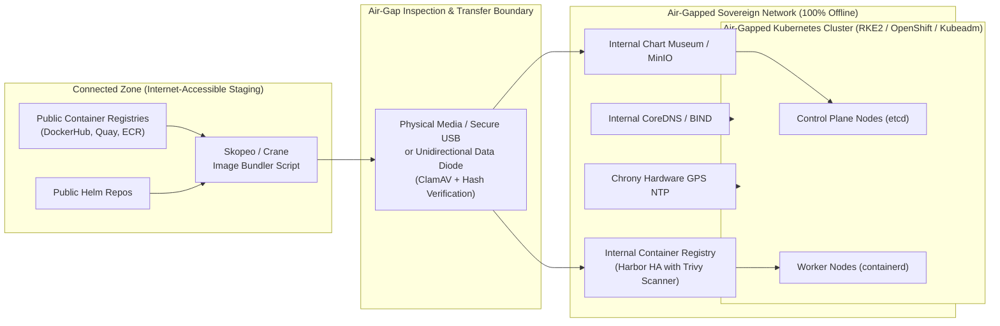

# Kubernetes Air-Gap Cluster Implementation: Zero-Trust Offline Architecture

## 1. Context & What Is an "Air-Gapped" Environment?

An **Air-Gapped** network is a computer network physically and logically isolated from unsecured external networks, especially the public Internet.

Air-gapped Kubernetes clusters are standard in:
- **Defense, Aerospace & Intelligence** (classified government networks)
- **Financial Core Banking & SWIFT Systems**
- **Industrial SCADA, Nuclear & Critical Infrastructure**
- **Sovereign Healthcare & Genomic Data Vaults**

In a true air-gapped environment:
- **Zero outbound or inbound internet connectivity** exists (no default route to `0.0.0.0/0`).
- Commands like `docker pull`, `helm repo add`, `apt-get install`, or `curl` immediately fail.
- All software artifacts, container images, Helm charts, OS patches, and security databases must be **inspected, cryptographically verified, and physically transferred** into the isolated boundary.

---

## 2. Core Architecture Blueprint



---

## 3. The 5 Essential Pillars of Air-Gapped Kubernetes

### 1. The Offline Kubernetes Distribution
Standard cloud-managed Kubernetes (like AWS EKS or GCP GKE) requires continuous connectivity to AWS/GCP regional APIs. For air-gapped deployments, use dedicated offline distributions:
- **RKE2 (Rancher Government Solutions)**: FIPS 140-2 validated, pre-packaged air-gap binary bundles.
- **Red Hat OpenShift Container Platform (Disconnected)**: Enterprise standard with Operator Lifecycle Manager (OLM) offline catalog mirroring.
- **K3s / Vanilla Kubeadm**: Lightweight, fully offline-capable.

---

### 2. Internal Container Registry (Harbor)
All images must be served locally. **Harbor** is the enterprise standard:
- Provides built-in vulnerability scanning (**Trivy** using pre-loaded offline CVE databases).
- Implements image signing and verification (**Notary / Cosign**) so workers only execute cryptographically approved images.
- Replaces upstream URLs: `docker.io/library/nginx:1.25` is rewritten to `registry.internal.corp/library/nginx:1.25`.

---

### 3. Container Runtime Image Mirroring via `containerd`
Instead of rewriting hundreds of third-party Helm charts to point to your internal registry, configure `containerd` registry mirrors in `/etc/containerd/config.toml`:

```toml
# /etc/containerd/config.toml on all worker nodes
[plugins."io.containerd.grpc.v1.cri".registry.mirrors]
  [plugins."io.containerd.grpc.v1.cri".registry.mirrors."docker.io"]
    endpoint = ["https://registry.internal.corp"]

  [plugins."io.containerd.grpc.v1.cri".registry.mirrors."quay.io"]
    endpoint = ["https://registry.internal.corp"]

  [plugins."io.containerd.grpc.v1.cri".registry.mirrors."registry.k8s.io"]
    endpoint = ["https://registry.internal.corp"]
```
Now, when a pod requests `registry.k8s.io/coredns:v1.11.1`, `containerd` automatically fetches it from `https://registry.internal.corp` transparently!

---

## 4. The Image Ingestion Workflow (Export $\rightarrow$ Scan $\rightarrow$ Import)

How do you get 50 container images into the air gap safely?

### Step 1: Export Images in Connected Zone using `skopeo`
```bash
#!/usr/bin/env bash
# export-images.sh (Run on internet-connected machine)

IMAGE_LIST=(
  "registry.k8s.io/kube-apiserver:v1.29.2"
  "registry.k8s.io/kube-controller-manager:v1.29.2"
  "registry.k8s.io/kube-scheduler:v1.29.2"
  "registry.k8s.io/kube-proxy:v1.29.2"
  "registry.k8s.io/etcd:3.5.10-0"
  "registry.k8s.io/coredns/coredns:v1.11.1"
  "calico/cni:v3.27.0"
  "calico/node:v3.27.0"
)

mkdir -p ./airgap-bundle
for img in "${IMAGE_LIST[@]}"; do
  # Sanitize name for tarball
  tarname=$(echo "$img" | tr '/:' '_').tar
  echo "📦 Archiving $img -> ./airgap-bundle/$tarname"
  skopeo copy "docker://$img" "docker-archive:./airgap-bundle/$tarname"
done

# Generate SHA256 checksum manifest
cd ./airgap-bundle && sha256sum *.tar > manifest.sha256
```

### Step 2: Security Gate Verification
1. Inspect bundle using antivirus and malware scanners.
2. Verify integrity: `sha256sum -c manifest.sha256`.
3. Transfer bundle across the air-gap via approved data diode or encrypted drive.

### Step 3: Ingest into Internal Harbor Registry
```bash
#!/usr/bin/env bash
# import-images.sh (Run inside the air-gapped network)

INTERNAL_REGISTRY="registry.internal.corp"

for archive in ./airgap-bundle/*.tar; do
  img_ref=$(skopeo inspect "docker-archive:$archive" | jq -r '.RepoTags[0]')
  target_ref="$INTERNAL_REGISTRY/${img_ref#*/}"
  echo "🚀 Pushing $archive -> docker://$target_ref"
  skopeo copy "docker-archive:$archive" "docker://$target_ref" --dest-tls-verify=false
done
```

---

## 5. Offline Infrastructure Services (NTP & DNS)

Two silent killers of air-gapped Kubernetes clusters:

1. **Clock Drift (etcd Failure)**: Kubernetes etcd consensus requires sub-10ms clock synchronization across control-plane nodes. Without access to public `pool.ntp.org`, deploy local **Chrony** servers synchronized with internal atomic clocks or GPS antennas.
2. **DNS Resolution**: CoreDNS must forward external requests to internal BIND / Active Directory DNS resolvers rather than public `8.8.8.8` or `1.1.1.1`.

---

## 6. Key Takeaways for DevOps & Security Interviews

1. **Supply Chain Security**: In an air gap, perimeter firewalls are not your only defense. Malicious code smuggled inside an unvetted container image bypasses the physical air gap. Enforce SBOM generation and binary image signing (Cosign).
2. **Operator Lifecycle Manager (OLM)**: When deploying operators (like Prometheus or Postgres Operator) in air-gapped OpenShift/Kubernetes, you must mirror the Operator catalog index and all associated bundle images.
3. **Containerd Mirroring**: Memorize how `containerd` config mirrors upstream registries; this saves teams from rewriting thousands of third-party manifest files.