# AWS Hexagonal Architecture: Decoupling Domain Logic from Cloud Infrastructure

## 1. Context & The "Cloud SDK Sprawl" Anti-Pattern

In typical serverless and microservices codebases, developers tightly couple business logic directly with cloud provider SDKs:

```python
# ❌ THE ANTI-PATTERN: Tightly coupled Lambda Handler
import boto3
import json

s3 = boto3.client('s3')
dynamodb = boto3.resource('dynamodb')

def lambda_handler(event, context):
    # Mixed: AWS API Gateway parsing + Business validation + DynamoDB persistence + S3 triggers
    user_id = event['pathParameters']['id']
    table = dynamodb.Table('Users')
    response = table.get_item(Key={'id': user_id})
    user = response.get('Item')
    
    if user['balance'] < 100:  # Business logic buried inside AWS glue code!
        raise Exception("Insufficient funds")
    
    table.update_item(...)
    s3.put_object(Bucket='invoices', ...)
```

### Why This Architecture Fails in Production:
1. **Impossible to Unit Test Locally**: Every unit test requires mocking complex AWS SDK objects (`boto3`, `botocore.exceptions`), running LocalStack, or deploying to a real AWS sandbox.
2. **Vendor Lock-In**: Porting this logic to a container, a CLI, GCP Cloud Functions, or an on-premise Kubernetes cluster requires a 100% rewrite.
3. **Fragile Upgrades**: When AWS updates SDK versions (e.g., AWS SDK v2 $\rightarrow$ v3 in Node.js), business logic breaks.

---

## 2. What Is Hexagonal Architecture (Ports & Adapters)?

Originally coined by Alistair Cockburn, **Hexagonal Architecture** divides software into three distinct zones:

```
[ Inbound Adapters ] ---> [ Inbound Ports ] ---> [ CORE DOMAIN ] <--- [ Outbound Ports ] <--- [ Outbound Adapters ]
  (API Gateway, SQS)      (Use Case Interfaces)   (Pure Logic)       (Repository API)       (DynamoDB, RDS, S3)
```



```mermaid
flowchart LR
    subgraph Drivers["Inbound (Driving) Adapters"]
        APIGW["API Gateway Lambda Adapter"]
        SQS["SQS Consumer Adapter"]
        TestRunner["Local Unit Test / CLI"]
    end

    subgraph Hexagon["Hexagonal Core Boundary"]
        subgraph InPorts["Inbound Ports"]
            OrderService["CreateOrderUseCase\n(Interface)"]
        end

        subgraph Core["Domain Business Logic (Pure Python / TS)"]
            DomainModel["Order, Customer, Price Calculator\n(Zero AWS SDK Imports!)"]
        end

        subgraph OutPorts["Outbound Ports"]
            OrderRepoPort["OrderRepository\n(Abstract Interface)"]
            NotifierPort["NotificationService\n(Abstract Interface)"]
        end
    end

    subgraph Driven["Outbound (Driven) Adapters"]
        DDBAdapter["DynamoDB Repository Adapter\n(boto3)"]
        MockRepo["In-Memory Dict Adapter\n(For Fast Unit Tests)"]
        SNSAdapter["Amazon SNS / SES Adapter"]
    end

    Drivers --> InPorts
    InPorts --> Core
    Core --> OutPorts
    OutPorts --> Driven
```

### The Golden Rule:
> **The Core Domain knows NOTHING about AWS.** It contains zero `import boto3`, zero JSON serialization logic, and zero HTTP status codes.

---

## 3. Directory Structure for AWS Lambda Hexagonal Project

```
order-service/
├── src/
│   ├── domain/                  # 1. PURE DOMAIN (No frameworks, no SDKs)
│   │   ├── models.py            # Order dataclass, status enums
│   │   └── exceptions.py        # InsufficientFundsError, OrderNotFoundError
│   │
│   ├── ports/                   # 2. CONTRACTS (Abstract Base Classes / Interfaces)
│   │   ├── inbound.py           # CreateOrderCommand, OrderUseCase
│   │   └── outbound.py          # OrderRepository, PaymentGatewayPort
│   │
│   └── adapters/                # 3. INFRASTRUCTURE & CLOUD GLUE
│       ├── inbound/
│       │   ├── lambda_api_gateway.py  # Translates APIGW Proxy Event -> Domain Command
│       │   └── lambda_sqs_worker.py   # Translates SQS Event -> Domain Command
│       └── outbound/
│           ├── dynamodb_repository.py # Implements OrderRepository using boto3
│           ├── in_memory_repository.py# Implements OrderRepository for unit testing
│           └── sns_notifier.py        # Implements NotifierPort using boto3
│
└── tests/
    ├── unit/                   # Tests run in 0.05 seconds with zero mocks!
    └── integration/            # Tests real DynamoDB tables in AWS sandbox
```

---

## 4. Production Code Implementation (Python)

### 1. The Core Domain (Zero Dependencies)
```python
# src/domain/models.py
from dataclasses import dataclass
from datetime import datetime
from decimal import Decimal

@dataclass
class Order:
    order_id: str
    customer_id: str
    amount: Decimal
    created_at: datetime

    def apply_discount(self, percent: Decimal):
        """Pure business logic - 100% testable in memory"""
        if percent < 0 or percent > 100:
            raise ValueError("Discount must be between 0 and 100")
        self.amount = self.amount * (1 - (percent / 100))
```

---

### 2. The Outbound Port (Interface Contract)
```python
# src/ports/outbound.py
from abc import ABC, abstractmethod
from src.domain.models import Order

class OrderRepository(ABC):
    @abstractmethod
    def save(self, order: Order) -> None:
        pass

    @abstractmethod
    def find_by_id(self, order_id: str) -> Order:
        pass
```

---

### 3. The Outbound DynamoDB Adapter
```python
# src/adapters/outbound/dynamodb_repository.py
import boto3
from src.ports.outbound import OrderRepository
from src.domain.models import Order

class DynamoDBOrderRepository(OrderRepository):
    def __init__(self, table_name: str):
        self.table = boto3.resource('dynamodb').Table(table_name)

    def save(self, order: Order) -> None:
        self.table.put_item(
            Item={
                'order_id': order.order_id,
                'customer_id': order.customer_id,
                'amount': str(order.amount),
                'created_at': order.created_at.isoformat()
            }
        )

    def find_by_id(self, order_id: str) -> Order:
        res = self.table.get_item(Key={'order_id': order_id})
        item = res.get('Item')
        # Translate DynamoDB schema back to pure Domain model
        return Order(...)
```

---

### 4. The Inbound Lambda Adapter (API Gateway Entrypoint)
```python
# src/adapters/inbound/lambda_api_gateway.py
import json
import os
from decimal import Decimal
from src.domain.models import Order
from src.adapters.outbound.dynamodb_repository import DynamoDBOrderRepository

# Dependency Injection setup
repo = DynamoDBOrderRepository(table_name=os.environ['ORDERS_TABLE'])

def handler(event, context):
    try:
        # Translate HTTP payload into Domain Objects
        body = json.loads(event['body'])
        order = Order(
            order_id=body['orderId'],
            customer_id=body['customerId'],
            amount=Decimal(str(body['amount'])),
            created_at=datetime.utcnow()
        )
        
        # Invoke business rule
        order.apply_discount(Decimal("10.0"))
        
        # Save via adapter
        repo.save(order)
        
        return {
            "statusCode": 201,
            "body": json.dumps({"status": "SUCCESS", "orderId": order.order_id})
        }
    except Exception as e:
        return {"statusCode": 400, "body": json.dumps({"error": str(e)})}
```

---

## 5. Key Takeaways for Senior DevOps & Cloud Architecture Interviews

1. **Test Speed & Reliability**: In a hexagonal codebase, 90% of your unit test suite runs in **sub-second time** using `in_memory_repository.py` without requiring Docker or LocalStack.
2. **Container or Lambda Flexibility**: If tomorrow the company decides to migrate from AWS Lambda to Kubernetes (Amazon EKS) or FastAPI, the domain and outbound adapters remain **100% identical**—you only write one new Inbound Adapter (a FastAPI router instead of a Lambda handler).
3. **Clean Code & Domain-Driven Design (DDD)**: High-growth companies prioritize developers who can separate cloud plumbing from business invariants. Hexagonal Architecture is the ultimate expression of this separation.