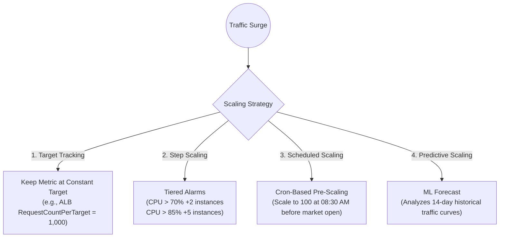

# Cloud Scaling Patterns Breakdown: Horizontal, Vertical & Queue-Based Leveling

## 1. Context & The Mechanics of Cloud Elasticity

In cloud engineering, **scalability** is the ability of a system to handle growing workloads gracefully by dynamically adjusting resources.
When traffic surges 100x during a flash sale or product launch, architectures either **absorb the load smoothly** or **cascade into database connection starvation, CPU thrashing, and HTTP 504 timeouts**.

---

## 2. Horizontal Scaling vs. Vertical Scaling

| Dimension | Vertical Scaling (Scale Up) | Horizontal Scaling (Scale Out) |
|-----------|-----------------------------|--------------------------------|
| **Mechanism** | Replacing an instance with a bigger machine (e.g., `t3.medium` $\rightarrow$ `r6g.16xlarge`) | Adding more identical instances behind a load balancer (e.g., 2 $\rightarrow$ 50 instances) |
| **Downtime** | Typically requires a reboot / failover maintenance window | **Zero downtime** (continuous rolling additions) |
| **Hardware Ceiling**| Hard physical ceiling (maximum instance size available in AWS) | **Virtually infinite** scale |
| **Fault Tolerance** | Single Point of Failure (if the giant box dies, everything dies) | High Availability (if 2 instances die, 48 remain active) |
| **Cost Curve** | Exponential (the largest instances carry price premiums) | Linear (pay exactly for the units running) |
| **Best For** | Monolithic legacy databases (PostgreSQL/Oracle) | Stateless microservices, APIs, containerized workers |

---

## 3. The 4 Auto Scaling Patterns in AWS



### Pattern 1: Target Tracking (The Modern Standard)
Instead of authoring complex math formulas, you specify a target metric:
- *"Maintain average CPU utilization across the fleet at 60%."*
- *"Maintain Application Load Balancer `RequestCountPerTarget` at 1,500 requests/minute per pod."*
AWS automatically adds or removes instances dynamically based on proportional calculus.

### Pattern 2: Scheduled Scaling (Beat the Cold-Boot Lag)
Auto-scaling takes 2 to 5 minutes to detect high CPU, launch new EC2 instances, execute user-data scripts, and pass health checks.
If your traffic spike is predictable (e.g., Black Friday 00:00 UTC or Stock Exchange open at 09:30 AM), **never wait for reactive alarms**. Schedule the cluster to scale up 30 minutes in advance.

### Pattern 3: Predictive Scaling (Machine Learning)
AWS analyzes 14 days of CloudWatch historical patterns, forecasts the traffic curve 48 hours into the future, and pre-scales capacity minutes before the anticipated surge arrives.

---

## 4. The Architectural Holy Grail: Queue-Based Load Leveling

In user-facing transactional systems (e.g., order checkout, image processing, ticket booking), fronting downstream relational databases with direct synchronous microservices leads to **database collapse**:

```mermaid
flowchart TD
    subgraph SynchronousFailure["❌ The Synchronous Crash (No Queue)"]
        Users1((100,000 Concurrent Users)) --> API1["API Servers (Scaled to 500 nodes)"]
        API1 -->|10,000 Concurrent SQL Connections| DB1[("PostgreSQL Database\n💥 Out of Connections / CPU 100%!")]
    end

    subgraph QueueLeveling["✅ Queue-Based Load Leveling (Smooth & Resilient)"]
        Users2((100,000 Concurrent Users)) --> API2["API Servers (Lightweight)"]
        API2 -->|Rapid Enqueue (< 5ms)| SQS[("Amazon SQS FIFO Queue\n(Buffers 500,000 messages safely)")]
        SQS -->|Pull at controlled rate (e.g. 50 workers)| Workers["Worker Fleet (Auto-scaled by Backlog)"]
        Workers -->|Safe connection pool (50 connections)| DB2[("PostgreSQL Database\n(Stable CPU 45% & 0% Errors)")]
    end
```

### How to Scale Workers: The "Backlog Per Instance" Metric
Never scale background queue workers based on **CPU utilization**! Workers processing heavy batches might idle while the queue grows by 200,000 messages.

Scale workers based on **Backlog Per Instance**:
$$\text{Backlog per Instance} = \frac{\text{ApproximateNumberOfMessagesVisible}}{\text{Running Worker Instances}}$$

If 1 worker can process 10 messages/minute, and acceptable latency is 5 minutes:
$$\text{Target Backlog per Instance} = 10 \times 5 = 50$$
When the backlog per instance exceeds 50, the Auto Scaling Group immediately provisions more workers.

---

## 5. Terraform Implementation: Target Tracking Scaling Policy

```hcl
# Auto Scaling Policy: ALB Request Count per Target
resource "aws_autoscaling_policy" "target_tracking_requests" {
  name                   = "alb-request-count-per-target"
  autoscaling_group_name = aws_autoscaling_group.app_asg.name
  policy_type            = "TargetTrackingScaling"

  target_tracking_configuration {
    predefined_metric_specification {
      predefined_metric_type = "ALBRequestCountPerTarget"
      resource_label         = "${aws_lb.app_alb.arn_suffix}/${aws_lb_target_group.app_tg.arn_suffix}"
    }

    # Maintain 1,200 requests per instance per minute
    target_value = 1200.0
  }
}
```

---

## 6. Key Takeaways for DevOps Interviews

1. **Scale-Out vs. Scale-In Asymmetry**: Scale out rapidly (aggressive alarms, small step thresholds) to preserve availability. Scale in slowly (use 300-second cooldown periods) to prevent "flapping" (rapidly cycling instances on and off).
2. **Statelessness is Mandatory**: To scale horizontally without dropping user state, session data must live outside compute nodes (in Redis, DynamoDB, or encrypted JWT tokens).
3. **Queue Leveling Trade-Off**: Queue-based load leveling trades **immediate real-time completion** for **system survivability and eventual consistency**. The user receives an instant "Order Received" confirmation while the backend processes the invoice asynchronously.