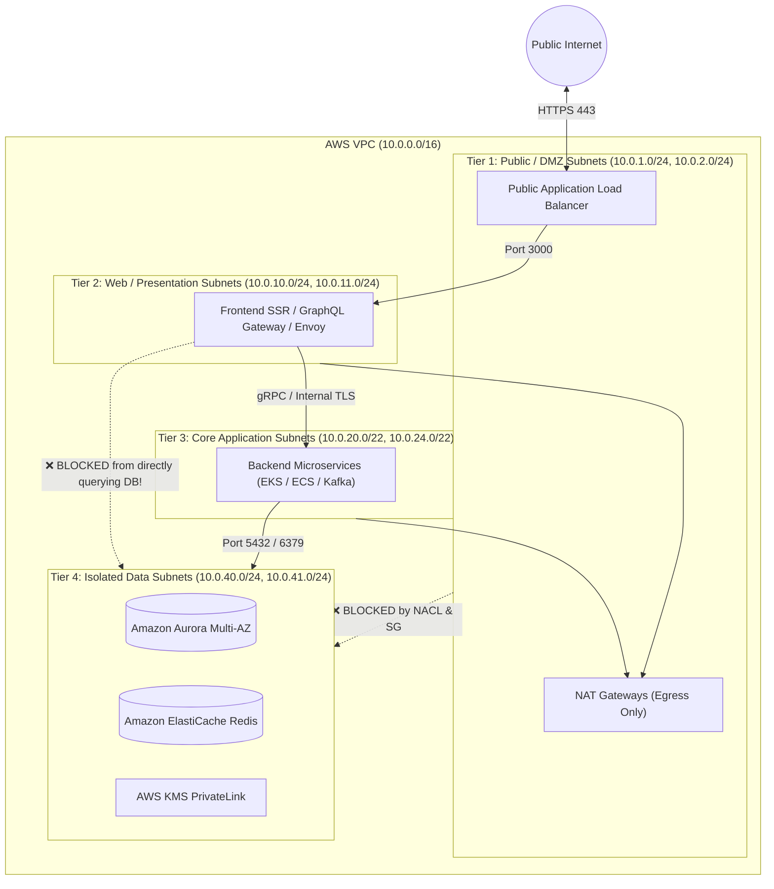

# AWS VPC Network Segmentation: The 4-Tier Zero-Trust Architecture

## 1. Context & The "Flat Network" Security Hazard

In basic tutorials, developers place applications, databases, and load balancers inside a single public subnet or a flat private subnet where every resource can communicate freely with any other resource.

### Why Flat Networks Fail Security Audits:
- **Lateral Movement**: If an attacker compromises a public-facing Node.js container via a remote code execution (RCE) zero-day, a flat network allows them to immediately scan, probe, and attack internal database ports (MySQL 3306, PostgreSQL 5432) directly.
- **Compliance Violations**: Standards like **PCI-DSS (Payment Card Industry)**, **HIPAA**, and **SOC 2 Type II** strictly mandate physical or logical network isolation between public entry points, application workloads, and database vaults holding cardholder/PII data.

The enterprise solution is **Multi-Tier Zero-Trust Network Segmentation**.

---

## 2. The 4-Tier Enterprise Segmentation Model



---

## 3. CIDR Allocation Matrix for High-Availability (3 AZs)

Allocating a `/16` VPC block (65,536 addresses) across 3 Availability Zones:

| Subnet Tier | AZ-A CIDR | AZ-B CIDR | AZ-C CIDR | Usable IPs / AZ | Target Workloads |
|-------------|-----------|-----------|-----------|-----------------|------------------|
| **Tier 1: Public (DMZ)** | `10.0.1.0/24` | `10.0.2.0/24` | `10.0.3.0/24` | 251 | Public ALBs, NAT Gateways |
| **Tier 2: Web / API** | `10.0.10.0/24` | `10.0.11.0/24` | `10.0.12.0/24` | 251 | Next.js SSR, Ingress Controllers |
| **Tier 3: App / EKS** | `10.0.16.0/21` | `10.0.24.0/21` | `10.0.32.0/21` | 2,043 | High-density Kubernetes Pods |
| **Tier 4: Isolated Data**| `10.0.40.0/24` | `10.0.41.0/24` | `10.0.42.0/24` | 251 | Aurora RDS, ElastiCache, HSM |

> [!NOTE]
> Tier 3 is given a `/21` block (2,048 IPs) per AZ because Kubernetes (AWS VPC CNI) assigns secondary private IPv4 addresses to every single running pod.

---

## 4. Multi-Layer Defense: Routing, NACLs & Security Groups

True segmentation uses defense-in-depth across three distinct AWS layers:

### Layer A: The Routing Layer
- **Tier 1 (Public)**: Route table has `0.0.0.0/0` $\rightarrow$ Internet Gateway (`igw-xxxx`).
- **Tier 2 & 3 (Private App)**: Route table has `0.0.0.0/0` $\rightarrow$ NAT Gateway (`nat-xxxx`).
- **Tier 4 (Data)**: Route table has **ZERO internet or NAT routes**. Contains only `10.0.0.0/16` $\rightarrow$ `local`. It is physically impossible for a database instance in Tier 4 to reach or be reached by the internet.

---

### Layer B: Stateless NACLs (Coarse Subnet Boundary Guards)
Network ACLs act as a perimeter firewall at the subnet boundary. They evaluate before Security Groups:

```hcl
# NACL blocking any direct traffic from Tier 1 (Public) into Tier 4 (Data)
resource "aws_network_acl_rule" "block_public_to_db" {
  network_acl_id = aws_network_acl.data_tier.id
  rule_number    = 50
  egress         = false
  protocol       = "tcp"
  rule_action    = "deny"
  cidr_block     = "10.0.1.0/24" # Tier 1 Public Subnet CIDR
  from_port      = 0
  to_port        = 65535
}
```

---

### Layer C: Stateful Security Groups (ENI Microsegmentation)
Security Groups enforce least-privilege traffic flows between instance tiers by referencing Security Group IDs rather than IP ranges:

```hcl
# Tier 4 RDS Security Group
resource "aws_security_group" "database" {
  name        = "tier4-database-sg"
  vpc_id      = aws_vpc.main.id
  description = "Strict DB access - only backend app tier allowed"
}

# Allow PostgreSQL ONLY from Tier 3 App instances
resource "aws_vpc_security_group_ingress_rule" "allow_backend_only" {
  security_group_id            = aws_security_group.database.id
  description                  = "PostgreSQL access from App Tier"
  referenced_security_group_id = aws_security_group.app_tier.id # Tier 3 SG!
  from_port                    = 5432
  to_port                      = 5432
  ip_protocol                  = "tcp"
}
```

---

## 5. Key Takeaways for DevOps & Security Interviews

1. **Defense-in-Depth Principle**: If an engineer misconfigures a Security Group rule by typing `0.0.0.0/0`, the **Route Table** and **NACL** still protect the database because Tier 4 has no default route to an Internet Gateway.
2. **Preventing Direct DB Queries from Frontend**: Even inside your private subnets, frontend SSR nodes should **never** have network access to RDS. If frontend pods get compromised by SSRF, they cannot access database credentials. Frontend must talk to backend APIs via gRPC/REST.
3. **AWS VPC CNI Sizing**: When planning CIDR blocks for Kubernetes, calculate pod density: a single `m5.2xlarge` worker node can attach up to 4 ENIs with 15 secondary IPs each = 58 pods per node. Plan your subnet CIDRs accordingly.