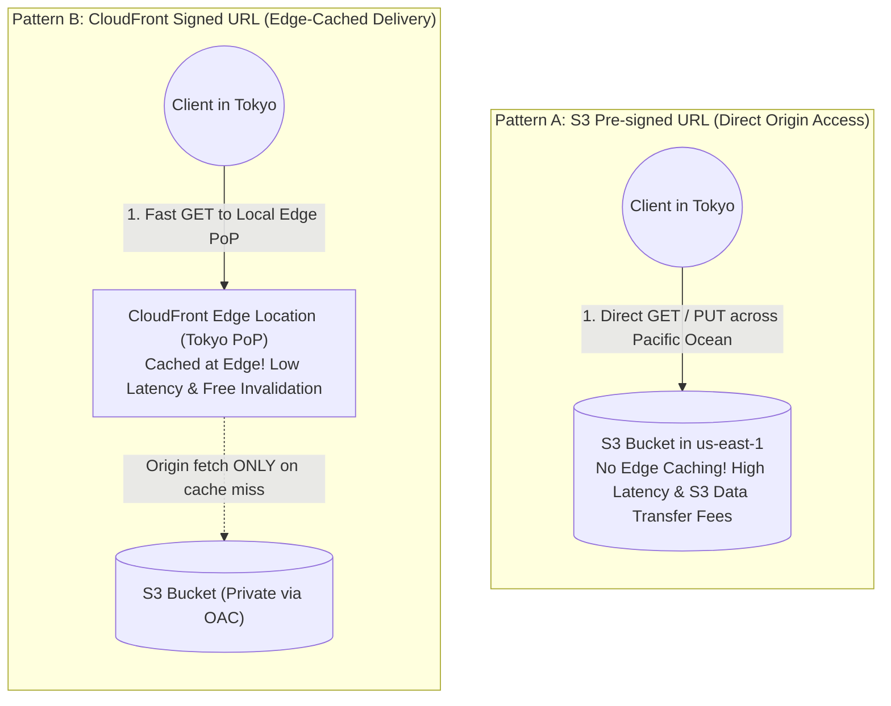
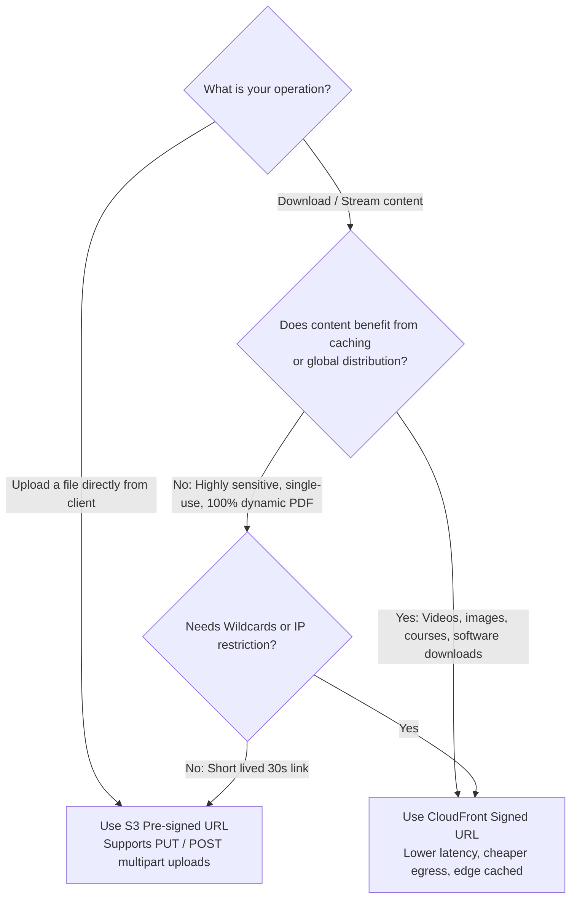

# CloudFront Signed URL vs. S3 Presigned URL: When to Use What?

## 1. Context & The Core Problem

When building cloud applications that serve private or restricted media—such as paid video streaming, digital courses, SaaS PDF invoices, medical records, or user profile uploads—you must prevent unauthorized public access while granting **temporary, authenticated access** to authorized users.

AWS offers two distinct mechanisms to achieve this:
1. **Amazon S3 Pre-signed URLs**
2. **Amazon CloudFront Signed URLs (and Signed Cookies)**

While both generate time-limited, cryptographically signed links, choosing the wrong one can lead to **crippling global latency, exorbitant data egress bills, or security compliance failures**.

---

## 2. Architecture Comparison



---

## 3. Comprehensive Comparison Matrix

| Architectural Feature | Amazon S3 Pre-signed URL | Amazon CloudFront Signed URL |
|-----------------------|--------------------------|------------------------------|
| **Primary Purpose** | **Direct Uploads (PUT/POST)** & single-file private downloads | **High-speed content distribution & media streaming (GET)** |
| **Edge Caching** | ❌ **No**. Every request hits the origin S3 bucket directly. | ✅ **Yes**. Cached at 600+ CloudFront edge locations globally. |
| **Supported HTTP Methods** | `GET`, `PUT`, `POST`, `DELETE`, `HEAD` | `GET`, `HEAD` (Download only) |
| **Cryptographic Mechanism** | **AWS SigV4** (Uses IAM credentials / STS role) | **RSA-SHA1 / Public Key Pairs** (CloudFront Key Groups) |
| **Multi-File / Wildcard Support** | ❌ **No**. Exactly 1 URL for 1 specific S3 object key. | ✅ **Yes**. Can sign wildcard paths (e.g., `https://cdn.acme.com/courses/101/*`) |
| **IP Address Whitelisting** | ❌ Limited / complex policy conditions | ✅ **Native**. Can restrict URL to a specific client CIDR IP. |
| **Latency for Global Users** | High (Traverses public internet to origin region) | Ultra-low (Terminates at closest local edge PoP) |
| **Data Transfer Cost** | High (S3 standard data transfer out: \$0.09/GB) | **Lower** (CloudFront egress discounts + free edge hits) |

---

## 4. The Decision Tree: Which One Should You Pick?



---

## 5. Code Implementation Examples

### Example A: Generating an S3 Pre-signed URL for Direct Upload (Python / boto3)
```python
import boto3
from botocore.config import Config

s3_client = boto3.client('s3', region_name='us-east-1', config=Config(signature_version='s3v4'))

# Generates URL allowing client to PUT an image directly into S3
upload_url = s3_client.generate_presigned_url(
    ClientMethod='put_object',
    Params={
        'Bucket': 'acme-user-avatars',
        'Key': 'uploads/user-42/avatar.png',
        'ContentType': 'image/png'
    },
    ExpiresIn=300,  # 5 minutes
    HttpMethod='PUT'
)
```

---

### Example B: Generating a CloudFront Signed URL for HLS Video Streaming (Python)
CloudFront Signed URLs support **Canned Policies** (simple expiration) and **Custom Policies** (wildcards, IP restrictions, date ranges):

```python
from datetime import datetime, timedelta
from cryptography.hazmat.backends import default_backend
from cryptography.hazmat.primitives import hashes
from cryptography.hazmat.primitives.asymmetric import padding
from cryptography.hazmat.primitives.serialization import load_pem_private_key
from botocore.signers import CloudFrontSigner

def rsa_signer(message):
    with open("cloudfront_private_key.pem", "rb") as key_file:
        private_key = load_pem_private_key(key_file.read(), password=None, backend=default_backend())
    return private_key.sign(message, padding.PKCS1v15(), hashes.SHA1())

# CloudFront Key Group Public Key ID
KEY_PAIR_ID = "K2JC3NDYYYYYY"
DISTRIBUTION_DOMAIN = "https://media.acme.com"

cf_signer = CloudFrontSigner(KEY_PAIR_ID, rsa_signer)

# Sign an entire HLS video directory with a single signed URL!
# Allows the video player to load playlist.m3u8 AND all .ts video chunks!
signed_url = cf_signer.generate_presigned_url(
    url=f"{DISTRIBUTION_DOMAIN}/hls/course-101/*",
    date_less_than=datetime.utcnow() + timedelta(hours=2)
)
```

---

## 6. What About CloudFront Signed Cookies?

When delivering hundreds of media files or an entire protected web application (e.g., an HLS/DASH video stream with thousands of 2-second `.ts` video segments):
- Appending query strings (`?Expires=...&Signature=...`) to every single media request breaks media players and clutters URLs.
- **CloudFront Signed Cookies** solve this by storing the cryptographic signature inside the user's browser cookie (`CloudFront-Policy`, `CloudFront-Signature`, `CloudFront-Key-Pair-Id`). The client browser sends the cookie automatically on every subsequent asset fetch without modifying URLs.

---

## 7. Key Takeaways for DevOps Interviews

1. **Uploads $\rightarrow$ S3 Presigned**: CloudFront Signed URLs do not support uploading binary files via `PUT` or `POST`. For file uploads, S3 Pre-signed URLs are the only option.
2. **Downloads $\rightarrow$ CloudFront Signed**: Serving gigabytes of downloadable software or video directly through S3 Presigned URLs wastes massive bandwidth and hits S3 API rate limits (`3,500 PUT / 5,500 GET per prefix per second`). Always front downloads with CloudFront.
3. **Key Management**: S3 Pre-signed URLs derive authority from the **IAM identity** that generated them. If the IAM user/role is deleted or loses `s3:GetObject` permission, existing pre-signed URLs stop working immediately. CloudFront signatures rely on the **CloudFront Public/Private Key Pair**, remaining valid until their embedded expiration timestamp.