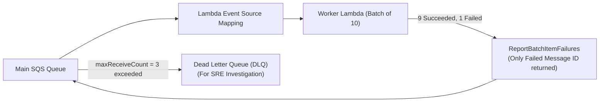

# AWS Lambda Integration Patterns with SQS & SNS: Resilient Event-Driven Architectures

## 1. Context: Synchronous vs. Asynchronous Decoupling

In distributed microservices, direct HTTP calls between services create brittle, tightly coupled dependency chains:
If Service A calls Service B, which calls Service C:
- Latency is cumulative: $T_{\text{total}} = T_A + T_B + T_C$.
- Availability degrades exponentially: If each service has 99% uptime, composite uptime is $0.99^3 = 97.0\%$.
- If Service C crashes, the failure cascades backward, bringing down Service A.

To build fault-tolerant, resilient architectures, AWS cloud engineers decouple systems using **Amazon SNS (Pub/Sub)** and **Amazon SQS (Message Queuing)** combined with **AWS Lambda**.

---

## 2. SNS vs. SQS: Core Differences

| Feature | Amazon SNS (Simple Notification Service) | Amazon SQS (Simple Queue Service) |
|---------|------------------------------------------|-----------------------------------|
| **Paradigm** | **Publish / Subscribe (1-to-Many Fan-out)** | **Message Queue (1-to-1 Point-to-Point)** |
| **Delivery Model** | Push (Pushes message immediately to subscribers) | Pull / Polling (Consumer polls or ESM polls) |
| **Persistence** | Ephemeral (If no subscribers exist, message is dropped) | Persistent (Stores messages up to 14 days) |
| **Backpressure** | None (Subscribers must absorb real-time traffic spikes) | **Full Backpressure Buffer** (Consumers process at their own pace) |
| **Ordering** | FIFO topics available (up to 300 msg/s) | Standard or FIFO queues |

---

## 3. The 4 Essential Integration Patterns

```mermaid
flowchart TD
    subgraph Pattern1["Pattern 1: SNS-to-SQS Fan-Out Pattern"]
        direction TB
        OrderService["Order Service (Publisher)"] -->|Publish 'OrderPlaced' Event| SNSTopic["Amazon SNS Topic\n(order-events)"]
        
        SNSTopic -->|Subscription A| SQS_Billing["Billing Queue (SQS)"]
        SNSTopic -->|Subscription B (Filter: Fraud)| SQS_Fraud["Fraud Detection Queue (SQS)"]
        SNSTopic -->|Subscription C| SQS_Email["Email Notification Queue (SQS)"]

        SQS_Billing --> Lambda_Billing["Billing Lambda"]
        SQS_Fraud --> Lambda_Fraud["Fraud ML Lambda"]
        SQS_Email --> Lambda_Email["SES Notifier Lambda"]
    end
```

### Pattern 1: The SNS $\rightarrow$ SQS Fan-Out Pattern
When an event occurs (e.g., `OrderPlaced`):
- The publisher pushes **one single message** to the SNS Topic.
- SNS duplicates and fans out the message to 3 separate SQS queues.
- Each queue acts as a shock absorber for its dedicated consumer Lambda.
- If the Email service is down for maintenance, messages accumulate safely in `SQS_Email` without affecting Billing or Fraud Detection!

---

### Pattern 2: SNS Message Filtering (Zero-Cost Routing)
SNS allows subscribers to define **Subscription Filter Policies**:
- Instead of invoking a Lambda function only to check `if event['type'] != 'international': return`, SNS evaluates the JSON attributes at the edge for **free**.
- Only messages matching the filter criteria are routed to the target queue.

---

### Pattern 3: Queue-Buffered Throttling Control
When Lambda processes messages from an SQS queue, it does so via an AWS-managed **Event Source Mapping (ESM)**.
By default, the ESM can scale up to 1,000 concurrent Lambda executions within minutes, potentially overwhelming downstream relational databases.

**The Solution**: Configure **`maximum_concurrency`** on the Event Source Mapping:
```hcl
resource "aws_lambda_event_source_mapping" "sqs_trigger" {
  event_source_arn = aws_sqs_queue.orders.arn
  function_name    = aws_lambda_function.process_order.arn
  batch_size       = 10

  # Strict ceiling: Never run more than 20 concurrent Lambdas
  # Guaranteed protection for PostgreSQL RDS connection pool!
  scaling_config {
    maximum_concurrency = 20
  }
}
```

---

### Pattern 4: Dead Letter Queue (DLQ) & Partial Batch Failure



#### The `ReportBatchItemFailures` Pattern:
In naive setups, if 1 message in a batch of 10 fails, the entire batch fails and is retried, resulting in duplicate processing of the 9 successful items.

Modern Lambda architectures enable **`ReportBatchItemFailures`**:

```python
# Python Lambda Handler with Partial Batch Failure Reporting
def lambda_handler(event, context):
    batch_item_failures = []
    
    for record in event['Records']:
        message_id = record['messageId']
        try:
            payload = json.loads(record['body'])
            process_transaction(payload) # Business logic
        except Exception as e:
            print(f"Failed to process message {message_id}: {e}")
            # Tell AWS SQS to retry ONLY this specific message!
            batch_item_failures.append({"itemIdentifier": message_id})
            
    return {
        "batchItemFailures": batch_item_failures
    }
```

---

## 4. Terraform Reference Implementation

```hcl
# 1. Main SQS Queue with DLQ Redrive
resource "aws_sqs_queue" "orders_dlq" {
  name                      = "orders-processing-dlq"
  message_retention_seconds = 1209600 # 14 days
}

resource "aws_sqs_queue" "orders_queue" {
  name                       = "orders-processing-queue"
  visibility_timeout_seconds = 60 # Must be >= 6x Lambda timeout!
  message_retention_seconds  = 345600

  redrive_policy = jsonencode({
    deadLetterTargetArn = aws_sqs_queue.orders_dlq.arn
    maxReceiveCount     = 3 # Move to DLQ after 3 failed retries
  })
}

# 2. SNS Topic
resource "aws_sns_topic" "order_events" {
  name = "order-events-topic"
}

# 3. Subscribe SQS to SNS Topic
resource "aws_sns_topic_subscription" "orders_queue_sub" {
  topic_arn = aws_sns_topic.order_events.arn
  protocol  = "sqs"
  endpoint  = aws_sqs_queue.orders_queue.arn
}

# 4. SQS Policy allowing SNS to push messages
resource "aws_sqs_queue_policy" "allow_sns" {
  queue_url = aws_sqs_queue.orders_queue.id

  policy = jsonencode({
    Version = "2012-10-17"
    Statement = [
      {
        Effect    = "Allow"
        Principal = { Service = "sns.amazonaws.com" }
        Action    = "sqs:SendMessage"
        Resource  = aws_sqs_queue.orders_queue.arn
        Condition = {
          ArnEquals = { "aws:SourceArn" = aws_sns_topic.order_events.arn }
        }
      }
    ]
  })
}
```

---

## 5. Key Takeaways for DevOps Interviews

1. **The 6x Rule for Visibility Timeout**: Always set your SQS `visibility_timeout_seconds` to **at least 6 times** the Lambda function timeout. If Lambda timeout is 10s, SQS visibility timeout should be at least 60s. This prevents other Lambda instances from picking up messages that are still being processed.
2. **Idempotency is Non-Negotiable**: Standard SQS queues guarantee **At-Least-Once delivery**. A message can be delivered twice during network glitches. Consumers must be idempotent (e.g., using DynamoDB conditional writes or unique transaction IDs).
3. **FIFO SQS vs Standard**: Use FIFO when strict sequential ordering and deduplication (`MessageDeduplicationId`) are mandatory (e.g., financial ledger transfers). Standard queues provide virtually unlimited throughput; FIFO queues support 300 to 3,000 transactions/second with high-throughput mode.