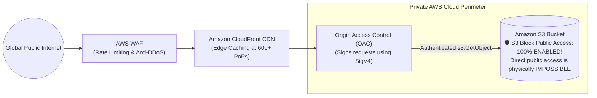

# How to Use S3 Buckets Securely for Public Data Storage (Zero-Leak Architecture)

## 1. Context & The "Public S3 Bucket" Paradox

Many cloud applications require hosting assets that are intended for public consumption:
- Static website assets (HTML, CSS, JS, favicons, logos)
- Public documentation, marketing brochures, and whitepapers
- Open datasets, catalog images, and public download mirrors

### The Fatal Anti-Pattern: Making the Bucket Public
Junior engineers often solve this by disabling S3 Block Public Access and attaching an open policy (`"Principal": "*"`):

```json
/* ❌ THE DANGEROUS ANTI-PATTERN: Open Public Bucket */
{
  "Effect": "Allow",
  "Principal": "*",
  "Action": "s3:GetObject",
  "Resource": "arn:aws:s3:::acme-public-assets/*"
}
```

### Why Direct Public S3 Buckets Fail Production Security:
1. **Accidental PII & Credential Leaks**: If an engineer or automated script accidentally dumps an `.env` file, database backup, or customer spreadsheet into this bucket, it is **immediately indexed by public search engines and dark web scrapers**.
2. **Denial of Wallet (Financial DDoS)**: Attackers can execute millions of HTTP `GET` requests directly against the S3 endpoint. AWS charges **\$0.0004 per 1,000 GET requests** and **\$0.09 per GB of data transfer**. An attacker can easily generate a \$10,000+ AWS bill overnight.
3. **No Web Application Firewall (WAF)**: Direct S3 endpoints cannot attach AWS WAF rules (no rate limiting, no geo-blocking, no bot defense).
4. **No Edge Caching**: Assets are fetched from the origin region, incurring high latency for international users.

---

## 2. The Production Architecture: The Zero-Public S3 Origin

The industry-standard architecture keeps the **S3 Bucket 100% private and invisible to the internet**, routing all public traffic through **Amazon CloudFront with Origin Access Control (OAC)** and **AWS WAF**:



### The 4 Security Guarantees:
1. **S3 Block Public Access remains 100% ENABLED**.
2. **Public users can NEVER access the S3 bucket URL directly** (`https://acme-assets.s3.amazonaws.com` returns `403 Forbidden`).
3. **Only requests passing through CloudFront and validated by AWS WAF** can read objects.
4. **Edge caching absorbs 95%+ of traffic**, shielding S3 from request-based billing spikes.

---

## 3. Terraform Production Blueprint

This blueprint implements the complete Zero-Public architecture:

```hcl
# 1. Private S3 Bucket
resource "aws_s3_bucket" "public_data" {
  bucket = "acme-public-distribution-2024"
}

# 2. Block 100% of Direct Public Access
resource "aws_s3_bucket_public_access_block" "lockdown" {
  bucket = aws_s3_bucket.public_data.id

  block_public_acls       = true
  block_public_policy     = true
  ignore_public_acls      = true
  restrict_public_buckets = true
}

# 3. CloudFront Origin Access Control (OAC)
resource "aws_cloudfront_origin_access_control" "oac" {
  name                              = "s3-public-data-oac"
  description                       = "OAC for public asset distribution"
  origin_access_control_origin_type = "s3"
  signing_behavior                  = "always"
  signing_protocol                  = "sigv4"
}

# 4. CloudFront Distribution
resource "aws_cloudfront_distribution" "cdn" {
  enabled             = true
  is_ipv6_enabled     = true
  default_root_object = "index.html"

  origin {
    domain_name              = aws_s3_bucket.public_data.bucket_regional_domain_name
    origin_id                = "S3Origin"
    origin_access_control_id = aws_cloudfront_origin_access_control.oac.id
  }

  default_cache_behavior {
    allowed_methods  = ["GET", "HEAD", "OPTIONS"]
    cached_methods   = ["GET", "HEAD"]
    target_origin_id = "S3Origin"

    forwarded_values {
      query_string = false
      cookies { forward = "none" }
    }

    viewer_protocol_policy = "redirect-to-https"
    min_ttl                = 0
    default_ttl            = 86400    # Cache for 24 hours at edge
    max_ttl                = 31536000 # Cache for 1 year
  }

  restrictions {
    geo_restriction {
      restriction_type = "none"
    }
  }

  viewer_certificate {
    cloudfront_default_certificate = true
  }
}

# 5. S3 Bucket Policy: Allow ONLY the CloudFront Distribution ARN
resource "aws_s3_bucket_policy" "allow_cloudfront_only" {
  bucket = aws_s3_bucket.public_data.id

  policy = jsonencode({
    Version = "2012-10-17"
    Statement = [
      {
        Sid       = "AllowCloudFrontServicePrincipalReadOnly"
        Effect    = "Allow"
        Principal = {
          Service = "cloudfront.amazonaws.com"
        }
        Action   = "s3:GetObject"
        Resource = "${aws_s3_bucket.public_data.arn}/*"
        Condition = {
          StringEquals = {
            # Strictly locks down access to this exact CloudFront Distribution!
            "AWS:SourceArn" = aws_cloudfront_distribution.cdn.arn
          }
        }
      },
      {
        Sid       = "EnforceTLSRequestsOnly"
        Effect    = "Deny"
        Principal = "*"
        Action    = "s3:*"
        Resource = [
          aws_s3_bucket.public_data.arn,
          "${aws_s3_bucket.public_data.arn}/*"
        ]
        Condition = {
          Bool = {
            "aws:SecureTransport" = "false" # Deny cleartext HTTP
          }
        }
      }
    ]
  })
}
```

---

## 4. Attaching AWS WAF Rate Limiting (Preventing Denial of Wallet)

To prevent bots from scraping millions of assets through CloudFront:
1. Create an AWS WAF Web ACL in `us-east-1` (CloudFront requires WAF to live in `us-east-1`).
2. Add an **IP-based Rate-Based Rule**:
   - Limit: Maximum 1,000 requests per 5-minute rolling window per IP.
   - Action: **Block (HTTP 403)** or **CAPTCHA**.
3. Attach Web ACL to `aws_cloudfront_distribution.cdn.web_acl_id`.

---

## 5. Key Takeaways for DevOps Interviews

1. **Origin Access Control (OAC) vs. Origin Access Identity (OAI)**: OAI is the legacy method that does not support AWS KMS encryption, dynamic requests, or all AWS regions. OAC is the modern AWS standard using SigV4 cryptographic request signing.
2. **Bucket Public Access Block**: When building public data distribution, **never disable S3 Block Public Access**. CloudFront uses an authenticated IAM service principal (`cloudfront.amazonaws.com`), which is compatible with 100% blocked public access!
3. **Always Enforce HTTPS**: Always include the `aws:SecureTransport: "false"` Deny statement in every bucket policy to guarantee data in transit is encrypted with TLS 1.2+.