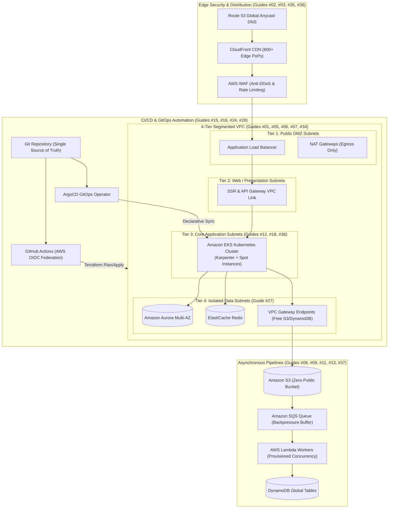

# 🚀 The Ultimate DevOps, Kubernetes & AWS Production Playbook
> **Based on the 38 Master Real-World Architectural Deep Dives from TechOps Examples.**

This repository contains comprehensive, production-grade architectural breakdowns, sequence diagrams, failure recovery playbooks, and Infrastructure-as-Code (Terraform / Kubernetes / Docker) blueprints for 38 essential DevOps, Cloud, and Container patterns.

---

## 📚 Master Architectural Index (All 38 Guides)

### 🌐 AWS Networking & Perimeter Security
| # | Architecture Guide | Core Services | Documentation |
|---|--------------------|---------------|---------------|
| **01** | **AWS Networking Basics & Subnet Design** | VPC, Subnets, CIDR, Route Tables | [Read Guide](file:///c:/Users/SANJEEV01/Documents/antigravity/TechOps%20Examples/01-aws-networking-subnets-basics.md) |
| **02** | **Automatically Block Suspicious Traffic** | AWS WAF, GuardDuty, EventBridge, Lambda | [Read Guide](file:///c:/Users/SANJEEV01/Documents/antigravity/TechOps%20Examples/02-automatically-block-suspicious-traffic.md) |
| **05** | **Securing Inbound & Outbound Network Traffic** | Security Groups, NACLs, Network Firewall | [Read Guide](file:///c:/Users/SANJEEV01/Documents/antigravity/TechOps%20Examples/05-how-aws-secures-inbound-and-outbound-traffic.md) |
| **06** | **Secure Three-Tier Architecture on AWS** | ALB, ASG, RDS Multi-AZ, Secrets Manager | [Read Guide](file:///c:/Users/SANJEEV01/Documents/antigravity/TechOps%20Examples/06-secure-three-tier-architecture-aws.md) |
| **07** | **Internet Gateway vs NAT Gateway** | IGW, NAT Gateway, Elastic IPs | [Read Guide](file:///c:/Users/SANJEEV01/Documents/antigravity/TechOps%20Examples/07-aws-internet-gateway-vs-nat-gateway.md) |
| **27** | **AWS VPC Gateway Endpoints Cost Optimization** | S3 & DynamoDB Endpoints, NAT Fee Bypass | [Read Guide](file:///c:/Users/SANJEEV01/Documents/antigravity/TechOps%20Examples/27-aws-vpc-gateway-endpoints-cost-optimization.md) |
| **31** | **AWS VPC Peering Deep Dive** | VPC Peering, Non-Transitive Routing, Mesh | [Read Guide](file:///c:/Users/SANJEEV01/Documents/antigravity/TechOps%20Examples/31-aws-vpc-peering-deep-dive.md) |
| **34** | **AWS VPC Network Segmentation (4-Tier Model)** | Zero-Trust Subnets, DMZ, Isolated Data | [Read Guide](file:///c:/Users/SANJEEV01/Documents/antigravity/TechOps%20Examples/34-aws-vpc-network-segmentation-deep-dive.md) |

---

### ☸️ Kubernetes & Container Orchestration
| # | Architecture Guide | Core Services | Documentation |
|---|--------------------|---------------|---------------|
| **12** | **Kubernetes Pod Disruption Budget (PDB)** | PDB, Eviction API, High Availability | [Read Guide](file:///c:/Users/SANJEEV01/Documents/antigravity/TechOps%20Examples/12-kubernetes-pod-disruption-budget-pdb-guide.md) |
| **15** | **Multi-Cloud GitOps Workflow for Kubernetes** | ArgoCD, ApplicationSet, Multi-Cluster | [Read Guide](file:///c:/Users/SANJEEV01/Documents/antigravity/TechOps%20Examples/15-multi-cloud-gitops-workflow-kubernetes.md) |
| **18** | **Kubernetes Node Not Ready Troubleshooting** | Kubelet, Containerd, DiskPressure, CNI | [Read Guide](file:///c:/Users/SANJEEV01/Documents/antigravity/TechOps%20Examples/18-kubernetes-node-not-ready-troubleshooting.md) |
| **21** | **Hidden Risks of Kubernetes Security Labels** | Label Spoofing, Service Hijacking, Kyverno | [Read Guide](file:///c:/Users/SANJEEV01/Documents/antigravity/TechOps%20Examples/21-hidden-risks-kubernetes-security-labels.md) |
| **30** | **Kubernetes Air-Gap Cluster Implementation** | Offline K8s, Harbor, containerd mirror | [Read Guide](file:///c:/Users/SANJEEV01/Documents/antigravity/TechOps%20Examples/30-kubernetes-air-gap-cluster-implementation.md) |
| **36** | **MxPlayer Scaling with EKS Spot Instances** | EKS, Karpenter, Spot Termination, PDB | [Read Guide](file:///c:/Users/SANJEEV01/Documents/antigravity/TechOps%20Examples/36-mxplayer-scaling-eks-spot-instances.md) |

---

### 🐳 Docker & Container Engineering
| # | Architecture Guide | Core Technologies | Documentation |
|---|--------------------|-------------------|---------------|
| **14** | **How to Reduce Docker Image Size** | Multi-Stage Builds, Distroless, Alpine | [Read Guide](file:///c:/Users/SANJEEV01/Documents/antigravity/TechOps%20Examples/14-how-to-reduce-docker-image-size.md) |
| **22** | **Mitigating Vulnerabilities with Docker Scout** | SBOM, CVE Scanning, Base Image Fixes | [Read Guide](file:///c:/Users/SANJEEV01/Documents/antigravity/TechOps%20Examples/22-detecting-mitigating-vulnerabilities-docker-scout.md) |
| **26** | **Why Should a Container Have Only One Process?** | PID 1, Zombie Reaping, Tini, Graceful SIGTERM | [Read Guide](file:///c:/Users/SANJEEV01/Documents/antigravity/TechOps%20Examples/26-why-container-should-have-only-one-process.md) |

---

### 🏗️ Infrastructure as Code (Terraform & CI/CD)
| # | Architecture Guide | Core Technologies | Documentation |
|---|--------------------|-------------------|---------------|
| **16** | **GitHub Actions Workflow for Terraform Workspaces** | AWS OIDC, Workspaces, PR Plan Preview | [Read Guide](file:///c:/Users/SANJEEV01/Documents/antigravity/TechOps%20Examples/16-github-actions-workflow-terraform-workspaces.md) |
| **17** | **Convert Existing Cloud Infrastructure to Terraform** | Terraform 1.5+ import block, Former2 | [Read Guide](file:///c:/Users/SANJEEV01/Documents/antigravity/TechOps%20Examples/17-convert-existing-cloud-infrastructure-to-terraform.md) |
| **24** | **Guide to a Well-Structured Terraform Project** | Layered State, Modular Layout, DRY | [Read Guide](file:///c:/Users/SANJEEV01/Documents/antigravity/TechOps%20Examples/24-well-structured-terraform-project-guide.md) |
| **28** | **The Problem with Overusing Dynamic Blocks** | HCL Anti-Patterns, Standalone SG Rules | [Read Guide](file:///c:/Users/SANJEEV01/Documents/antigravity/TechOps%20Examples/28-problem-with-overusing-terraform-dynamic-blocks.md) |

---

### ⚡ Serverless, Storage & Event-Driven Architecture
| # | Architecture Guide | Core Services | Documentation |
|---|--------------------|---------------|---------------|
| **03** | **How AWS Signed URLs Work Internally** | S3, SigV4, HMAC-SHA256, CloudFront | [Read Guide](file:///c:/Users/SANJEEV01/Documents/antigravity/TechOps%20Examples/03-how-aws-signed-urls-work-internally.md) |
| **08** | **Scalable Direct File Upload Architecture** | S3 Pre-signed URLs, EventBridge, SQS | [Read Guide](file:///c:/Users/SANJEEV01/Documents/antigravity/TechOps%20Examples/08-scalable-file-upload-architecture.md) |
| **09** | **Lambda Concurrency & Throttling Prevention** | Reserved Concurrency, SQS, RDS Proxy | [Read Guide](file:///c:/Users/SANJEEV01/Documents/antigravity/TechOps%20Examples/09-aws-lambda-concurrency-and-throttling-prevention.md) |
| **10** | **Cross-Origin Resource Sharing (CORS) in S3** | S3 CORS, Preflight OPTIONS, CloudFront | [Read Guide](file:///c:/Users/SANJEEV01/Documents/antigravity/TechOps%20Examples/10-amazon-s3-cross-origin-resource-sharing-cors.md) |
| **11** | **Architecture to Overcome API Gateway Payload Limit** | S3 Presigned URLs, Claim-Check Pattern | [Read Guide](file:///c:/Users/SANJEEV01/Documents/antigravity/TechOps%20Examples/11-architecture-to-overcome-api-gateway-payload-limit.md) |
| **13** | **Provisioned Concurrency Cuts Lambda Cold Starts** | Firecracker MicroVM, Application AutoScaling | [Read Guide](file:///c:/Users/SANJEEV01/Documents/antigravity/TechOps%20Examples/13-provisioned-concurrency-aws-lambda-cold-starts.md) |
| **32** | **AWS Hexagonal Architecture Patterns** | Ports & Adapters, Clean Architecture | [Read Guide](file:///c:/Users/SANJEEV01/Documents/antigravity/TechOps%20Examples/32-aws-hexagonal-architecture-pattern.md) |
| **35** | **CloudFront Signed URLs vs S3 Presigned URLs** | Edge Caching, Geo-Restrictions, SigV4 | [Read Guide](file:///c:/Users/SANJEEV01/Documents/antigravity/TechOps%20Examples/35-cloudfront-signed-url-vs-s3-presigned-url.md) |
| **37** | **AWS Lambda Integration Patterns with SQS & SNS** | Fan-out, Event Source Mapping, DLQ | [Read Guide](file:///c:/Users/SANJEEV01/Documents/antigravity/TechOps%20Examples/37-aws-lambda-integration-patterns-sqs-sns.md) |
| **38** | **Secure S3 Buckets for Public Data Storage** | CloudFront OAC, WAF, Zero-Public S3 | [Read Guide](file:///c:/Users/SANJEEV01/Documents/antigravity/TechOps%20Examples/38-secure-s3-buckets-for-public-data-storage.md) |

---

### 🛡️ Cloud Security & DevSecOps
| # | Architecture Guide | Core Focus | Documentation |
|---|--------------------|------------|---------------|
| **23** | **Exposed AWS Keys & Secrets Prevention** | Zero-Key OIDC, Gitleaks, GuardDuty Auto-Revocation | [Read Guide](file:///c:/Users/SANJEEV01/Documents/antigravity/TechOps%20Examples/23-exposed-aws-keys-secrets-prevention.md) |

---

### 💰 FinOps & Scalability Engineering
| # | Architecture Guide | Core Focus | Documentation |
|---|--------------------|------------|---------------|
| **04** | **Designing an AWS Machine Learning Architecture** | SageMaker, Feature Store, S3, Glue | [Read Guide](file:///c:/Users/SANJEEV01/Documents/antigravity/TechOps%20Examples/04-designing-aws-machine-learning-architecture.md) |
| **19** | **Shopify BigQuery $1M Query Cost Analysis** | Columnar Scans, Partitioning, Quota Guards | [Read Guide](file:///c:/Users/SANJEEV01/Documents/antigravity/TechOps%20Examples/19-shopify-bigquery-1m-query-cost-analysis.md) |
| **20** | **AWS Prime Day Record-Breaking Traffic** | Cellular Architecture, Shuffle Sharding, DynamoDB | [Read Guide](file:///c:/Users/SANJEEV01/Documents/antigravity/TechOps%20Examples/20-aws-prime-day-record-breaking-traffic.md) |
| **25** | **Cloud Disaster Recovery (RTO & RPO)** | Pilot Light, Warm Standby, Active-Active | [Read Guide](file:///c:/Users/SANJEEV01/Documents/antigravity/TechOps%20Examples/25-cloud-disaster-recovery-strategies-rto-rpo.md) |
| **29** | **How Levels.fyi Cuts Cloud Bill by 15%** | Graviton ARM64, Cache Layers, Right-Sizing | [Read Guide](file:///c:/Users/SANJEEV01/Documents/antigravity/TechOps%20Examples/29-how-levelsfyi-cuts-cloud-bill-by-15-percent.md) |
| **33** | **Cloud Scaling Patterns Breakdown** | Horizontal, Vertical, Queue Load Leveling | [Read Guide](file:///c:/Users/SANJEEV01/Documents/antigravity/TechOps%20Examples/33-cloud-scaling-patterns-horizontal-vertical-queue.md) |

---

## 🗺️ High-Level Enterprise Architecture Landscape

---

## 💡 Quick Engineering Rules of Thumb
1. **Never hardcode static AWS Access Keys**: Use AWS OIDC federation for GitHub Actions and IAM Roles for compute nodes (Guide #16, #23).
2. **Never expose S3 buckets directly to the public**: Keep S3 100% private and front with CloudFront OAC + AWS WAF (Guide #38).
3. **Route S3/DynamoDB traffic via Gateway Endpoints**: Eliminates 100% of NAT Gateway data fees ($0.045/GB saved) (Guide #27).
4. **Use PDBs with Spot Compute**: Run 80%+ of stateless Kubernetes compute on Spot instances with Karpenter and Pod Disruption Budgets to slash compute bills by 70% (Guide #12, #36).
5. **Decouple heavy ingestion with SQS buffers**: Protect relational databases from spike starvation using queue-based load leveling (Guide #09, #33, #37).
