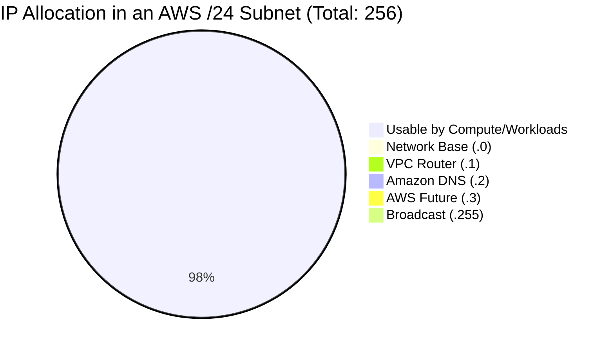
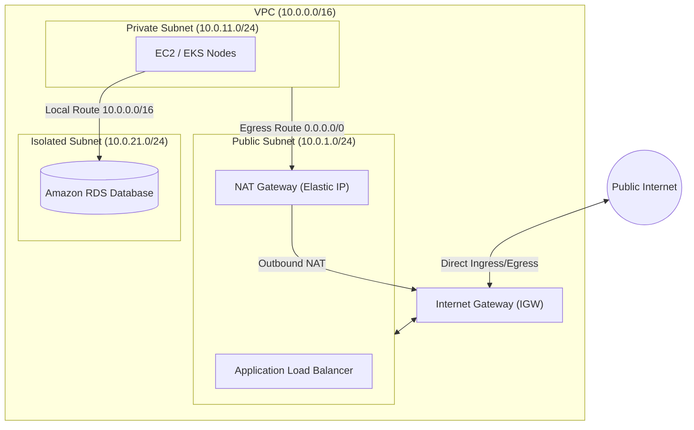

# Context 01: AWS Networking Basics — AWS Subnets for Beginners
*Complete Video Masterclass Breakdown & Architecture Analysis*

---

## 📺 Video Metadata & Context Overview

| Field | Detail |
|---|---|
| **Context / Video Title** | AWS Networking Basics — AWS Subnets for Beginners |
| **Topic Domain** | AWS Core Networking, VPC Architecture, IP Subnetting |
| **Target Roles** | Cloud Engineers, DevOps/SRE, Solution Architects, Systems Administrators |
| **Prerequisites** | Basic understanding of IP addresses (IPv4) and cloud infrastructure |
| **Primary AWS Services** | Amazon VPC, Subnets, Route Tables, Internet Gateways (IGW), Elastic IPs |
| **Key Takeaway** | Subnets are strictly zonal (bound to one AZ). In AWS, every subnet loses 5 reserved IP addresses. Network isolation depends on route table associations. |

---

## ⏱️ Video Breakdown & Timestamp Agenda

- `00:00 - 02:30` | **The Hook & Problem Framing**: Why misjudged CIDR blocks cause major scaling outages.
- `02:30 - 06:15` | **VPC vs Subnet Foundation**: Office building vs rooms analogy; VPC regional vs Subnet zonal boundary.
- `06:15 - 10:45` | **CIDR Notation & The 5 Reserved IPs**: The exact math of $2^{(32-n)}$ and why you never get 256 IPs in a `/24`.
- `10:45 - 16:30` | **Public vs Private vs Isolated Subnets**: How Route Tables dictate internet accessibility.
- `16:30 - 22:00` | **Multi-AZ Architecture Blueprint**: Deploying high-availability subnet topologies across AZ-A and AZ-B.
- `22:00 - 26:45` | **Hands-On Terraform Implementation**: Writing production VPC, Subnets, and Route Table associations.
- `26:45 - 31:30` | **Production Failure Modes & War Stories**: Overlapping CIDRs, IP exhaustion in EKS, and asymmetric routing.
- `31:30 - End`   | **Senior Architect Interview Drill**: Scenario-based questions on subnet design and VPC peering.

---

## 🧠 Section 1: In-Depth Conceptual & Architectural Analysis

### 1.1 VPC vs Subnet Boundaries
A **Virtual Private Cloud (VPC)** is a logically isolated virtual network spanning all Availability Zones (AZs) in an AWS region.
A **Subnet** is a contiguous range of IPv4 addresses carved out of the VPC's CIDR block.

```
AWS Region: us-east-1 (VPC CIDR: 10.0.0.0/16 - 65,536 IPs)
├── Availability Zone: us-east-1a
│   ├── Subnet 1 (Public):   10.0.1.0/24   [Zonal Boundary]
│   └── Subnet 2 (Private):  10.0.11.0/24  [Zonal Boundary]
└── Availability Zone: us-east-1b
    ├── Subnet 3 (Public):   10.0.2.0/24   [Zonal Boundary]
    └── Subnet 4 (Private):  10.0.12.0/24  [Zonal Boundary]
```

> **Key Rule**: A subnet can **never** span multiple Availability Zones. If `us-east-1a` fails, all subnets inside it fail. Redundancy requires creating matching subnets in `us-east-1b`.

---

### 1.2 The Math of CIDR & The 5 Reserved IP Addresses

For any IPv4 CIDR block with prefix length $n$:
$$\text{Total Addresses} = 2^{(32 - n)}$$
$$\text{Usable Addresses in AWS} = 2^{(32 - n)} - 5$$

```
Subnet: 10.0.1.0/24 (Total: 256 IPs, Usable: 251 IPs)
├── 10.0.1.0   -> Network Address (First address of the network)
├── 10.0.1.1   -> AWS VPC Router (Default gateway for routing inside the subnet)
├── 10.0.1.2   -> Amazon-Provided DNS Server (Base IP + 2; maps to Route 53 Resolver)
├── 10.0.1.3   -> AWS Future Use (Reserved for upcoming platform capabilities)
└── 10.0.1.255 -> Network Broadcast Address (AWS does not route broadcast, but reserves it)
```



---

### 1.3 Subnet Classifications & Route Table Mechanics

Subnets inherit network personality through their attached **Route Table**:



1. **Public Subnet**: Route table has `0.0.0.0/0 -> igw-xxxx`. Resources must possess an Elastic IP or public IP to communicate with the internet.
2. **Private Subnet with Egress**: Route table has `0.0.0.0/0 -> nat-xxxx` (pointing to a NAT Gateway in a public subnet). External clients cannot initiate inbound sessions.
3. **Isolated Data Subnet**: Route table has only `10.0.0.0/16 -> local`. Completely severed from internet egress and ingress.

---

## 🛠️ Section 2: Production Hands-on Lab (Terraform)

```hcl
# 1. Production VPC Definition
resource "aws_vpc" "production" {
  cidr_block           = "10.0.0.0/16"
  enable_dns_support   = true
  enable_dns_hostnames = true

  tags = {
    Name        = "prod-core-vpc"
    Environment = "production"
  }
}

# 2. Internet Gateway
resource "aws_internet_gateway" "igw" {
  vpc_id = aws_vpc.production.id
  tags = { Name = "prod-igw" }
}

# 3. Public Subnet across 2 AZs
resource "aws_subnet" "public_1a" {
  vpc_id                  = aws_vpc.production.id
  cidr_block              = "10.0.1.0/24"
  availability_zone       = "us-east-1a"
  map_public_ip_on_launch = true
  tags = { Name = "prod-public-1a" }
}

resource "aws_subnet" "public_1b" {
  vpc_id                  = aws_vpc.production.id
  cidr_block              = "10.0.2.0/24"
  availability_zone       = "us-east-1b"
  map_public_ip_on_launch = true
  tags = { Name = "prod-public-1b" }
}

# 4. Route Table for Public Subnets
resource "aws_route_table" "public_rt" {
  vpc_id = aws_vpc.production.id

  route {
    cidr_block = "0.0.0.0/0"
    gateway_id = aws_internet_gateway.igw.id
  }

  tags = { Name = "prod-public-rt" }
}

resource "aws_route_table_association" "pub_1a" {
  subnet_id      = aws_subnet.public_1a.id
  route_table_id = aws_route_table.public_rt.id
}

resource "aws_route_table_association" "pub_1b" {
  subnet_id      = aws_subnet.public_1b.id
  route_table_id = aws_route_table.public_rt.id
}
```

---

## 💥 Section 3: Real-World War Stories & Failure Modes

### Incident 1: The EKS IP Exhaustion Outage
- **What happened**: A company launched an Amazon EKS cluster in `/24` subnets (251 usable IPs).
- **The Failure**: The AWS VPC CNI assigns a real secondary VPC IP to every Kubernetes pod. When microservices scaled during Black Friday, the subnet ran out of available IP addresses. New pods remained stuck in `ContainerCreating` with `FailedCreatePodSandBox: no IP addresses available`.
- **The Fix**: Sizing container subnets with `/20` or `/19` blocks, or utilizing secondary VPC CIDRs (`100.64.0.0/16` CGNAT) specifically dedicated to pod networking.

### Incident 2: The Overlapping Peering Gridlock
- **What happened**: Two teams created VPCs using `10.0.0.0/16`. Months later, company management requested VPC Peering to connect their microservices.
- **The Failure**: AWS VPC Peering and Transit Gateway strictly forbid routing between overlapping CIDRs.
- **The Fix**: The team had to recreate their entire infrastructure or deploy complex PrivateLink / AWS Network Address Translation solutions. **Rule**: Always coordinate CIDR assignment centrally across your organization.

---

## 🎯 Section 4: Senior Staff Interview Drill

**Q1: Can you change the CIDR block of an existing AWS Subnet?**
> **Answer**: No. Once a subnet is created, its CIDR block cannot be modified or expanded. To resize, you must create a new subnet with the desired CIDR, migrate instances, and delete the old subnet. You can, however, associate secondary CIDR blocks to the parent VPC.

**Q2: An EC2 instance has a Public IP and is inside a Public Subnet with an IGW, but cannot reach the internet. What are the top 3 items to check?**
> **Answer**:
> 1. Check if the Security Group allows outbound traffic (port 443 / 80).
> 2. Check the Subnet Network ACL (NACL) — verify both inbound AND outbound ephemeral ports (1024–65535) are allowed.
> 3. Verify the Route Table has an explicit route `0.0.0.0/0 -> igw-xxxx` (ensure it isn't pointing to a blackholed or detached gateway).
