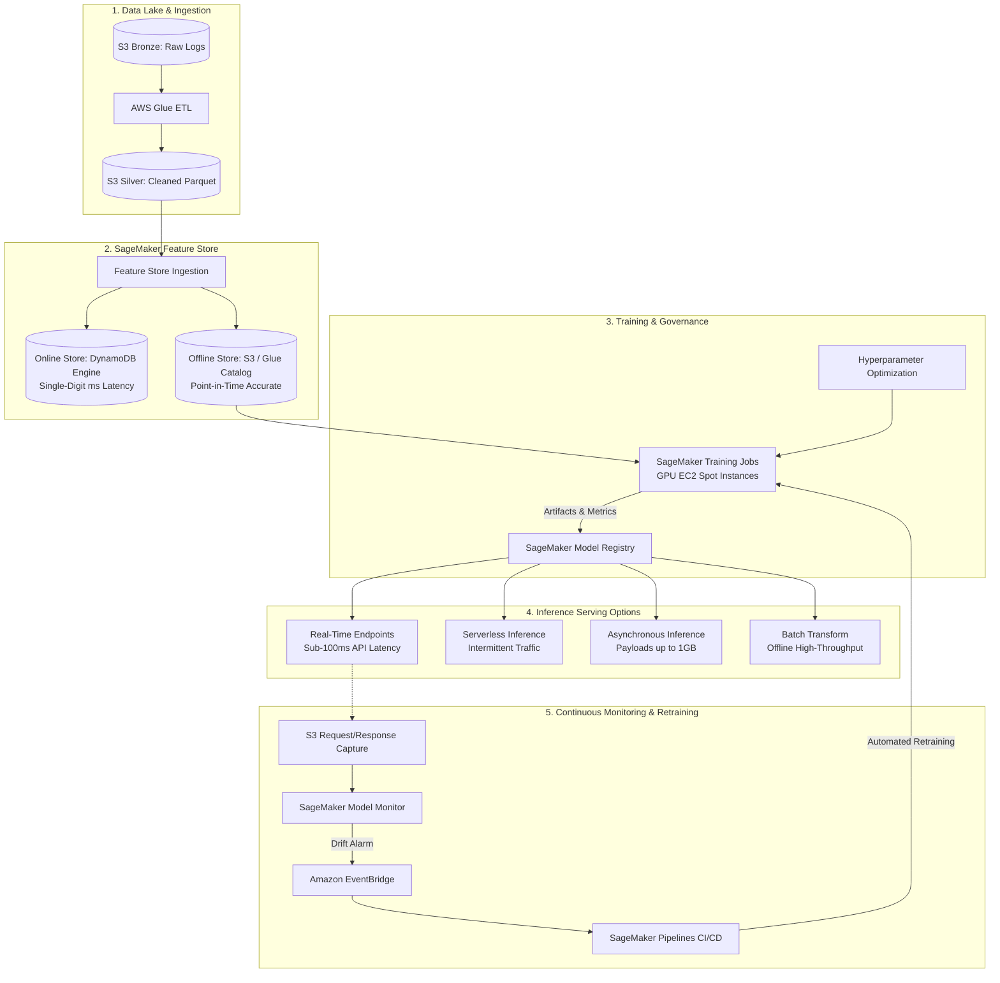

# Context 04: Designing an AWS Machine Learning Architecture
*Complete Video Masterclass Breakdown & Architecture Analysis*

---

## 📺 Video Metadata & Context Overview

| Field | Detail |
|---|---|
| **Context / Video Title** | Designing an AWS Machine Learning Architecture |
| **Topic Domain** | MLOps, Enterprise ML Architecture, Distributed Training, Model Governance |
| **Target Roles** | MLOps Engineers, Machine Learning Architects, Data Engineers, Cloud Architects |
| **Prerequisites** | Machine Learning fundamentals, Docker containers, AWS S3, compute primitives |
| **Primary AWS Services** | Amazon SageMaker, Amazon S3, AWS Glue, Amazon DynamoDB, Amazon EventBridge |
| **Key Takeaway** | Enterprise ML is an end-to-end feedback loop, not an isolated notebook. Cost-efficient architectures combine Managed Spot Training, dual-tier Feature Stores, multi-modal serving, and automated drift retraining triggers. |

---

## ⏱️ Video Breakdown & Timestamp Agenda

- `00:00 - 03:30` | **The State of Enterprise ML**: Moving from Jupyter notebooks to production-grade resilient systems.
- `03:30 - 08:45` | **Data Ingestion & The Feature Store**: Medallion Data Lake and Online vs Offline Feature Store synchronization.
- `08:45 - 15:00` | **Distributed Training & Spot Economics**: How Managed Spot Training slashes GPU costs by 70–90% with checkpointing.
- `15:00 - 20:30` | **Serving Topology: 4 Inference Flavors**: Real-Time vs Serverless vs Asynchronous vs Batch Transform.
- `20:30 - 26:15` | **Model Governance & Registry**: Versioning, artifact immutability, approvals, and container lineage.
- `26:15 - 31:00` | **Continuous Monitoring & Retraining CI/CD**: Model Monitor data drift detection triggering SageMaker Pipelines.
- `31:00 - 35:45` | **Production War Stories**: The silent concept drift outage and the Spot GPU capacity interruption.
- `35:45 - End`   | **Senior Staff Interview Drill**: Feature store time-travel queries, multi-model endpoints, and latency optimization.

---

## 🧠 Section 1: In-Depth Conceptual & Architectural Analysis

### 1.1 The Complete MLOps System Architecture



---

### 1.2 Dual-Tier Feature Store Dynamics

A common pitfall in production ML is **train-serve skew** (where features computed at training time differ in format, timestamp, or calculation logic from features fed to the model at inference time).

* **SageMaker Online Feature Store**:
  - Engineered for low-latency lookup ($< 10 \text{ ms}$).
  - Serves real-time inference requests (e.g. user's 30-day click count, device trust score).
  - Backed by an AWS-managed DynamoDB key-value engine.
* **SageMaker Offline Feature Store**:
  - Engineered for high-throughput batch extraction and historical replay.
  - Automatically appends record commits into S3 in Parquet format.
  - Supports **point-in-time time-travel queries** via Amazon Athena, preventing future feature leakage into training sets.

---

### 1.3 The 4 Inference Paradigms Comparison

| Metric | Real-Time Endpoint | Serverless Inference | Asynchronous Inference | Batch Transform |
|---|---|---|---|---|
| **Max Payload** | 6 MB | 4 MB | **1 GB** (via S3 pointer) | Unlimited |
| **Max Timeout** | 60 seconds | 60 seconds | **1 hour** (3,600s) | Days |
| **Scale to Zero** | No (min 1 instance) | **Yes** (0 instances) | **Yes** (auto-scales to 0) | Yes (terminates on job done) |
| **Cold Starts** | None | Yes (2–10 seconds) | Yes (10–30 seconds) | N/A |
| **Billing Model** | Provisioned instance/hr | Millisecond execution | Active processing only | Duration of batch job |
| **Best For** | E-commerce checkout, fraud check | Dev/test, low-volume APIs | GenAI, video/audio processing | Nightly batch scoring |

---

## 🛠️ Section 2: Production Code & Implementation

```python
from sagemaker.pytorch import PyTorch
from sagemaker.inputs import TrainingInput

# 1. Define S3 fast-file-mode training inputs
training_data = TrainingInput(
    s3_data="s3://enterprise-ml-lake/features/fraud_detection/v3/",
    input_mode="FastFile"  # Streams data directly from S3 without downloading entire dataset
)

# 2. Production Spot Training Estimator
estimator = PyTorch(
    entry_point="train.py",
    source_dir="./src",
    role="arn:aws:iam::123456789012:role/SageMakerExecutionRole",
    framework_version="2.1.0",
    py_version="py310",
    instance_count=4,
    instance_type="ml.g5.2xlarge",
    
    # Economics: Spot Instances with Automated S3 Checkpointing
    use_spot_instances=True,
    max_run=7200,          # 2 Hours max training
    max_wait=14400,        # 4 Hours max wait for Spot capacity
    checkpoint_s3_uri="s3://enterprise-ml-lake/checkpoints/fraud_detection_run_42/",
    
    # Metric Tracking for SageMaker Experiments
    metric_definitions=[
        {"Name": "train:loss", "Regex": "loss: ([0-9\\.]+)"},
        {"Name": "val:auc", "Regex": "val_auc: ([0-9\\.]+)"}
    ]
)

# 3. Launch the distributed training job
# estimator.fit({'train': training_data})
```

---

## 💥 Section 3: Real-World War Stories & Edge Cases

### Incident 1: The Silent Concept Drift Catastrophe
- **What happened**: A fintech company deployed a credit risk ML model with 94% accuracy. Six months later, default rates skyrocketed, yet the model was still happily predicting low risk.
- **The Failure**: Economic interest rates had changed dramatically. The relationship between input features (income, debt) and the target variable (default probability) had shifted (**Concept Drift**), but the model had zero automated monitoring.
- **The Fix**: Implement **SageMaker Model Monitor** schedules that capture real-time traffic to S3, run daily baseline divergence checks (calculating Kolmogorov-Smirnov and Jensen-Shannon distance metrics), and alert engineers whenever distribution drift exceeds 15%.

### Incident 2: Spot Training Termination Loss
- **What happened**: A team ran a 36-hour distributed training job on `p3.8xlarge` Spot instances. At hour 34, AWS reclaimed the spot capacity.
- **The Failure**: The team did not configure a `checkpoint_s3_uri`. 34 hours of GPU compute ($3,000+) was completely lost with zero saved progress.
- **The Fix**: Always configure checkpointing to Amazon S3 inside your training code (e.g. saving state every epoch to `/opt/ml/checkpoints`). SageMaker automatically synchronizes this directory to S3, enabling the training job to resume seamlessly on new capacity.

---

## 🎯 Section 4: Senior Staff Interview Drill

**Q1: How do you prevent Feature Leakage when extracting training datasets from a Feature Store?**
> **Answer**: By using **Point-in-Time Accurate (Time-Travel) Joins**. In SageMaker Offline Feature Store, every record has an `EventTime` timestamp. When joining feature tables with historical event labels (e.g., whether a loan defaulted 3 months later), queries must only join feature values that were valid *prior* to the label's `EventTime`, ensuring data that occurred after the event cannot leak into the model's training set.

**Q2: When should you migrate from a SageMaker Real-Time Endpoint to an Asynchronous Inference Endpoint?**
> **Answer**: Migrate when:
> 1. Payloads exceed 6 MB (Asynchronous supports up to 1 GB via S3 input pointers).
> 2. Model processing duration exceeds 60 seconds (Asynchronous supports up to 1 hour).
> 3. Traffic is intermittent and cost savings are paramount (Asynchronous can scale its auto-scaling group down to **0 instances** when the internal SQS queue is empty, whereas Real-Time endpoints must maintain at least 1 provisioned instance 24/7).
