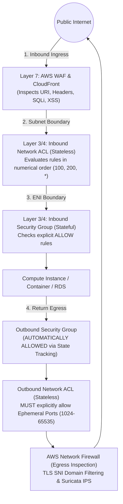

# Context 05: How AWS Secures Inbound and Outbound Network Traffic
*Complete Video Masterclass Breakdown & Architecture Analysis*

---

## 📺 Video Metadata & Context Overview

| Field | Detail |
|---|---|
| **Context / Video Title** | How AWS Secures Inbound and Outbound Network Traffic |
| **Topic Domain** | AWS Network Security, Packet Flow, Defense-in-Depth, Egress Filtering |
| **Target Roles** | Network Architects, DevSecOps Engineers, Cloud Security Engineers, SREs |
| **Prerequisites** | TCP/IP 3-way handshake, OSI layers 3/4/7, CIDR addressing |
| **Primary AWS Services** | Security Groups, Network ACLs, AWS Network Firewall, AWS PrivateLink, Transit Gateway |
| **Key Takeaway** | Security Groups are stateful firewalls at the ENI; NACLs are stateless filters at the subnet. Production networks must secure egress traffic with domain filtering (AWS Network Firewall) and private endpoints to prevent exfiltration. |

---

## ⏱️ Video Breakdown & Timestamp Agenda

- `00:00 - 03:00` | **The 4-Layer Security Model**: Perimeter $\rightarrow$ VPC Boundary $\rightarrow$ Subnet Border $\rightarrow$ ENI Interface.
- `03:00 - 08:30` | **Security Groups vs Network ACLs Deep Dive**: Stateful tracking vs Stateless rule evaluations.
- `08:30 - 13:45` | **The Ephemeral Port Mechanism**: Why omitting ports 1024–65535 breaks return traffic in NACLs.
- `13:45 - 19:15` | **Zero IP Hardcoding**: Implementing Security Group Chaining across N-Tier microservices.
- `19:15 - 25:00` | **Securing Egress Traffic**: Why unrestricted `0.0.0.0/0` outbound is an audit failure and how AWS Network Firewall fixes it.
- `25:00 - 30:15` | **Hands-On Terraform Configuration**: Writing production SG references and custom NACLs.
- `30:15 - 34:30` | **Production War Stories**: The NACL ephemeral port blackhole and the malware C2 server exfiltration.
- `34:30 - End`   | **Senior Staff Interview Drill**: Asymmetric routing in inspection VPCs, connection tracking table limits.

---

## 🧠 Section 1: In-Depth Conceptual & Architectural Analysis

### 1.1 Complete Packet Traversal Flow

When an external client communicates with an EC2 instance or container in a private AWS subnet, the packet traverses four sequential evaluation boundaries:



---

### 1.2 The Definitive Comparison: Security Groups vs Network ACLs

| Architectural Attribute | Security Group (SG) | Network Access Control List (NACL) |
|---|---|---|
| **Operating Layer** | Virtual interface (ENI level) | Subnet boundary |
| **State Tracking** | **Stateful**: Outbound response automatically permitted regardless of outbound rules. | **Stateless**: Return traffic must be explicitly permitted in the reverse direction. |
| **Rule Capabilities** | **ALLOW rules only** (implicit deny for anything not listed). | **ALLOW and DENY rules supported**. |
| **Evaluation Order** | All rules evaluated simultaneously before making an allow decision. | Evaluated in **numerical order** (lowest number first). First match wins immediately. |
| **Connection Limits** | Tracks connection state in a finite memory table (subject to connection tracking limits). | Stateless (no connection state stored; zero connection tracking limit). |
| **Scale / Quota** | Up to 1,000 rules per SG (via quota increase). | Max 20 rules default (max 40 hard ceiling). |

---

### 1.3 The Stateless Ephemeral Port Mechanism

When an external browser connects to your HTTPS web server:
1. **Source**: Client IP, Source Port: `54321` (Ephemeral port assigned by client OS).
2. **Destination**: Server IP, Destination Port: `443`.
3. Inbound NACL matches: `Rule 100: ALLOW TCP Port 443 from 0.0.0.0/0`.
4. The server accepts and prepares an HTTP response packet:
   - **Source**: Server IP, Source Port: `443`.
   - **Destination**: Client IP, Destination Port: `54321`.
5. Because NACLs do **not** remember that this was part of an established TCP stream, the Outbound NACL must contain:
   - `Rule 100: ALLOW TCP Ports 1024-65535 to 0.0.0.0/0`.

> If you forget the outbound ephemeral port rule, the return packet is dropped at the subnet line, causing the client browser to spin indefinitely and time out!

---

## 🛠️ Section 2: Production Code & Implementation

```hcl
# 1. Application Load Balancer Security Group
resource "aws_security_group" "alb_sg" {
  name        = "prod-web-alb-sg"
  description = "Accepts external HTTPS from public internet"
  vpc_id      = aws_vpc.main.id

  ingress {
    description = "Allow HTTPS from anywhere"
    from_port   = 443
    to_port     = 443
    protocol    = "tcp"
    cidr_blocks = ["0.0.0.0/0"]
  }

  egress {
    description     = "Forward traffic only to App instances"
    from_port       = 8080
    to_port         = 8080
    protocol        = "tcp"
    security_groups = [aws_security_group.app_sg.id]
  }
}

# 2. Application Tier Security Group (Referencing ALB SG)
resource "aws_security_group" "app_sg" {
  name        = "prod-app-sg"
  description = "Allows traffic ONLY from ALB"
  vpc_id      = aws_vpc.main.id

  ingress {
    description     = "HTTP traffic strictly from ALB"
    from_port       = 8080
    to_port         = 8080
    protocol        = "tcp"
    security_groups = [aws_security_group.alb_sg.id] # Zero IP Hardcoding!
  }

  egress {
    description     = "Allow DB calls strictly to DB SG"
    from_port       = 5432
    to_port         = 5432
    protocol        = "tcp"
    security_groups = [aws_security_group.db_sg.id]
  }
}

# 3. Database Security Group (Referencing App SG)
resource "aws_security_group" "db_sg" {
  name        = "prod-db-sg"
  description = "Allows PostgreSQL strictly from App tier"
  vpc_id      = aws_vpc.main.id

  ingress {
    description     = "PostgreSQL from App Tier only"
    from_port       = 5432
    to_port         = 5432
    protocol        = "tcp"
    security_groups = [aws_security_group.app_sg.id]
  }
  # No egress rules needed (stateful handles return)
}
```

---

## 💥 Section 3: Real-World War Stories & Edge Cases

### Incident 1: The Cryptomining Malware Exfiltration
- **What happened**: A developer inadvertently deployed a container with an unpatched remote code execution (RCE) vulnerability. Attackers compromised the container and began downloading a cryptominer and exfiltrating database dumps.
- **The Failure**: The application's Security Group had `egress: 0.0.0.0/0 ALLOW ALL`. The compromised container had unrestricted internet outbound access to attacker-controlled C2 servers.
- **The Fix**: Deploy **AWS Network Firewall** with TLS Server Name Indication (SNI) stateful rule filtering. Block all outbound egress by default, allowing only an explicit whitelist of approved external domains (e.g. `*.github.com`, `api.stripe.com`, `*.datadoghq.com`).

### Incident 2: Security Group Connection Tracking Exhaustion
- **What happened**: An ultra-high-throughput streaming service experienced mysterious 10% packet drops during a flash spike, even though CPU and memory were under 40%.
- **The Failure**: EC2 instances track every stateful connection in an internal connection tracking table (`conntrack`). When an instance exceeds its maximum connection tracking limit (typically 250,000 to 1,000,000 concurrent flows), **new packets are dropped silently**.
- **The Fix**: Use **Untracked Connections**. If you configure a Security Group rule that allows TCP/UDP traffic symmetrically on both ingress and egress, AWS marks the flow as *untracked*, completely bypassing the connection tracking table and eliminating the drop bottleneck.

---

## 🎯 Section 4: Senior Staff Interview Drill

**Q1: How do you achieve symmetric traffic inspection using AWS Network Firewall in a multi-VPC Transit Gateway environment?**
> **Answer**: By creating a dedicated **Centralized Inspection VPC** and enabling **Transit Gateway Appliance Mode**. Without Appliance Mode, traffic between VPC-A and VPC-B that passes through an inspection firewall can return via a different Availability Zone interface (asymmetric routing). Stateful firewalls like AWS Network Firewall drop asymmetric return packets because they never saw the original TCP SYN. Appliance Mode forces return traffic to route through the exact same AZ ENI that handled the forward flow.

**Q2: What happens if an Inbound NACL permits traffic on port 443, but the Security Group does not?**
> **Answer**: The packet passes the subnet border (NACL allows it), but is immediately dropped at the virtual network interface (ENI) by the Security Group. The operating system on the EC2 instance never sees the packet, and no TCP RST is sent (silent drop).
