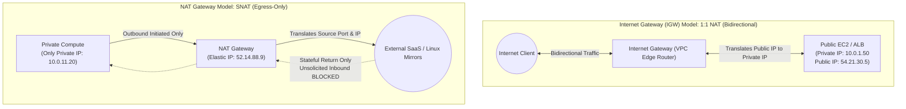

# Context 07: AWS Internet Gateway vs NAT Gateway: When to Use What?
*Complete Video Masterclass Breakdown & Architecture Analysis*

---

## 📺 Video Metadata & Context Overview

| Field | Detail |
|---|---|
| **Context / Video Title** | AWS Internet Gateway vs NAT Gateway — When to Use What? |
| **Topic Domain** | AWS Cloud Networking, FinOps Cost Optimization, VPC Routing, High Availability |
| **Target Roles** | Cloud Architects, DevOps Engineers, FinOps Practitioners, Infrastructure Leads |
| **Prerequisites** | IPv4 routing, Network Address Translation (NAT), AWS VPC fundamentals |
| **Primary AWS Services** | Internet Gateway (IGW), NAT Gateway, VPC Endpoints, Route Tables, Elastic IPs |
| **Key Takeaway** | Internet Gateways are free, regional, and bidirectional. NAT Gateways are expensive (~$0.045/GB), zonal, and egress-only. Optimize cloud costs by bypassing NAT Gateways using free Gateway VPC Endpoints for S3 and DynamoDB. |

---

## ⏱️ Video Breakdown & Timestamp Agenda

- `00:00 - 02:45` | **The Core Dilemma**: Why mixing up IGW and NAT GW leads to security breaches or massive AWS bills.
- `02:45 - 07:30` | **Internet Gateway (IGW) Deep Dive**: 1:1 NAT, VPC-wide regional resilience, and zero data processing fees.
- `07:30 - 13:15` | **NAT Gateway Deep Dive**: 1-to-many Port Address Translation (PAT/SNAT), unidirectional egress, and Elastic IPs.
- `13:15 - 18:45` | **The High Availability Trap**: Why a single NAT Gateway creates a cross-AZ single point of failure and extra data fees.
- `18:45 - 24:30` | **The FinOps Breakdown**: Calculating the $0.045/GB processing cost and eliminating it with free Gateway VPC Endpoints.
- `24:30 - 29:15` | **Hands-On Terraform Implementation**: Building a fault-tolerant multi-AZ NAT layout with VPC Endpoints.
- `29:15 - 34:00` | **Production War Stories**: The $18,000 uncompressed analytics bill and the AZ outage blackout.
- `34:00 - End`   | **Senior Staff Interview Drill**: NAT Gateway vs NAT Instance vs VPC Interface Endpoints.

---

## 🧠 Section 1: In-Depth Conceptual & Architectural Analysis

### 1.1 Fundamental Architectural Differences



---

### 1.2 Deep Technical Comparison Matrix

| Architectural Feature | Internet Gateway (IGW) | NAT Gateway |
|---|---|---|
| **Traffic Direction** | **Bidirectional** (Inbound ingress & Outbound egress) | **Unidirectional (Outbound Egress Only)** |
| **Translation Type** | **1-to-1 NAT** (Maps private IP directly to assigned Public IP) | **1-to-Many PAT / SNAT** (Maps many private IPs to 1 Elastic IP) |
| **VPC Placement** | Attached at the **VPC perimeter root** | Deployed inside a specific **Public Subnet** |
| **Instance IP Needs** | Instance **must** possess a Public IPv4 / Elastic IP | Instance has **only a Private IP** |
| **High Availability** | **Regional**: Redundant across all AZs managed natively by AWS | **Zonal**: Single point of failure if tied to only one AZ |
| **Throughput & Limits** | **No bandwidth limit**; horizontally scaled by AWS automatically | Baseline 5 Gbps, bursts up to **45 Gbps** per gateway |
| **Cost Model** | **100% Free** (No hourly fee, zero data processing fee) | **Expensive**: ~$0.045/hr + **~$0.045 per GB processed** |

---

### 1.3 The Multi-AZ Failure Domain & Cross-AZ Data Fees

```mermaid
flowchart TD
    subgraph AntiPattern["Anti-Pattern: Single NAT Gateway across AZs (Fragile + Costly)"]
        AZ_A1["AZ us-east-1a: Public Subnet"] --> NAT_Single["Single NAT Gateway"]
        AZ_B1["AZ us-east-1b: Private Subnet"] -->|Cross-AZ Traffic ($0.01/GB fee!)| NAT_Single
        NAT_Single --> FailNote["If AZ us-east-1a fails, AZ us-east-1b loses all internet!"]
    end

    subgraph BestPractice["Production Best Practice: Dedicated NAT Gateway Per AZ"]
        subgraph AZ_A2["AZ us-east-1a"]
            PrivA["Private Subnet A"] --> NATA["NAT Gateway A"]
        end
        subgraph AZ_B2["AZ us-east-1b"]
            PrivB["Private Subnet B"] --> NATB["NAT Gateway B"]
        end
        NATA & NATB --> IGW_Regional["Regional Internet Gateway"]
    end
```

1. **Failure Domain**: If an Availability Zone has an outage, private subnets relying on a NAT Gateway in that AZ lose all internet access.
2. **Cross-AZ Traffic Fee**: Moving packets across Availability Zone boundaries incurs a **$0.01 per GB** inter-AZ data transfer charge on top of the $0.045/GB NAT processing fee!

---

### 1.4 The FinOps S3 Cost Trap & Gateway Endpoint Remedy

```mermaid
flowchart LR
    Compute[Private EC2 / Containers]
    SubnetRT[Subnet Route Table]
    S3_GW[S3 Gateway VPC Endpoint]
    NAT[NAT Gateway]
    S3[(Amazon S3)]
    APIs((External SaaS APIs))

    Compute --> SubnetRT
    SubnetRT -->|Prefix List: pl-63a5400a (S3)<br/>COST: $0.00 / GB| S3_GW
    SubnetRT -->|0.0.0.0/0 (Default Internet)<br/>COST: $0.045 / GB| NAT
    S3_GW --> S3
    NAT --> APIs
```

- **Scenario**: Backing up 30 TB of database snapshots or training datasets to Amazon S3 through a NAT Gateway:
  $$30,000 \text{ GB} \times \$0.045 = \mathbf{\$1,350 \text{ per month in unnecessary NAT fees!}}$$
- **Solution**: Provision an **AWS Gateway VPC Endpoint for S3**.
  - Creates a dedicated route table entry pointing S3 traffic directly to S3 across the internal AWS backbone.
  - Cost: **$0.00 (Free)**. Instantly eliminates $1,350/mo.

---

## 🛠️ Section 2: Production Code & Implementation

```hcl
# 1. Elastic IPs for NAT Gateways
resource "aws_eip" "nat_1a" {
  domain = "vpc"
  tags   = { Name = "prod-nat-eip-1a" }
}

resource "aws_eip" "nat_1b" {
  domain = "vpc"
  tags   = { Name = "prod-nat-eip-1b" }
}

# 2. Multi-AZ NAT Gateways (1 per AZ for True Fault Tolerance)
resource "aws_nat_gateway" "nat_1a" {
  allocation_id = aws_eip.nat_1a.id
  subnet_id     = aws_subnet.public_1a.id
  tags          = { Name = "prod-nat-gw-1a" }
  depends_on    = [aws_internet_gateway.igw]
}

resource "aws_nat_gateway" "nat_1b" {
  allocation_id = aws_eip.nat_1b.id
  subnet_id     = aws_subnet.public_1b.id
  tags          = { Name = "prod-nat-gw-1b" }
  depends_on    = [aws_internet_gateway.igw]
}

# 3. FinOps Optimization: S3 Gateway VPC Endpoint (100% Free)
resource "aws_vpc_endpoint" "s3_gateway" {
  vpc_id            = aws_vpc.main.id
  service_name      = "com.amazonaws.us-east-1.s3"
  vpc_endpoint_type = "Gateway"

  # Automatically inject S3 routes into both private route tables
  route_table_ids = [
    aws_route_table.private_1a_rt.id,
    aws_route_table.private_1b_rt.id
  ]

  tags = { Name = "prod-s3-gateway-endpoint" }
}
```

---

## 💥 Section 3: Real-World War Stories & Edge Cases

### Incident 1: The $22,000 S3 Docker Pull Bill
- **What happened**: A company ran a 100-node Kubernetes cluster that scaled dynamically using Karpenter. When new worker nodes spun up, they pulled 2 GB container images from Amazon ECR.
- **The Failure**: ECR stores actual container image layers in an underlying Amazon S3 bucket. Because the cluster lacked an S3 Gateway Endpoint, all 2 GB image pulls routed through the NAT Gateway, racking up **$22,000 in NAT processing fees** in a single billing cycle.
- **The Fix**: Adding a zero-cost S3 Gateway VPC Endpoint dropped NAT Gateway data volume by 94% the following month.

### Incident 2: The Port Exhaustion Timeouts
- **What happened**: A high-frequency payment aggregator microservice inside a private subnet made 50,000 outbound HTTP calls per minute to a single external bank API.
- **The Failure**: Outbound requests suddenly began failing with `Connection timed out`.
- **The Root Cause**: A single NAT Gateway Elastic IP supports a maximum of **64,512 concurrent source ports** per destination IP/port combination. The service exhausted all available source ports (**SNAT Port Exhaustion**).
- **The Fix**: Associate secondary private and Elastic IPs to the NAT Gateway (AWS supports up to 8 Elastic IPs per NAT Gateway), multiplying available concurrent connection sockets up to 516,000.

---

## 🎯 Section 4: Senior Staff Interview Drill

**Q1: What is the difference between a Gateway VPC Endpoint and an Interface VPC Endpoint (AWS PrivateLink)?**
> **Answer**:
> - **Gateway VPC Endpoint**: Supported *only* for **Amazon S3** and **Amazon DynamoDB**. It modifies subnet route tables directly. It is completely **free** (zero hourly, zero data transfer cost) and operates at the VPC routing layer.
> - **Interface VPC Endpoint**: Powered by AWS PrivateLink. Deploys an Elastic Network Interface (ENI) with a private IP directly into your subnet for other AWS services (ECR, KMS, SQS, CloudWatch). It costs ~$0.01/hour per AZ plus ~$0.01/GB data processed.

**Q2: Can an EC2 instance in a private subnet receive an unsolicited incoming SSH connection through a NAT Gateway?**
> **Answer**: No. NAT Gateways do not support port forwarding or inbound DNAT mapping. They only allow stateful return traffic for outbound connections initiated by internal private resources. To connect to an instance in a private subnet, you must use **AWS Systems Manager Session Manager** or a VPN / Direct Connect.
