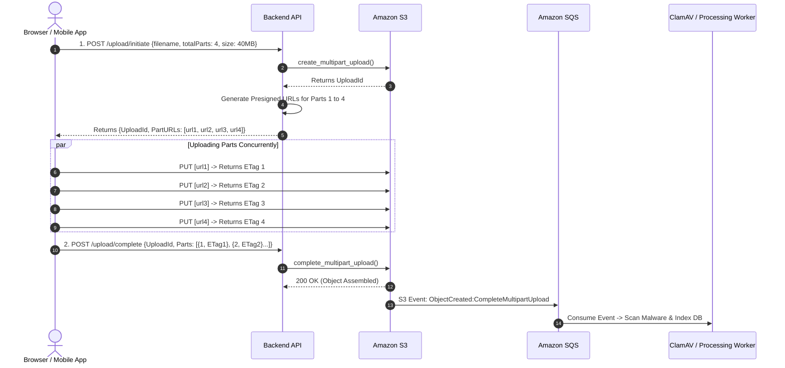

# Context 08: How to Design a Scalable File Upload Architecture in AWS
*Complete Video Masterclass Breakdown & Architecture Analysis*

---

## 📺 Video Metadata & Context Overview

| Field | Detail |
|---|---|
| **Context / Video Title** | How to Design a Scalable File Upload Architecture in AWS |
| **Topic Domain** | Serverless Architecture, Storage Engineering, Event-Driven Systems, Scalability |
| **Target Roles** | Cloud Architects, Full-Stack Engineers, Backend Architects, Distributed Systems Engineers |
| **Prerequisites** | HTTP protocols, AWS Lambda limits, S3 object storage primitives |
| **Primary AWS Services** | Amazon S3, AWS Lambda, Amazon API Gateway, Amazon EventBridge, Amazon SQS |
| **Key Takeaway** | Never proxy file streams through application servers or API Gateways. Use pre-signed multipart uploads directly to S3, decouple post-processing using SQS event queues, and protect storage with lifecycle abort rules. |

---

## ⏱️ Video Breakdown & Timestamp Agenda

- `00:00 - 03:00` | **The Monolithic Anti-Pattern**: Why streaming files through API Gateway/Lambda fails at scale.
- `03:00 - 08:30` | **The Modern Architecture Blueprint**: Direct-to-S3 pre-signed ingestion & decoupled processing.
- `08:30 - 15:00` | **Large Files & Multipart Uploads**: How to upload 500 MB to 5 TB files in parallel chunks with resume capability.
- `15:00 - 20:45` | **Asynchronous Pipeline Flow**: S3 Event Notifications $\rightarrow$ EventBridge $\rightarrow$ SQS $\rightarrow$ Worker Lambdas.
- `20:45 - 26:15` | **Security & Antivirus Ingestion**: Scanning files for malware (ClamAV) and quarantining infected payloads.
- `26:15 - 31:00` | **Hands-On Python Code**: Initiating, signing parts, and completing multipart uploads using `boto3`.
- `31:00 - 35:30` | **Production War Stories**: The $12,000 abandoned multipart upload bill and the memory spike crash.
- `35:30 - End`   | **Senior Staff Interview Drill**: S3 Transfer Acceleration, Checksum validation, and WebSocket notifications.

---

## 🧠 Section 1: In-Depth Conceptual & Architectural Analysis

### 1.1 Architectural Comparison: Monolith vs Direct-to-S3

```mermaid
flowchart TD
    subgraph AntiPattern["Anti-Pattern: Proxying File Uploads (Fails at Scale)"]
        User1[Client] -->|File Upload 50MB| APIGW[API Gateway: HARD 10MB LIMIT -> FAILS!]
        APIGW -->|File Stream| Lambda1[Lambda: 6MB Payload Limit -> FAILS!]
        Lambda1 -->|Memory Bloat| S3_1[Amazon S3]
    end

    subgraph ScalablePattern["Scalable Pattern: Direct-to-S3 Claim-Check Architecture"]
        User2[Client] -->|1. Metadata Request (1 KB)| AuthAPI[Auth API Gateway / Lambda]
        AuthAPI -->|2. Pre-signed Multipart URLs| User2
        User2 ==>|3. Direct Parallel Binary Stream (up to 5 TB)| S3_2[Amazon S3 Ingestion Bucket]
        S3_2 -->|4. ObjectCreated Event| EB[Amazon EventBridge]
        EB -->|5. Queue Buffer| SQS[Amazon SQS Queue]
        SQS -->|6. Batch Processing| Workers[Worker Lambdas / ECS Tasks<br/>ClamAV Scan, Transcoding, OCR]
    end
```

---

### 1.2 Deep Dive: S3 Multipart Upload Mechanics

When uploading files $> 100 \text{ MB}$, uploading as a single HTTP PUT is fragile: a momentary Wi-Fi hiccup drops the connection, forcing the user to re-upload from 0%.

**The S3 Multipart Workflow:**
1. **Initiate**: Client sends file metadata (name, size, checksum) to your backend API. Backend calls `s3.create_multipart_upload()` and receives an `UploadId`.
2. **Chunk Division**: The file is segmented into parts (e.g., 10 MB chunks).
3. **Generate Part URLs**: Backend issues pre-signed URLs for parts $1 \dots N$.
4. **Parallel Transmission**: The client uploads parts concurrently using HTTP `PUT`. If part 7 fails, the client retries *only* part 7.
5. **Assembly**: Client sends part numbers and returned S3 `ETag` checksums to the backend API, which invokes `s3.complete_multipart_upload()`. S3 stitches the parts together into a single object in milliseconds.



---

## 🛠️ Section 2: Production Code & Implementation

### 2.1 Multipart Upload Coordinator (`multipart_manager.py`)

```python
import boto3
from botocore.exceptions import ClientError

s3 = boto3.client('s3', region_name='us-east-1')

def initiate_upload(bucket_name: str, object_key: str, total_parts: int, content_type: str):
    """
    Step 1: Initializes multipart upload and generates part pre-signed URLs.
    """
    try:
        # Create multipart session
        mp_response = s3.create_multipart_upload(
            Bucket=bucket_name,
            Key=object_key,
            ContentType=content_type
        )
        upload_id = mp_response['UploadId']
        
        # Generate presigned URLs for each part
        part_urls = []
        for part_num in range(1, total_parts + 1):
            url = s3.generate_presigned_url(
                ClientMethod='upload_part',
                Params={
                    'Bucket': bucket_name,
                    'Key': object_key,
                    'UploadId': upload_id,
                    'PartNumber': part_num
                },
                ExpiresIn=3600  # 1 Hour validity
            )
            part_urls.append({"partNumber": part_num, "uploadUrl": url})

        return {"uploadId": upload_id, "parts": part_urls}

    except ClientError as e:
        print(f"Error initiating upload: {e}")
        raise e

def complete_upload(bucket_name: str, object_key: str, upload_id: str, parts: list):
    """
    Step 2: Completes upload after client uploads all chunks.
    parts structure: [{'PartNumber': 1, 'ETag': '"abc..."'}, ...]
    """
    try:
        response = s3.complete_multipart_upload(
            Bucket=bucket_name,
            Key=object_key,
            UploadId=upload_id,
            MultipartUpload={'Parts': sorted(parts, key=lambda x: x['PartNumber'])}
        )
        return {"status": "success", "location": response['Location']}
    except ClientError as e:
        print(f"Error completing upload: {e}")
        raise e
```

---

## 💥 Section 3: Real-World War Stories & Edge Cases

### Incident 1: The $14,000 Abandoned Multipart Storage Ghost
- **What happened**: A video editing SaaS allowed users to upload 4K video files (50 GB each). Users frequently closed their laptops midway through uploads, leaving files 30% uploaded.
- **The Failure**: In Amazon S3, uploaded parts of an incomplete multipart upload remain stored in the bucket indefinitely until explicitly aborted or completed! The company accumulated **450 TB of hidden, orphaned chunks**, leading to a massive monthly storage bill for files that didn't exist in the console.
- **The Fix**: Configure an **S3 Lifecycle Rule** on the bucket with the action: `AbortIncompleteMultipartUpload` set to **7 days**. AWS automatically purges abandoned parts at zero cost.

```hcl
# Terraform Lifecycle Rule to purge incomplete uploads
resource "aws_s3_bucket_lifecycle_configuration" "cleanup_rule" {
  bucket = aws_s3_bucket.uploads.id

  rule {
    id     = "auto-abort-incomplete-multipart-uploads"
    status = "Enabled"

    abort_incomplete_multipart_upload {
      days_after_initiation = 7
    }
  }
}
```

### Incident 2: The SQS Poison Pill Crash Loop
- **What happened**: A user uploaded a corrupted or malformed image file. When the thumbnail generator Lambda consumed the event from SQS, the image processing library threw an uncaught segmentation fault.
- **The Failure**: The message returned to the SQS queue, re-invoked Lambda, and crashed again. This loop repeated 80,000 times in 2 hours, consuming concurrency and triggering alerts.
- **The Fix**: Always configure an **Amazon SQS Dead Letter Queue (DLQ)** with `maxReceiveCount = 3`. If a message fails processing 3 times, SQS moves it to the DLQ, alerting on-call engineers without blocking subsequent uploads.

---

## 🎯 Section 4: Senior Staff Interview Drill

**Q1: How does Amazon S3 Transfer Acceleration (S3TA) speed up global file uploads?**
> **Answer**: S3TA utilizes AWS CloudFront's globally distributed network of Edge Locations. Instead of client bytes routing over the variable, congested public internet across continents to an S3 bucket in Virginia, the client connects to the nearest local AWS Edge Location (e.g. in Frankfurt or Singapore). Once ingested, traffic is routed over AWS's private, congestion-controlled fiber-optic backbone, reducing latency by **50% to 500%**.

**Q2: What is the minimum part size allowed for Amazon S3 Multipart Uploads?**
> **Answer**: **5 MB** (except for the final part, which can be smaller). If a client attempts to upload a part smaller than 5 MB (other than the last part), S3 will reject `CompleteMultipartUpload` with an `EntityTooSmall` error. The maximum part size is **5 GB**, and an object can have up to **10,000 parts** (allowing a maximum object size of 5 TB).
