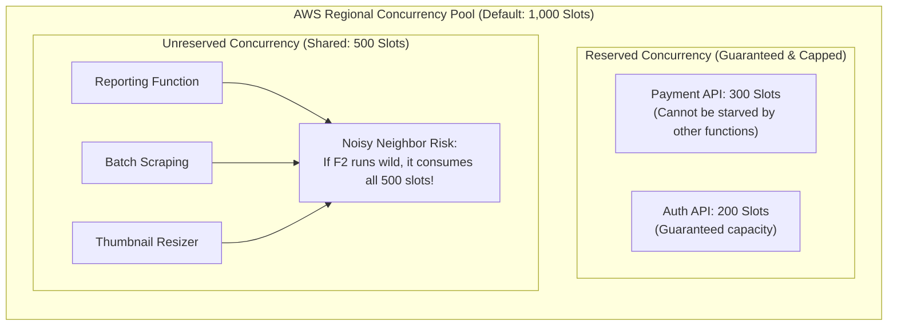
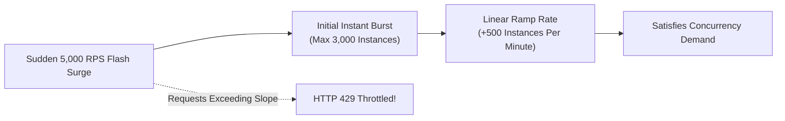
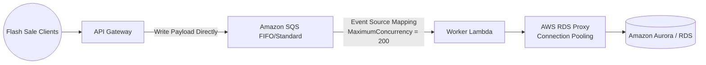

# Context 09: How AWS Lambda Prevents Function Throttling During Traffic Spikes
*Complete Video Masterclass Breakdown & Architecture Analysis*

---

## 📺 Video Metadata & Context Overview

| Field | Detail |
|---|---|
| **Context / Video Title** | How AWS Lambda Prevents Function Throttling During Traffic Spikes |
| **Topic Domain** | Serverless Architecture, Concurrency Engineering, Resiliency, High-Scale Event Systems |
| **Target Roles** | Serverless Architects, Backend Leads, Site Reliability Engineers (SRE), Cloud Engineers |
| **Prerequisites** | AWS Lambda fundamentals, synchronous vs asynchronous invocations, REST APIs |
| **Primary AWS Services** | AWS Lambda, Amazon SQS, Amazon API Gateway, AWS RDS Proxy, Amazon CloudWatch |
| **Key Takeaway** | Concurrency is a product of throughput and duration ($\text{RPS} \times \text{Duration}$). Sudden spikes cause throttling due to regional pool exhaustion and burst rate limits. Prevent failures using Reserved Concurrency, SQS queue buffering, and RDS Proxy. |

---

## ⏱️ Video Breakdown & Timestamp Agenda

- `00:00 - 03:15` | **The Concurrency Myth**: Why RPS alone does not determine Lambda concurrency consumption.
- `03:15 - 08:30` | **The Concurrency Formula**: Calculating concurrency ($\text{RPS} \times \text{Duration}$) with concrete production numbers.
- `08:30 - 14:00` | **The 3 Concurrency Models**: Unreserved (noisy neighbor risk), Reserved (floor & ceiling), and Provisioned (zero cold starts).
- `14:00 - 19:15` | **Lambda Scaling & Burst Limits**: Regional burst allowances (500 to 3,000) and the +500 instances/minute slope.
- `19:15 - 24:45` | **Asynchronous Queue Buffering with SQS**: Absorbing 50,000 RPS surges and controlling downstream drain rates.
- `24:45 - 29:30` | **Database Protection with RDS Proxy**: Preventing relational database connection crashes as Lambda scales.
- `29:30 - 34:15` | **Production War Stories**: The recursive loop that killed the company checkout API and the Black Friday database collapse.
- `34:15 - End`   | **Senior Staff Interview Drill**: Full Jitter vs Equal Jitter algorithms, Maximum Concurrency on SQS event source mappings.

---

## 🧠 Section 1: In-Depth Conceptual & Architectural Analysis

### 1.1 The Golden Rule of Lambda Concurrency

$$\text{Concurrency} = \text{Requests per Second (RPS)} \times \text{Average Execution Duration (seconds)}$$

```
Scenario A: Ultra-Fast Microservice
1,000 RPS with a 10 ms (0.01s) runtime
Concurrency = 1,000 * 0.01 = 10 concurrent instances

Scenario B: Slow Database / Downstream API Call
1,000 RPS with a 2,000 ms (2.0s) runtime
Concurrency = 1,000 * 2.0 = 2,000 concurrent instances (Exhausts default regional quota!)
```

> **The Insight**: A downstream dependency that slows down by $4\times$ will multiply your Lambda concurrency consumption by $4\times$ instantaneously, triggering widespread throttling!

---

### 1.2 Unreserved vs Reserved vs Provisioned Concurrency

AWS accounts possess a regional quota of **1,000 concurrent executions** by default.



| Model | Guaranteed Minimum? | Hard Ceiling? | Eliminates Cold Starts? | Cost |
|---|---|---|---|---|
| **Unreserved** | No (Shares pool with all other functions) | No (Can consume up to account limit) | No | Standard Lambda pricing |
| **Reserved** | **Yes** (Dedicated slots reserved exclusively) | **Yes** (Cannot scale beyond assigned number) | No | Free (part of normal execution) |
| **Provisioned** | **Yes** (Pre-warmed containers always hot) | Bound by provisioned count | **Yes (0ms Cold Starts)** | Extra hourly fee per provisioned slot |

---

### 1.3 Burst Limits & Linear Scaling Slopes

When traffic surges instantly from 0 to 5,000 RPS, Lambda scales in two stages:
1. **Initial Burst**: 500 to 3,000 instances spin up immediately (region dependent: 3,000 in us-east-1, 1,000 in eu-central-1, 500 in smaller regions).
2. **Linear Growth**: After the initial burst, Lambda can only add **500 additional instances every minute**.
3. If incoming requests exceed this ramp rate, excess requests are rejected with **HTTP 429 Too Many Requests**.



---

### 1.4 The Resiliency Blueprint: SQS Buffering + RDS Proxy



1. **Queue Leveling**: API Gateway writes incoming payloads directly to **Amazon SQS** via an AWS Service Integration (no Lambda in the ingestion path).
2. **Controlled Concurrency**: SQS buffers 100,000 requests safely. The Lambda Event Source Mapping uses `MaximumConcurrency = 200`, preventing Lambda from scaling beyond 200 instances.
3. **Database Protection**: **AWS RDS Proxy** pools and multiplexes database connections, ensuring thousands of Lambda executions share a small, healthy pool of 50 database connections.

---

## 🛠️ Section 2: Production Code & Implementation

### 2.1 Client-Side Exponential Backoff with Full Jitter (Python)

```python
import time
import random
import boto3
from botocore.exceptions import ClientError

def call_lambda_with_jitter(client, function_name: str, payload: str, max_retries: int = 5):
    """
    Standard AWS Full Jitter Backoff Algorithm:
    Sleep = random(0, min(max_backoff, base * 2 ^ attempt))
    """
    base = 0.5  # 500 ms
    max_backoff = 16.0  # 16 seconds
    
    for attempt in range(max_retries):
        try:
            response = client.invoke(
                FunctionName=function_name,
                InvocationType='RequestResponse',
                Payload=payload
            )
            return response
        except ClientError as e:
            if e.response['Error']['Code'] == 'TooManyRequestsException':
                if attempt == max_retries - 1:
                    print("Max retries exceeded. Request permanently throttled.")
                    raise e
                    
                # Calculate sleep with Full Jitter
                ceiling = min(max_backoff, base * (2 ** attempt))
                sleep_time = random.uniform(0, ceiling)
                print(f"Throttled. Attempt {attempt + 1}. Sleeping for {sleep_time:.2f}s...")
                time.sleep(sleep_time)
            else:
                raise e
```

---

## 💥 Section 3: Real-World War Stories & Edge Cases

### Incident 1: The Recursive Noisy Neighbor Outage
- **What happened**: A developer wrote a test function that processed an S3 file and wrote the output back into the same S3 bucket with the same prefix.
- **The Failure**: S3 triggered the Lambda function infinitely. Within 20 seconds, the rogue function spun up 1,000 concurrent instances, consuming **100% of the AWS account's regional concurrency**.
- **The Disaster**: The primary user-facing checkout API, payment gateway, and customer login lambdas had zero available concurrency, throwing `429 Too Many Requests` to 100% of global web customers.
- **The Fix**:
  1. Set **Reserved Concurrency** on all critical production functions so they have guaranteed slots.
  2. Implement an automated CloudWatch Alarm on `ConcurrentExecutions > 800` to notify on-call engineers.
  3. Use AWS Lambda's native recursive loop detection (enabled automatically on S3/SQS/SNS).

### Incident 2: The Relational Database Meltdown
- **What happened**: A marketing campaign sent push notifications to 2 million mobile app users at 9:00 AM.
- **The Failure**: Lambda scaled instantly from 20 instances to 1,200 instances. Each container opened 5 database connections to PostgreSQL. 6,000 simultaneous connections overwhelmed PostgreSQL (`FATAL: remaining connection slots are reserved for non-replication superuser connections`), taking down the entire database cluster.
- **The Fix**: Deploy **AWS RDS Proxy** to pool connections, and set a hard ceiling on the Lambda function's **Reserved Concurrency** to match the maximum database pool capacity.

---

## 🎯 Section 4: Senior Staff Interview Drill

**Q1: What happens to throttled messages when Lambda is invoked asynchronously vs synchronously?**
> **Answer**:
> - **Synchronous**: The caller receives an immediate **HTTP 429 Too Many Requests** exception. The caller must implement retry logic with exponential backoff.
> - **Asynchronous** (e.g. S3 Event, EventBridge): Lambda places the event into an internal managed queue and retries execution automatically for up to **6 hours** with exponential backoff. If all retries fail, the event is routed to an **Amazon SQS Dead Letter Queue (DLQ)** or **Lambda Destination** (if configured).

**Q2: Why is "Full Jitter" superior to standard exponential backoff without jitter?**
> **Answer**: Without jitter, if 1,000 clients are throttled at the exact same millisecond, they all calculate the identical retry backoff (e.g., 2 seconds, then 4 seconds). They will retry in unison, creating periodic synchronized traffic spikes ("thundering herd" effect) that repeatedly re-throttle the system. **Full Jitter** randomizes the backoff between 0 and the exponential ceiling, evenly distributing retries across time and maximizing system throughput.
