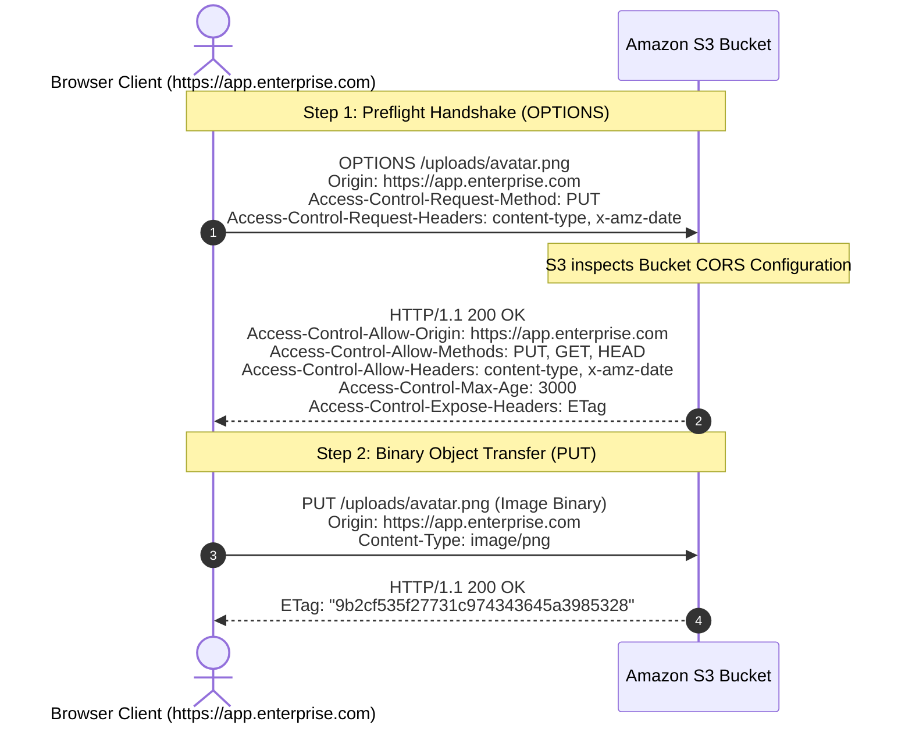
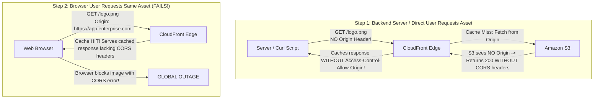

# Context 10: Using Cross-Origin Resource Sharing (CORS) in Amazon S3
*Complete Video Masterclass Breakdown & Architecture Analysis*

---

## 📺 Video Metadata & Context Overview

| Field | Detail |
|---|---|
| **Context / Video Title** | Using Cross Origin Resource Sharing (CORS) in Amazon S3 |
| **Topic Domain** | Web Security, Browser Security Architecture, Object Storage, Edge Caching |
| **Target Roles** | Frontend Architects, Full-Stack Leads, Cloud Engineers, Security Practitioners |
| **Prerequisites** | HTTP request/response headers, Same-Origin Policy (SOP), browser preflight requests |
| **Primary AWS Services** | Amazon S3, Amazon CloudFront, AWS WAF |
| **Key Takeaway** | S3 evaluates CORS rules *only* when the incoming request carries an `Origin` header. CloudFront must be configured with custom Cache Policies that include `Origin` in the cache key to prevent devastating cross-browser CORS cache-poisoning outages. |

---

## ⏱️ Video Breakdown & Timestamp Agenda

- `00:00 - 03:00` | **The Browser Security Model**: Same-Origin Policy (SOP) fundamentals (Protocol, Host, Port).
- `03:00 - 07:45` | **Why S3 Ingestion Triggers CORS**: Decoupled frontend SPAs communicating directly with S3 buckets.
- `07:45 - 13:30` | **Preflight `OPTIONS` Requests**: How browsers negotiate permissions before sending binary `PUT` payloads.
- `13:30 - 19:00` | **S3 CORS JSON Anatomy**: Deconstructing `AllowedOrigins`, `AllowedMethods`, `AllowedHeaders`, and `MaxAgeSeconds`.
- `19:00 - 24:15` | **The `ExposeHeaders` Critical Setting**: Enabling client JavaScript to read `ETag` and upload checksums.
- `24:15 - 29:30` | **The CloudFront Cache-Poisoning Trap**: Why CloudFront caches non-CORS responses and breaks global web apps.
- `29:30 - 34:00` | **Production War Stories**: The curl debugging wild goose chase and the multi-CDN origin mismatch.
- `34:00 - End`   | **Senior Staff Interview Drill**: Wildcards vs specific origins with credentials, S3 pre-signed header alignment.

---

## 🧠 Section 1: In-Depth Conceptual & Architectural Analysis

### 1.1 The Same-Origin Policy (SOP) Trigger

Browsers enforce the **Same-Origin Policy** to protect users from malicious cross-site scripting. Two URLs share the same origin only if their **Scheme (protocol), Host (domain), and Port** match exactly:

```
Frontend SPA Origin: https://app.enterprise.com:443
Target Storage:      https://my-bucket.s3.us-east-1.amazonaws.com:443
                      └─── Different Hostname! CORS REQUIRED ───┘
```

When client-side code (`fetch()` or `axios`) sends a request to S3, the browser intercepts the call and verifies that Amazon S3 explicitly approves the calling origin.

---

### 1.2 Simple vs Preflight Requests



* **Preflight Trigger**: Any request using methods other than `GET`, `HEAD`, `POST`, or passing custom headers (like `x-amz-*` or `Authorization`) triggers an automatic HTTP `OPTIONS` preflight request.
* **`Access-Control-Max-Age`**: Directs the browser to cache this handshake for the specified number of seconds (e.g. 3000s). This prevents the browser from making redundant `OPTIONS` round-trips for every chunk or image.

---

### 1.3 The CloudFront CORS Cache Poisoning Catastrophe

When placing Amazon CloudFront in front of an Amazon S3 bucket, a default configuration creates a catastrophic cache collision:



**The Solution:**
You must configure CloudFront's **Origin Request Policy** and **Cache Policy**:
1. Add `Origin`, `Access-Control-Request-Method`, and `Access-Control-Request-Headers` to the **Cache Key**.
2. CloudFront now maintains distinct cache copies: one for direct requests and separate copies for each authorized browser origin.

---

## 🛠️ Section 2: Production Code & Implementation

### 2.1 Complete Production S3 CORS Configuration (`cors.json`)

```json
[
  {
    "AllowedHeaders": [
      "*"
    ],
    "AllowedMethods": [
      "GET",
      "PUT",
      "POST",
      "HEAD",
      "DELETE"
    ],
    "AllowedOrigins": [
      "https://app.enterprise.com",
      "https://admin.enterprise.com",
      "https://staging.enterprise.com"
    ],
    "ExposeHeaders": [
      "ETag",
      "x-amz-server-side-encryption",
      "x-amz-request-id",
      "x-amz-id-2"
    ],
    "MaxAgeSeconds": 3000
  }
]
```

### 2.2 Terraform Infrastructure as Code

```hcl
# 1. Production S3 Bucket
resource "aws_s3_bucket" "assets" {
  bucket = "enterprise-customer-assets-prod"
}

# 2. S3 CORS Configuration
resource "aws_s3_bucket_cors_configuration" "assets_cors" {
  bucket = aws_s3_bucket.assets.id

  cors_rule {
    allowed_headers = ["*"]
    allowed_methods = ["PUT", "POST", "GET", "HEAD"]
    allowed_origins = [
      "https://app.enterprise.com",
      "https://admin.enterprise.com"
    ]
    expose_headers  = ["ETag", "x-amz-server-side-encryption"]
    max_age_seconds = 3000
  }
}

# 3. CloudFront Cache Policy with CORS in Cache Key
resource "aws_cloudfront_cache_policy" "cors_cache_policy" {
  name        = "prod-s3-cors-cache-policy"
  default_ttl = 86400
  max_ttl     = 31536000
  min_ttl     = 0

  parameters_in_cache_key_and_forwarded_to_origin {
    cookies_config {
      cookie_behavior = "none"
    }
    headers_config {
      header_behavior = "whitelist"
      headers {
        items = [
          "Origin",
          "Access-Control-Request-Method",
          "Access-Control-Request-Headers"
        ]
      }
    }
    query_strings_config {
      query_string_behavior = "none"
    }
    enable_accept_encoding_gzip   = true
    enable_accept_encoding_brotli = true
  }
}
```

---

## 💥 Section 3: Real-World War Stories & Edge Cases

### Incident 1: The `curl` Test Wild Goose Chase
- **What happened**: A developer deployed CORS to an S3 bucket and tested it via terminal:
  `curl -I https://enterprise-assets.s3.amazonaws.com/test.jpg`
- **The Failure**: The response contained zero `Access-Control-Allow-Origin` headers. The engineer spent 6 hours rewriting Terraform code believing S3 had a platform bug.
- **The Root Cause**: **S3 is an object store, not an HTTP web server**. S3 evaluates CORS rules *only* when the incoming request carries an `Origin:` header!
- **The Proper Test Command**:
  ```bash
  curl -X OPTIONS https://enterprise-assets.s3.amazonaws.com/test.jpg \
    -H "Origin: https://app.enterprise.com" \
    -H "Access-Control-Request-Method: PUT" \
    -I
  ```

### Incident 2: The Missing `ExposeHeaders` JavaScript Failure
- **What happened**: A client-side web application uploaded large files directly to S3 via pre-signed URLs. To verify data integrity, the JavaScript code attempted to read `response.headers['etag']` to compare it against the locally calculated MD5 checksum.
- **The Failure**: The frontend console threw `undefined` when reading the `ETag` header, even though Chrome DevTools Network Tab clearly showed the `ETag` header in the raw HTTP response!
- **The Root Cause**: Browsers hide all custom response headers from client-side JavaScript unless they are explicitly enumerated in S3's `ExposeHeaders` configuration list.
- **The Fix**: Add `"ExposeHeaders": ["ETag"]` to the S3 bucket's CORS policy.

---

## 🎯 Section 4: Senior Staff Interview Drill

**Q1: Why should you avoid using `"AllowedOrigins": ["*"]` on an Amazon S3 bucket used for authenticated enterprise uploads?**
> **Answer**: Wildcard `*` allows any website on the internet (including malicious phishing domains) to invoke client-side requests against your S3 bucket. If the user is logged into an intranet or corporate VPN, a malicious site could abuse ambient network trust to access or upload data. In addition, when credentials (cookies or Authorization headers) are passed in cross-origin requests, modern browsers reject responses where `Access-Control-Allow-Origin` is a wildcard `*`.

**Q2: What is the purpose of `MaxAgeSeconds` in an Amazon S3 CORS rule?**
> **Answer**: `MaxAgeSeconds` specifies the maximum time (in seconds) that the client browser is permitted to cache the preflight `OPTIONS` response. Setting this value (e.g. `3000` seconds) drastically reduces application latency and eliminates unnecessary HTTP requests by allowing subsequent `PUT` or `GET` calls to execute immediately without re-triggering the preflight handshake.
